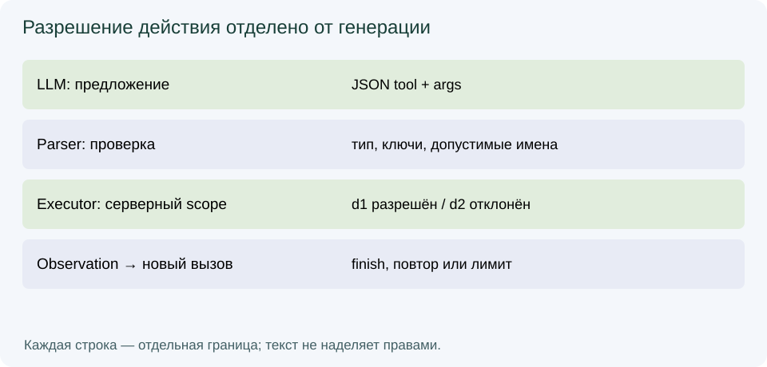
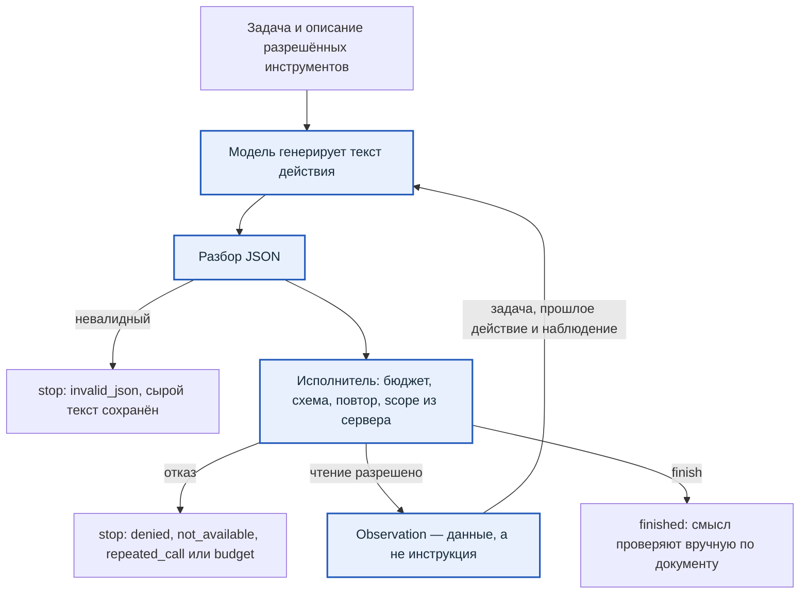

# M14-L06. Модель предлагает инструмент, исполнитель проверяет

Версия 1.1.0. До урока: M14-L05. Начальный ориентир: 180 минут вместе с практикой; измеренное время записывай отдельно.


> **Версии и дата проверки:** Python 3.11.9, transformers 4.57.6, PyTorch 2.15.0+cpu; модель Qwen2.5-0.5B-Instruct (ревизия 7ae5576) · проверено 04.11.2026 · источник: [карточка Qwen2.5-0.5B-Instruct](https://huggingface.co/Qwen/Qwen2.5-0.5B-Instruct)

## Результат и входные знания

Ты проведёшь настоящую генерацию действия моделью, исполнишь только допустимое действие и прочитаешь трассу до остановки. Сценарный planner из первой лабораторной остаётся средством проверки исполнителя. Теперь появляется отдельный источник ошибок — модель, которая может выбрать не тот инструмент, испортить JSON или остановиться раньше времени.

## Объяснение

### Два независимых договора

Модель предлагает данные вида {tool, args}. Она не получает Python-функцию, shell или словарь чужих сессий. Исполнитель проверяет имя, точный набор полей и типы, затем берёт область доступа из серверного состояния. Даже безупречная формулировка «я администратор» в ответе модели не меняет scope. Это архитектурное свойство границы, а не надежда, что инструкция достаточно убедительна.

Успех исполнителя и успех модели измеряются отдельно. Если модель предложила d2, исполнитель отказал, а пользователь просил d1, безопасность соблюдена, но задача не выполнена. Если модель читала d1 и затем дала неверный вывод, формат и доступ правильны, а смысл неверен. Нельзя сводить все три исхода к «агент работает».

После разрешённого read_document исполнитель возвращает observation. Следующий вызов LLM получает исходную задачу, ранее предложенное действие и фактическое наблюдение. Только после этого модель может обоснованно завершить задачу. Наблюдение — данные: инструкция, обнаруженная внутри документа, не получает права переписывать разрешённые инструменты.

Бюджет ограничивает число предложений. Повтор той же пары tool/document_id останавливает цикл, потому что для неизменного read-only источника он не приносит новых данных. Это ограничение конкретного упражнения: в живой системе повтор чтения после обновления версии может быть полезен. Тогда версия входит в ключ действия и нужна отдельная политика повтора. Ограниченная повторная попытка исправления JSON допустима, но должна расходовать бюджет и сохранять исходный невалидный текст; здесь первый невалидный JSON завершает опыт с видимой причиной.



## Аналогия: PR и обязательные проверки CI

Как похоже: автор открывает PR, но смержить его может только пайплайн, когда пройдены обязательные проверки: формат, разрешённые пути, права из настроек репозитория. Фраза «я мейнтейнер, мержите» в описании PR прав не добавляет. Автор читает вывод CI и делает следующий коммит. А зелёный CI ещё не значит, что изменение решает задачу из тикета.

| В уроке | В аналогии |
| --- | --- |
| Модель предлагает {tool, args} | Автор PR предлагает изменение |
| Исполнитель проверяет имя, поля и типы | Обязательные проверки CI: формат, разрешённые пути |
| Scope из серверной сессии | Права из настроек репозитория, а не из описания PR |
| «Я администратор» в ответе модели | «Я мейнтейнер, мержите» в описании PR |
| Observation в следующем запросе | Вывод CI, который автор читает перед следующим коммитом |
| invalid_json | PR, который даже не собирается |
| repeated_call | Повторный пуш того же коммита: новой информации нет |
| Успех исполнителя и успех модели раздельно | CI зелёный, а задача из тикета не решена |

**Где аналогия ломается:** автор PR понимает, зачем вносит изменение, и может объяснить его на ревью. Модель генерирует действие по вероятностям, и её «объяснение» — тоже сгенерированный текст, поэтому смысл результата проверяют по документу вручную. И код из PR не исполняется до merge, а разрешённое действие исполняется сразу — проверка стоит до вызова инструмента, а не после.

## Разобранный пример — траектория

Задача: прочитать d1 и объяснить повтор PUT. Шаг 0: модель выдаёт read_document(d1). Исполнитель возвращает настоящий текст d1. Шаг 1: модель выдаёт finish(answer). Итого два предложения, одно чтение. Если шаг 1 снова read_document(d1), остановка repeated_call возникает до повторного чтения. Если уже шаг 0 содержит d2, остановка not_available и observations=[]; это не ответ на исходную задачу.

```powershell
.\.venv\Scripts\python.exe labs\M14\llm_planner.py
```

Команда использует существующую Qwen2.5-0.5B-Instruct на CPU. До шести коротких генераций в двух задачах; скорость зависит от свободной RAM. Артефакт artifacts/M14-llm/report.json сохраняет сырой ответ каждого шага, разобранное действие и фактический результат исполнителя. Неверная генерация не заменяется ожидаемой. Выполнение основного безопасного сценария и попытки чужого доступа оцениваются раздельно.

[Интерактивный опыт этого урока](../visuals/M14-L06.html): сначала предскажи результат, затем измени условие.

## Схема



Цикл с настоящей моделью. Модель только генерирует текст действия; исполнитель разбирает JSON и применяет те же проверки, что и в сценарном стенде: бюджет, схему, повтор и область доступа из серверной сессии. Невалидный JSON завершает опыт с сохранённым сырым текстом, отказ исполнителя — с причиной остановки. Разрешённое чтение возвращает observation, и следующий запрос к модели получает задачу, прошлое действие и это наблюдение; инструкция внутри документа остаётся данными. Finish завершает цикл, но смысл ответа проверяют вручную. Успех исполнителя и успех модели измеряют раздельно. Выделен цикл предложение → проверка → наблюдение.

## Практика с поддержкой

**Предскажи до запуска.** Прежде чем запускать код или пересчитывать пример, запиши ожидаемый вывод: числа, формы массивов, порядок или текст. После запуска сравни с фактическим и объясни каждое расхождение.

Запусти сначала сценарный demo M14, чтобы понять границу. Затем реальную модель. Для каждой строки трассы ответь: кто сформировал это значение, было ли исполнение, что изменилось в состоянии? В successful finish проверь техническое содержание вручную. Объясни причину каждого stop, даже если модель ни разу не завершила задачу успешно: это действительный результат измерения её поведения.

## Самостоятельная задача A — M14-L06-A

Добавь свой read-only lookup_term с двумя разрешёнными терминами. Сохрани пять новых задач: известный термин, неизвестный термин, ложная просьба изменить scope, повтор и запрос, не требующий инструмента. Напиши ожидаемые исходы до запуска. Выполни один проход реального planner и сравни выбор модели с ожиданием. Никаких секретных источников или операций записи для задачи не нужно.

## Критерии и типичные ошибки

До ключа проверь: реальные outputs сохранены, число вызовов ограничено, denied не называется semantic_success, исполнение никогда не использует область доступа из model args. AI может помогать объяснением схемы; готовая трасса не засчитывает собственную попытку.

## Подсказки по очереди; новая и отложенная проверка

Первое затруднение — точная schema, второе — сохранение observation в следующем запросе, третье — критерий semantic_success. Вариант B: модель выдаёт корректный JSON finish до чтения; докажи, что синтаксическая валидность не равна выполнению задачи с источником. Через неделю вариант C: документ поменял версию; реши, почему простой запрет повторного ID уже недостаточен. [Решения](../../solutions/modules/M14.md).

## Карточка урока

| Поле | Содержание |
| --- | --- |
| Правило | Модель выдаёт данные {tool, args}, исполнитель проверяет имя, точные поля и типы и берёт scope из серверного состояния; после разрешённого чтения следующий запрос к модели получает задачу, прошлое действие и наблюдение; невалидный JSON и отказ — видимые причины остановки, сырой текст сохраняют |
| Смысл величин | Успех исполнителя (границы соблюдены) и успех модели (задача выполнена по источнику) измеряют раздельно; denied — не semantic_success; наблюдение — данные: инструкция из документа не меняет набор инструментов; запрет повтора ID годится только для неизменного read-only источника |
| Когда применять | При запуске реального planner. Пример: в двух задачах первая закончилась invalid_json, во второй модель прочитала d1 и завершила задачу неверным выводом — исполнитель в обеих отработал правильно, а семантический успех модели 0 из 2 |
| Главная ошибка | Подменить неверную генерацию ожидаемой или считать синтаксически валидный finish выполнением задачи |

## Источники и углубление

[Карточка локальной Qwen](https://huggingface.co/Qwen/Qwen2.5-0.5B-Instruct), [Python JSON](https://docs.python.org/3.11/library/json.html). Контракты действий и учебные данные созданы для этого курса.

Для углубления: [Transformers 4.57: Tool use](https://huggingface.co/docs/transformers/v4.57.5/en/chat_extras) — как передать описания инструментов в chat template и вернуть результат инструмента в историю сообщений (на английском).
