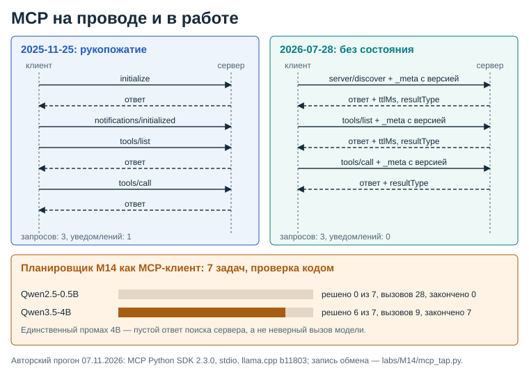
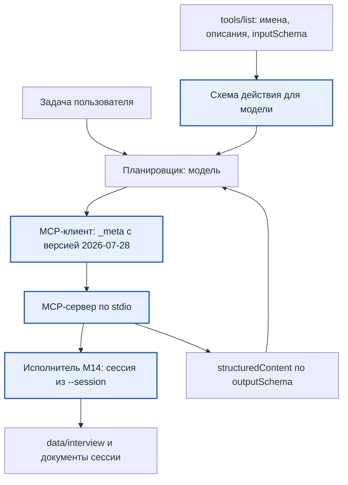

# M14-L09X. MCP: свой сервер инструментов

**Расширение 1.2.0.** Урок дополняет модуль, не входит в обязательный минимум 1.1.0.

**Результат:** написать MCP-сервер «база вопросов собеседования», который оборачивает уже существующие контракты инструментов курса, и подключить к нему планировщик M14 как MCP-клиент. Нужно увидеть протокол на проводе и объяснить, что изменилось в ревизии спецификации 2026-07-28.

**До урока:** M14-L02, M14-L03, M14-L06, M14-L08X. Нужен пакет `mcp` (Python SDK 2.3.0, `requirements-optional.in`). Тесты и записи обмена работают без модели; прогон планировщика требует llama.cpp и GGUF из M09-L07X. Ориентир — 180 минут чтения, сервера и задачи; это плановая гипотеза, а не измеренное время.

> **Версии и дата проверки:** Python 3.11.9; MCP Python SDK 2.3.0 (mcp-types 2.3.0); спецификация MCP 2026-07-28 и прежняя 2025-11-25; llama.cpp b11803, Qwen2.5-0.5B-Instruct и Qwen3.5-4B в Q4_K_M · проверено 07.11.2026 · источник: [MCP Specification 2026-07-28](https://modelcontextprotocol.io/specification/2026-07-28)

## Объяснение

### Что такое MCP

Model Context Protocol (MCP) — открытый протокол между приложением с моделью и сервером инструментов. Сообщения — JSON-RPC 2.0. Сервер предлагает три вида возможностей:
- **инструменты** (tools) — функции с JSON Schema аргументов и результата, их вызывает модель через клиента;
- **ресурсы** (resources) — данные по URI, их читает само приложение;
- **шаблоны prompt** (prompts) — заготовки сообщений для пользователя.

Транспорт бывает двух видов. stdio: клиент запускает сервер дочерним процессом, и сообщения идут строками JSON через stdin и stdout. Streamable HTTP: сервер работает отдельно и принимает POST. Один сервер обслуживает любых клиентов: IDE, чат-приложение, собственного агента. Каждому не нужен свой код интеграции.

В M14 контракт инструмента был словарём в коде исполнителя. В MCP тот же контракт становится `inputSchema` инструмента, а исполнитель — сервером. Правило M14-L06 не меняется: модель предлагает вызов, а сервер проверяет аргументы и решает, что выполнить. Правило M14-L03 тоже остаётся: область доступа берётся из конфигурации сервера или проверенной личности клиента, а не из аргументов, которые пишет модель.

### Сервер курса

`labs/M14/mcp_server.py` написан на `MCPServer` из Python SDK 2.3; в версии 1 этот класс назывался `FastMCP`. Новых возможностей сервер не добавляет, он оборачивает существующие:
- `read_document` вызывает исполнитель M14 (`labs/M14/demo.py`). Сессия задаётся флагом `--session` при запуске процесса, поэтому лишний аргумент `session` от модели ничего не расширит;
- `search_questions` и `get_question` читают синтетические наборы `data/interview`: 12 вопросов backend и 8 вопросов HR;
- ресурс `interview://questions/{question_id}` отдаёт тот же вопрос по URI.

Результаты описаны типами (`TypedDict`), поэтому у каждого инструмента есть `outputSchema`, а клиент получает `structuredContent`. Все инструменты только читают, это объявлено аннотациями `readOnlyHint` и `destructiveHint`. Ошибка «нет вопроса» возвращается через `ToolError`: модель видит понятный текст, а не трассировку. Список инструментов не меняется, пока процесс жив, поэтому сервер разрешает клиенту кешировать `tools/list` на час.

### Что изменилось в ревизии 2026-07-28

Ревизия 2026-07-28 сделала MCP протоколом без состояния. Каждый запрос теперь самодостаточен: сервер не хранит протокольную сессию, и на любой запрос может ответить любой экземпляр сервера за балансировщиком. Основные изменения по [списку изменений спецификации](https://modelcontextprotocol.io/specification/2026-07-28/changelog):

| Было в 2025-11-25 | Стало в 2026-07-28 |
| --- | --- |
| Рукопожатие `initialize` и `notifications/initialized` | Рукопожатия нет: версия протокола, возможности и имя клиента идут в `_meta` каждого запроса |
| Сессия `Mcp-Session-Id` в HTTP | Сессий нет; состояние между вызовами — явные ручки, которые выдаёт сервер и которые передают обычным аргументом |
| Версия согласуется один раз | Метод `server/discover` обязателен: сервер сообщает версии и возможности по запросу |
| Сервер сам спрашивает клиента (`sampling/createMessage`, `elicitation/create`, `roots/list`) | Многошаговый запрос: сервер отвечает `resultType: "input_required"`, клиент повторяет запрос с ответами |
| Результат без типа | У каждого результата `resultType`: `complete` или `input_required` |
| `resources/subscribe` и HTTP GET | `subscriptions/listen` — один поток уведомлений по подписке |
| `ping`, `logging/setLevel` | Удалены; уровень логов задаётся в `_meta` запроса |
| Задачи (tasks) в ядре | Задачи вынесены в официальное расширение |
| Нет подсказок кеша | `ttlMs` и `cacheScope` у списков и чтения ресурсов, `tools/list` в устойчивом порядке |

Python SDK 2.x поддерживает обе ревизии. Клиент по умолчанию сначала вызывает `server/discover`. Если старый сервер не отвечает на этот метод, клиент выполняет прежнее рукопожатие. Ветка SDK 1.x (1.30.0) осталась для старого кода. Ошибка «ресурс не найден» сменила код с −32002 на −32602 (Invalid Params).



Сопоставь рисунок с записью обмена: где в каждой ревизии передаётся версия протокола и почему справа нет уведомления.

## Аналогия: сервис с OpenAPI

Backend-разработчик видел это в микросервисах. Сервис публикует описание OpenAPI, клиент читает его и вызывает нужный endpoint с телом по схеме. MCP устроен так же, только endpoint выбирает модель.

| В уроке | В аналогии |
| --- | --- |
| MCP-сервер | Микросервис |
| `tools/list` с `inputSchema` | Файл `openapi.json` со схемами запросов |
| `tools/call` | POST на endpoint |
| `outputSchema` и `structuredContent` | Схема ответа и тело JSON |
| stdio-сервер как дочерний процесс | Плагин, который приложение запускает само |
| `_meta` с версией в каждом запросе (2026-07-28) | Заголовки авторизации и версии API в каждом запросе вместо sticky-сессии |
| `ttlMs` у `tools/list` | `Cache-Control: max-age` у описания API |

**Где аналогия ломается:** endpoint выбирает не программист, а модель, и выбирает по тексту описания. Описание инструмента становится частью prompt. Неточное описание даёт неверный вызов, а описание от чужого сервера — это непроверенный текст, через который возможна инъекция (T40). Аннотация `readOnlyHint` от чужого сервера — подсказка, а не гарантия: проверку прав и подтверждение действий клиент оставляет у себя.

## Разобранный пример

Python-блок выполняй из корня `C:\projects\ml-llm-course` в окружении курса. Пакет `mcp` для него не нужен: пример читает замороженную запись настоящего обмена по ревизии 2026-07-28 и строит из полученного списка инструментов схему действия для модели.

```python
import json
from pathlib import Path

from jsonschema import Draft202012Validator

lines = Path("quality/mcp/wire-auto.jsonl").read_text(encoding="utf-8").splitlines()
messages = [json.loads(json.loads(line)["line"]) for line in lines]
assert [m.get("method", "result") for m in messages] == ["server/discover", "result", "tools/list", "result", "tools/call", "result"]
meta = messages[0]["params"]["_meta"]
assert meta["io.modelcontextprotocol/protocolVersion"] == "2026-07-28"  # версия в каждом запросе, а не в рукопожатии
listing = messages[3]["result"]
assert listing["resultType"] == "complete" and listing["ttlMs"] == 3_600_000  # список можно хранить час
tools = listing["tools"]
assert [t["name"] for t in tools] == ["search_questions", "get_question", "read_document"]

variants = [{"type": "object", "additionalProperties": False, "required": ["tool", "args"],
             "properties": {"tool": {"const": t["name"]}, "args": dict(t["inputSchema"], additionalProperties=False)}}
            for t in tools]
action = Draft202012Validator({"anyOf": variants})
assert action.is_valid({"tool": "read_document", "args": {"document_id": "d1"}})
assert not action.is_valid({"tool": "read_document", "args": {"document_id": "d2", "session": "s2"}})  # права не аргумент
assert not action.is_valid({"tool": "delete_document", "args": {"document_id": "d1"}})               # такого инструмента нет
```

Сервер сообщил модели, что вообще можно сделать. Схема из его `inputSchema` не даёт модели ни придумать инструмент, ни добавить аргумент, которого нет в контракте.

### Авторский прогон 07.11.2026

```powershell
.\.venv\Scripts\python.exe -m pip install -r requirements-optional.in
.\.venv\Scripts\python.exe labs\M14\mcp_planner.py wire
.\.venv\Scripts\python.exe labs\M14\mcp_planner.py report
```

**Обмен на проводе.** `wire` дважды запускает настоящий сервер через прослушку stdio (`labs/M14/mcp_tap.py`). Клиент оба раза делает одно и то же: `list_tools` и один вызов `read_document`.

- **2026-07-28:** `server/discover` → ответ, `tools/list` → ответ, `tools/call` → ответ. Это 3 запроса, и в каждом `_meta` несёт версию, возможности и имя клиента; в каждом ответе есть `serverInfo` и `resultType`.
- **2025-11-25:** `initialize` → ответ, уведомление `notifications/initialized`, `tools/list` → ответ, `tools/call` → ответ. Это 3 запроса и уведомление, `_meta` нет.

Ответ на `tools/list` по ревизии 2026-07-28 несёт `ttlMs` = 3 600 000 и `cacheScope` = `private`, как задал сервер. Результаты инструментов в обеих ревизиях одинаковы, и тест это проверяет.

**Планировщик через MCP.** Семь задач с проверкой кодом, модель получает инструменты из `tools/list`, клиент работает по stdio:

| Показатель | 0.5B | 4B |
| --- | --- | --- |
| Задач решено | 0 из 7 | 6 из 7 |
| Задач закончено | 0 из 7 | 7 из 7 |
| Вызовов инструментов | 28 | 9 |
| Вызовов с ошибкой | 4 | 0 |

Что показал прогон:
- **0.5B вызывает инструменты, но не работает с ними.** Схема не дала ей ошибиться в форме: все 28 вызовов — существующие инструменты с аргументами нужной формы. Но она повторяла один и тот же вызов до конца бюджета и ни разу не закончила. Запросы к поиску она писала транслитом («idem», «parametrizovaniye»), а `get_question` четыре раза вызвала с выдуманным id 1234567890. Схема проверяет форму, а не смысл: такой id сервер отклонил ошибкой.
- **4B справилась почти со всем за 9 вызовов.** На каждую задачу ей хватило одного-трёх вызовов. Документ d2 она прочитать не смогла и ответила, что он недоступен: сервер вернул `not_available`, и выдумывать текст модель не стала.
- **Единственную неудачу 4B дал инструмент, а не модель.** В задаче про HR-вопрос о помощи модель трижды правильно вызвала `search_questions("просит помощи")`, а поиск ничего не нашёл. Сервер сравнивает слова по первым шести буквам, и «просит» не совпало с «просишь», а «помощи» — с «помощь». Трасса вызовов отделяет ошибку модели от ошибки инструмента: аргументы верные, пустой результат пришёл от сервера.

У автора прогон занял меньше минуты на 0.5B и около трёх минут на 4B.

## Схема



Планировщик как MCP-клиент. Модель видит инструменты из `tools/list`, а её ответ ограничен схемой, собранной из их `inputSchema`. Клиент передаёт вызов серверу по stdio, и каждый запрос несёт версию протокола в `_meta`. Сервер вызывает прежний исполнитель M14. Область сессии исполнитель берёт из флага запуска, а не из аргументов модели. Ответ возвращается структурированным по `outputSchema` и уходит модели как данные. Выделен путь от схемы до исполнителя: здесь проверяется, что модель вообще может сделать.

## Практика с поддержкой

**Предскажи до запуска.** Прежде чем запускать код, запиши ожидаемый вывод: сколько сообщений уйдёт серверу в каждой ревизии протокола, какая модель решит больше задач и на каком шаге маленькая модель собьётся. После запуска сравни с фактическим и объясни каждое расхождение.

1. Выполни `.\.venv\Scripts\python.exe labs\M14\mcp_planner.py wire`. Открой `artifacts/M14/mcp/wire-auto.jsonl` и `wire-legacy.jsonl`, найди в них `server/discover`, `initialize` и поле `_meta`.
2. Выполни `.\.venv\Scripts\python.exe labs\M14\mcp_planner.py report` и сверь с таблицей авторского прогона. В `quality/mcp/planner.jsonl` найди задачу `read-d2` и объясни, откуда модель узнала, что документ недоступен.
3. Запусти сервер вручную `.\.venv\Scripts\python.exe labs\M14\mcp_server.py --session s2` и подключись к нему из Python через `Client(StdioServerParameters(...))`. Какой документ теперь доступен?
4. Если модели скачаны, повтори прогон: `.\.venv\Scripts\python.exe labs\M14\mcp_planner.py run --models tiny`.

## Самостоятельная задача A — M14-L09X-A

Добавь в сервер собеседование с состоянием, не нарушая протокола без состояния. Нужны два инструмента. `start_interview(track)` начинает собеседование по треку и возвращает ручку. `next_question(handle)` отдаёт следующий ещё не заданный вопрос. Состояние живёт на сервере под ручкой, а не в протокольной сессии: её в 2026-07-28 нет. Покажи, что второе соединение с той же ручкой продолжает то же собеседование, а угаданная ручка отклоняется. Объясни, почему ручка не должна быть номером по порядку.

## Подсказки по очереди

1. Новые инструменты регистрируются на уже построенном сервере декоратором `@server.tool()`.
2. Состояние — словарь «ручка → очередь id вопросов» в памяти процесса сервера.
3. Непредсказуемую ручку даёт `secrets.token_urlsafe`.
4. Ошибку, которую должна прочитать модель, бросают как `ToolError`.

## Критерии и типичные ошибки

**Критерии до попытки:** инструменты сервера оборачивают существующие контракты; область доступа не зависит от аргументов модели; у результатов есть схема; ошибка понятна модели; клиент проверен на обеих ревизиях протокола; модель не может назвать несуществующий инструмент. Для самостоятельного зачёта объясни без открытого кода, чем ручка отличается от протокольной сессии, и найди в записи обмена, где передаётся версия протокола.

**Типичные ошибки:** передавать сессию или права аргументом инструмента; доверять `readOnlyHint` чужого сервера; описывать инструмент так, что модель путает его с соседним; ждать от протокола 2026-07-28 сессии, которой в нём нет; выдавать ручки по порядку, так что их можно угадать.

## Новая и отложенная проверка

**Повтор B:** клиент открывает новое соединение и делает один `tools/list` и три `tools/call`. Сколько сообщений он отправит серверу по ревизии 2025-11-25 и сколько по 2026-07-28, если `server/discover` вызывает один раз? Что изменится, если результат `tools/list` с `ttlMs` = 3 600 000 уже лежит в кеше клиента? **Отложенная C:** реши, какие части тренажёра вынести в MCP-серверы: базу вопросов, рубрики, распознавание речи, отправку отчёта. Для каждого реши, нужен ли инструмент или хватит ресурса, откуда сервер возьмёт права пользователя без протокольной сессии и какие действия потребуют подтверждения. [Ключи](../../solutions/modules/M14.md) открывай после сохранения попытки.

## Карточка урока

| Поле | Содержание |
| --- | --- |
| Правило | MCP-сервер — исполнитель инструментов. Контракт задают `inputSchema` и `outputSchema`, права берутся из конфигурации или проверенной личности клиента, а не из аргументов. Описания инструментов — часть prompt. В ревизии 2026-07-28 протокольной сессии нет, и состояние держат под ручкой, которую выдал сервер |
| Смысл величин | Версия протокола в `_meta` каждого запроса; `resultType` — завершён ли запрос; `ttlMs` и `cacheScope` — сколько и где можно хранить список. Решено — задача прошла проверку кодом; вызовов — сколько раз модель обращалась к серверу |
| Когда применять | Когда один набор инструментов нужен нескольким приложениям или агентам. Пример: 4B решила 6 задач из 7 за 9 вызовов, 0.5B — 0 из 7 за 28. По 2025-11-25 клиент сначала шлёт `initialize` и уведомление, по 2026-07-28 — сразу запросы с версией в `_meta` |
| Главная ошибка | Передавать права аргументом инструмента, верить аннотациям чужого сервера и путать ошибку инструмента с ошибкой модели |

## Источники и углубление

Спецификация: [MCP 2026-07-28](https://modelcontextprotocol.io/specification/2026-07-28) и [список изменений](https://modelcontextprotocol.io/specification/2026-07-28/changelog). Обсуждения изменений: [SEP-2575 — протокол без состояния](https://github.com/modelcontextprotocol/modelcontextprotocol/pull/2575), [SEP-2567 — без протокольных сессий](https://github.com/modelcontextprotocol/modelcontextprotocol/pull/2567). Python SDK: [репозиторий](https://github.com/modelcontextprotocol/python-sdk) и [переход на версию 2](https://py.sdk.modelcontextprotocol.io/v2/migration/).
