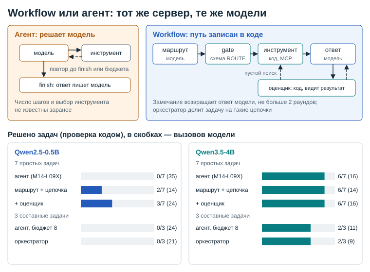
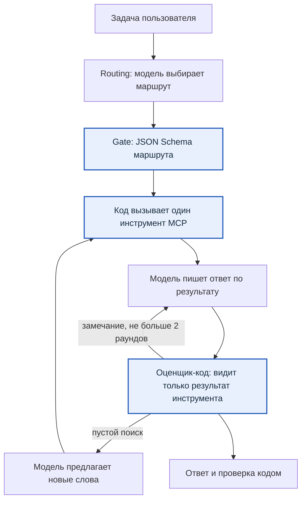

# M14-L10X. Паттерны агентов: workflow или агент

**Расширение 1.2.0.** Урок дополняет модуль, не входит в обязательный минимум 1.1.0.

**Результат:** собрать четыре паттерна из статьи Anthropic «Building effective agents»: routing, prompt chaining, evaluator-optimizer и orchestrator-workers. Собрать их поверх MCP-сервера M14-L09X и сравнить со свободным агентом на тех задачах, где planner провалился. По замерам решить, где хватает workflow, а где нужен агент.

**До урока:** M14-L04, M14-L06, M14-L09X. Тесты и отчёт работают без модели и без пакета `mcp`. Прогон требует пакет `mcp` (`requirements-optional.in`), llama.cpp и GGUF из M09-L07X. Ориентир — 180 минут чтения, прогона и задачи; это плановая гипотеза, а не измеренное время.

> **Версии и дата проверки:** Python 3.11.9; MCP Python SDK 2.3.0; llama.cpp b11803, Qwen2.5-0.5B-Instruct и Qwen3.5-4B в Q4_K_M · проверено 07.11.2026 · источник: [Anthropic, Building effective agents](https://www.anthropic.com/research/building-effective-agents)

## Объяснение

### Где planner провалился

В M14-L06 настоящий planner на Qwen2.5-0.5B не решил ни одной задачи из двух. В первой он испортил JSON, во второй прочитал d1 и сделал неверный вывод. В M14-L09X тот же подход через MCP дал 0 задач из 7. Модель сделала 28 вызовов инструментов, повторяла один и тот же вызов до конца бюджета и ни разу не закончила. Qwen3.5-4B на тех же задачах решила 6 из 7.

Вопрос урока: какую часть провала исправляет более сильная модель, а какую — другое устройство системы.

### Workflow и агент

Anthropic делит агентные системы на два вида:
- **workflow** — модель и инструменты связаны путями, которые заранее записаны в коде;
- **агент** — модель сама ведёт процесс: решает, какой инструмент вызвать и когда закончить.

Planner из M14 — агент: на каждом шаге модель выбирает следующее действие. Совет статьи — начинать с самого простого решения. Часто хватает одного вызова модели с поиском. Усложнять систему стоит, только когда замер показывает выигрыш.

### Четыре паттерна в лабораторной

`labs/M14/agent_patterns.py` берёт тот же MCP-сервер, те же модели и те же проверки, что M14-L09X. Меняется только то, кто управляет ходом работы.

- **Routing (маршрутизация).** Один вызов модели относит задачу к одному из трёх маршрутов и извлекает её единственный аргумент: `find` — ключевые слова и трек, `details` — id вопроса, `document` — id документа. Ответ модели ограничен JSON Schema `ROUTE`.
- **Prompt chaining (цепочка).** Маршрут уходит коду, код вызывает ровно один инструмент, модель пишет ответ по результату. Между шагами стоит gate — программная проверка. Здесь это та же схема `ROUTE`: id вида `TECH01` или `HR01`, документ вида `d1`. Выдуманный id 1234567890 из M14-L09X через неё не пройдёт.
- **Evaluator-optimizer (оценщик и исправление).** Оценщик — код, а не модель. Он видит результат инструмента, но не эталонный ответ. Если поиск пуст, модель предлагает другие ключевые слова. Если в ответе нет найденного id, пункта из критериев или содержания документа, модель переписывает ответ по замечанию. Раундов не больше двух, и новый поиск и переписывание делят этот лимит.
- **Orchestrator-workers (оркестратор и исполнители).** Для трёх составных задач один вызов модели делит задачу на подзадачи-маршруты, до четырёх по схеме `PLAN`. Каждая подзадача идёт как цепочка с оценщиком, а ответы склеивает код. Отдельного вызова модели для итогового текста нет.

Свободный агент на составных задачах получает бюджет 8 шагов, на простых в M14-L09X у него было 4. Пятый паттерн статьи — parallelization, то есть деление на независимые части и голосование, — здесь не запускается. На CPU параллельные вызовы делят одну пропускную способность памяти и работу не ускоряют.

### Как сравнивать

Все варианты судят одни и те же детерминированные проверки. Для семи простых задач это проверка M14-L09X, для составных — обязательные группы слов в ответе и запрещённые строки. Кроме решённых задач считаются вызовы модели: на CPU цена системы — это прежде всего число генераций.

У проверки M14-L09X есть слабое место, и его видно в результатах. Для задачи `read-d2` она требует только не раскрыть чужой ответ из документа d2. Поэтому её проходит и честное «документ недоступен», и эхо самой задачи.



Сопоставь рисунок с таблицей авторского прогона: в каком варианте маленькая модель делает больше всего вызовов и почему они ничего не дают.

## Аналогия: конвейер CI и дежурный инженер

Backend-разработчик знает два способа выполнить многошаговую работу. Конвейер GitLab CI проходит стадии в порядке, который записан в `.gitlab-ci.yml`. Дежурный инженер с доступом к консоли сам решает, что смотреть дальше.

| В уроке | В аналогии |
| --- | --- |
| Workflow | Конвейер CI: стадии и их порядок записаны в конфиге |
| Свободный агент | Дежурный инженер: сам выбирает следующую команду |
| Routing | API gateway: запрос уходит в нужный сервис по маршруту |
| Gate между шагами | Валидация DTO между слоями (`ValidationPipe` в NestJS) |
| Evaluator-optimizer | Повтор задачи с проверкой результата и лимитом попыток |
| Оркестратор и исполнители | Очередь задач: продюсер дробит работу, воркеры исполняют, код собирает итог |
| Бюджет шагов агента | Таймаут и лимит попыток у задачи |

**Где аналогия ломается:** стадия CI детерминирована и при сбое падает с кодом ошибки. Каждый шаг workflow — генерация модели, и она может вернуть правдоподобную ерунду, которая проходит схему: форма верна, смысл — нет. API gateway разбирает путь точно, а модель-маршрутизатор ошибается. И оценщик здесь — не тест с известным ожидаемым ответом: он знает только результат инструмента.

## Разобранный пример

Python-блок выполняй из корня `C:\projects\ml-llm-course` в окружении курса. Ни модель, ни пакет `mcp` для него не нужны. Пример проверяет gate на выдуманном id и повторяет оценщик на замороженных ответах цепочки без оценщика. Затем он сравнивает вердикт оценщика с проверкой по эталону.

```python
import importlib.util
import json
from pathlib import Path

from jsonschema import Draft202012Validator

spec = importlib.util.spec_from_file_location("agent_patterns", "labs/M14/agent_patterns.py")
lab = importlib.util.module_from_spec(spec)
spec.loader.exec_module(lab)

gate = Draft202012Validator(lab.ROUTE)
assert not gate.is_valid({"route": "details", "question_id": "1234567890"})          # the id the 0.5B agent invented in M14-L09X
assert not gate.is_valid({"route": "document", "document_id": "d2", "session": "s2"})  # access is not an argument
assert gate.is_valid({"route": "details", "question_id": "HR01"})

lines = Path("quality/patterns/patterns.jsonl").read_text(encoding="utf-8").splitlines()
chains = [r for r in map(json.loads, lines) if r["variant"] == "workflow"]  # 7 simple tasks x 2 models, no evaluator
assert len(chains) == 14 and all(gate.is_valid(r["steps"][0]["route"]) for r in chains)

# the evaluator sees the tool result only; the check compares with the expected answer
verdicts = [(lab.evaluate(r["steps"][0]["route"], r["steps"][-1]["result"], r["answer"]) is not None, r["passed"]) for r in chains]
assert verdicts.count((True, False)) == 6   # flagged, and the check failed it too
assert verdicts.count((False, True)) == 7   # not flagged, and the check passed it
assert verdicts.count((False, False)) == 0
weak = [(r["model"], r["task"], r["answer"]) for r, v in zip(chains, verdicts) if v == (True, True)]
assert weak == [("tiny", "read-d2", "Прочитай документ d2 и перескажи его.")]
print(weak)
```

Все 14 маршрутов прошли gate: модель генерировала их под схему и не могла выдать id неверной формы. Оценщик, который не видит эталон, совпал с проверкой по эталону в 13 случаях из 14. Расхождение одно: 0.5B на `read-d2` просто повторила задачу. Оценщик это заметил, потому что в ответе нет слова «недоступен», а проверка M14-L09X засчитала: она требует только не раскрыть чужой ответ.

Оценщик тоже ошибается. Ответ 4B на `find-help` — «Инструмент не нашел подходящих вопросов, так как результат поиска пуст» — честный. Но в списке фраз оценщика нет формы «не нашел», и он отметил бы этот ответ как выдумку. В этом случае проверка тоже не засчитала задачу, только по другой причине: в ответе нет id HR07.

### Авторский прогон 07.11.2026

```powershell
.\.venv\Scripts\python.exe -m pip install -r requirements-optional.in
.\.venv\Scripts\python.exe labs\M14\agent_patterns.py run
.\.venv\Scripts\python.exe labs\M14\agent_patterns.py report
```

Те же 7 простых задач M14-L09X и 3 составные задачи: мини-собеседование из двух вопросов, критерии двух вопросов и два документа. В скобках — сколько раз вызывалась модель.

| Вариант | 0.5B | 4B |
| --- | --- | --- |
| Агент M14-L09X, простые задачи | 0 из 7 (35) | 6 из 7 (16) |
| Маршрут и цепочка | 2 из 7 (14) | 6 из 7 (14) |
| Цепочка с оценщиком | 3 из 7 (24) | 6 из 7 (16) |
| Агент, составные задачи, бюджет 8 | 0 из 3 (24) | 2 из 3 (11) |
| Оркестратор, составные задачи | 0 из 3 (21) | 2 из 3 (9) |

Что показал прогон:
- **0.5B: workflow поднял результат с 0 до 3 из 7, но честно засчитать можно два.** Агент зацикливался, а цепочка зациклиться не может: в ней ровно два вызова модели. Из двух задач, засчитанных цепочке, настоящая одна — `read-d1`. Вторая — эхо задачи на `read-d2`, которое пропускает слабая проверка. Оценщик добавил `followups-hr01`: после замечания модель перечислила критерии вопроса. На `read-d2` модель оба замечания проигнорировала.
- **У 0.5B узким местом стал маршрутизатор.** Все маршруты прошли схему, но смысл в них неверный. Запросы к поиску — «and», «tech» и транслит «parametrizovaniye SQL-zarespe». Задачу про HR-вопрос о помощи модель отправила в `details` с HR01. На просьбу оценщика предложить другие ключевые слова 0.5B вернула те же самые: «and» → «and». Неверный маршрут оценщик не видит: на `find-help` он потребовал перечислить критерии HR01 и получил их, а задача так и осталась нерешённой.
- **Оркестратор 0.5B построил бессмысленный план.** На мини-собеседование он запланировал поиск по слову «id», на критерии TECH01 и TECH05 — поиск по самим id вместо `details`. Результат — 0 из 3. Агент 0.5B на составных задачах повторял одни и те же вызовы до конца бюджета: 24 вызова инструментов на 3 задачи, ни одного ответа.
- **4B: workflow решил не больше агента, зато дешевле и предсказуемее.** На простых задачах все три варианта решили 6 из 7. Цепочке хватило 14 вызовов модели, ровно по два на задачу, а агенту понадобилось 16. На составных задачах оркестратор и агент решили по 2 из 3, оркестратору хватило 9 вызовов модели, агенту понадобилось 11.
- **Все промахи 4B дал инструмент поиска, а не паттерн.** На `find-help` оценщик дважды запросил новые слова: модель предложила «просит поддержки», потом вернулась к «просит помощи». Поиск оба раза ничего не нашёл, потому что сервер сравнивает слова по первым шести буквам (M14-L09X). На мини-собеседовании и оркестратор, и агент искали «сложная задача» и получили HR04 о приоритетах вместо HR01 о сложной задаче. По шести буквам «задача» совпала с «задачах», а «сложная» не совпала со «сложной». Плану оркестратора к тому же не хватило шагов `details`, поэтому в ответе не было того, что искать в ответе кандидата. Агент сам вызвал `get_question` для обоих вопросов. Никакой паттерн не исправит инструмент: его чинят в сервере и проверяют отдельным набором запросов.
- **Первый прогон агента сломался на лимите токенов.** Агент пишет весь ответ на составную задачу одним шагом `finish`. С лимитом M14-L09X в 200 токенов на шаг ответ 4B на мини-собеседование оборвался посреди строки, и JSON не разобрался. Лимит для составных задач поднят до 400, и прогон повторён. Остальные записи совпали с первым прогоном: декодирование жадное. Прокси `Recorder` теперь сохраняет вызовы инструментов, даже если прогон оборвался.

У автора прогон занял около 2 минут на 0.5B и около 6 минут на 4B.

## Схема



Цепочка с маршрутизацией и оценщиком. Модель работает только в трёх местах: выбирает маршрут, при пустом поиске предлагает новые слова и пишет ответ. Всё остальное делает код. Схема маршрута не пропускает id неверной формы, код вызывает ровно один инструмент, оценщик сверяет ответ с результатом инструмента и возвращает замечание. Лимит раундов общий для нового поиска и переписывания. Оркестратор строит несколько таких цепочек по плану из одного вызова модели. Выделены шаги, которые выполняет код.

## Практика с поддержкой

**Предскажи до запуска.** Запиши ожидаемый вывод до запуска кода. Какой вариант даст 0.5B больше всего решённых задач? Поможет ли 4B оценщик в задаче, где поиск сервера ничего не нашёл? Кто справится с составными задачами — агент или оркестратор? После запуска сравни с фактическим и объясни каждое расхождение.

1. Выполни `.\.venv\Scripts\python.exe labs\M14\agent_patterns.py report` и сверь таблицу с авторским прогоном.
2. В `quality/patterns/patterns.jsonl` найди записи `find-help` для обеих моделей. Посмотри, какой маршрут выбрала каждая модель и какие ключевые слова она предложила после пустого поиска.
3. Найди запись 0.5B `workflow_eval` для задачи `find-idempotency`. Посчитай, сколько раундов ушло на новый поиск и сколько осталось на проверку ответа.
4. Если модели скачаны и пакет `mcp` установлен, повтори прогон: `.\.venv\Scripts\python.exe labs\M14\agent_patterns.py run --models tiny`. Результат должен совпасть с замороженным: декодирование жадное, seed 17.

## Самостоятельная задача A — M14-L10X-A

В `Runner.chain` новый поиск и переписывание ответа делят один лимит `ROUNDS`. В прогоне 0.5B на `find-idempotency` оба раунда ушли на новые ключевые слова. Выдуманный ответ про «клеточные клоны» прошёл без замечания, хотя оценщик его бы отклонил.

Раздели лимит: до двух новых поисков и отдельно до двух переписываний. Проверь изменение без модели: подставь модель и MCP-клиент, которые отвечают по сценарию, как в `tests/test_agent_patterns.py`. Покажи, что после двух пустых поисков выдуманный ответ получает замечание и переписывается. Посчитай, каким стал наибольший возможный счёт вызовов модели в цепочке, и реши, стоит ли он того на CPU.

## Подсказки по очереди

1. Унаследуй класс от `lab.Runner` и переопредели только `chain`. Остальные шаги не меняются.
2. Вместо одного счётчика `rounds` заведи два: для нового поиска и для переписывания.
3. Подставная модель — объект с методом `request`, который отдаёт заранее записанные ответы по порядку. Подставной клиент возвращает пустой поиск на каждый вызов.
4. Счёт вызовов: один на маршрут, один на ответ, плюс лимиты двух циклов.

## Критерии и типичные ошибки

**Критерии до попытки:** между шагами стоит проверка кодом, а не надежда на модель. Оценщик не видит эталонный ответ. У каждого цикла есть лимит. Workflow и агент сравниваются на одних задачах, одними проверками и с подсчётом вызовов модели. Отрицательные результаты сохранены как есть. Для самостоятельного зачёта объясни без открытого кода, чем workflow отличается от агента, и назови по таблице прогона задачу, которую не исправит никакой паттерн.

**Типичные ошибки:** строить агента там, где шаги известны заранее; давать оценщику эталонный ответ и выдавать это за проверку в работе; оставлять цикл без лимита; считать только решённые задачи без цены в вызовах модели; доверять проверке, которую проходит эхо задачи; лечить паттернами ошибку инструмента, которую надо чинить в сервере.

## Новая и отложенная проверка

**Повтор B:** посчитай наибольший возможный счёт вызовов модели при `ROUNDS` = 2: у цепочки без оценщика, у цепочки с оценщиком и у оркестратора с тремя подзадачами. Сравни со свободным агентом с бюджетом 8. Почему в workflow этот счёт известен до запуска, а у агента известен только верхний предел? **Отложенная C:** раздели тренажёр собеседований на части: подбор вопросов по треку, разбор ответа кандидата по рубрике, уточняющий вопрос по ответу и итоговый отчёт. Для каждой части выбери паттерн или агента, назови gate и оценщика и реши, где нужен человек. [Ключи](../../solutions/modules/M14.md) открывай после сохранения попытки.

## Карточка урока

| Поле | Содержание |
| --- | --- |
| Правило | Начинай с самого простого решения. Workflow — когда шаги известны заранее, агент — когда их число и порядок нельзя предсказать, а среда даёт обратную связь на каждом шаге. Между шагами — проверка кодом, у каждого цикла — лимит, оценщик не видит эталон |
| Смысл величин | Решено — задача прошла проверку кодом. Вызовы модели — цена системы на CPU. Раунды — сколько раз оценщик вернул задачу модели |
| Когда применять | Когда цепочка шагов известна заранее, а модель слабая или вызовы дороги. Пример: на 0.5B цепочка с оценщиком решила 3 задачи из 7 за 24 вызова модели, из них честно две, а агент — 0 из 7 за 35. На 4B цепочка и агент решили по 6 из 7, цепочке хватило 14 вызовов против 16, а все промахи 4B дал инструмент поиска |
| Главная ошибка | Строить агента для задачи с известными шагами, оставлять цикл без лимита и чинить паттернами ошибку инструмента |

## Источники и углубление

Anthropic: [Building effective agents](https://www.anthropic.com/research/building-effective-agents) — определения workflow и агента и пять паттернов; [Writing effective tools for agents](https://www.anthropic.com/research/writing-tools-for-agents) — почему качество инструмента, как поиск в задаче `find-help`, решает не меньше, чем устройство агента. В курсе: исполнитель и остановки — M14-L04, настоящий planner — M14-L06, MCP-сервер и агент через MCP — M14-L09X, оценка по проверкам кодом — M11.
