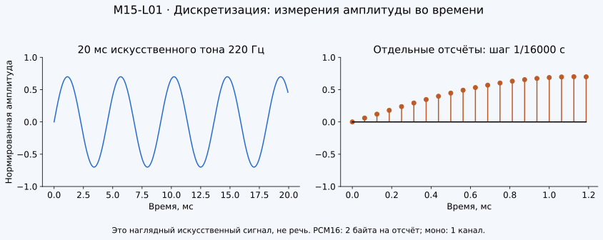

# M15-L01. Аудио и речь

Версия материала: 1.1.0. Это самостоятельный урок: внешняя проверка наставником необязательна.

> **Версии и дата проверки:** Python 3.11.9, Vosk 0.3.45 и vosk-model-small-ru-0.22; синтез — Windows System.Speech с голосом Microsoft Irina Desktop · проверено 04.11.2026 · источник: [Python 3.11: wave](https://docs.python.org/3.11/library/wave.html)

## Результат и входные знания

После урока ты сможешь: **Прочитать PCM-запись и связать частоту, разрядность и длительность с числом байтов.** Перед началом нужны M09, M11 и M13: диалог, метрики и диагностика. Если термин из этого списка неясен, вернись к соответствующему уроку и воспроизведи его маленький пример. Продолжение по календарю не заменяет понимание зависимости.

## Объяснение

Цифровое аудио — последовательность измерений амплитуды звукового сигнала. Частота дискретизации показывает, сколько измерений приходится на секунду одного канала. При 16000 Гц это 16000 отсчётов в секунду. Разрядность определяет способ хранения каждого отсчёта; PCM16 использует два байта на число. Число каналов отличает моно от стерео. Эти параметры вместе определяют размер несжатого звука.

WAV — контейнер, внутри которого может находиться звуковой поток с определённым кодированием и метаданными. Расширение.wav само по себе не гарантирует нужный формат. Перед передачей в распознаватель проверь частоту, число каналов и тип отсчётов. В обязательной лабораторной используется моно PCM16 при 16000 Гц. Выбранный адаптер и модель ожидают именно этот путь подготовки.

При нормализации целочисленного PCM16 в float амплитуда примерно переводится в диапазон от−1 до 1. Отсчёты представляют относительный уровень, а не физическую громкость в децибелах без калибровки. Значения около границ могут указывать на клиппинг: вершины сигнала обрезались, и форма волны потеряна. Простое уменьшение громкости уже обрезанной записи не восстанавливает утраченные детали.

Фрейм в аудиофайле содержит один отсчёт каждого канала. Поэтому длительность равна числу фреймов, делённому на частоту. Для стерео нельзя ещё раз делить длительность на число каналов: они уже объединены во фрейме. В сетевой передаче словом frame иногда называют пакет из многих отсчётов; всегда уточняй смысл единицы в конкретном API.

Изменить число 16000 на 48000 в заголовке недостаточно, чтобы корректно преобразовать запись. Нужно пересчитать последовательность отсчётов с фильтрацией — выполнить resampling. Иначе изменится воспринимаемая длительность и высота звука. При объединении стерео в моно также надо обработать значения каналов, а не просто отбросить каждый второй байт.

Речевой сигнал содержит паузы, шумы и изменения громкости. Визуализация формы волны помогает увидеть тишину, обрезание и длину фрагментов, но не показывает качество распознавания сама по себе. Красивый график не означает разборчивую речь. Слушай запись, проверяй технические параметры и сохраняй текстовый эталон для последующего сравнения.



Сопоставь подписи с примером: объясни величины и укажи, какие отношения показаны на рисунке.

## Аналогия: несжатое изображение и видео

Как похоже: размер несжатой картинки — ширина × высота × байты на пиксель, а у видео ещё умножается на кадры в секунду. Файл .mp4 — контейнер, и кодек внутри может быть разным. Если в заголовке картинки исправить ширину, изображение не масштабируется, а превратится в мусор. Пересвеченные пиксели уже потеряли детали, и уменьшение яркости их не вернёт.

| В уроке | В аналогии |
| --- | --- |
| Частота дискретизации | Кадры в секунду у видео |
| PCM16: 2 байта на отсчёт | Байты на пиксель у несжатого изображения |
| Моно и стерео | Один канал яркости или три канала RGB |
| WAV — контейнер | .mp4 — контейнер, кодек внутри может быть разным |
| Фрейм: по отсчёту каждого канала | Пиксель: значения всех каналов цвета вместе |
| Resampling вместо правки заголовка | Масштабирование картинки вместо правки ширины в заголовке |
| Клиппинг | Пересвеченные пиксели: уменьшение яркости не вернёт детали |

**Где аналогия ломается:** картинку видно целиком, и дефект часто заметен глазом, а звук разворачивается во времени: пауза, обрыв или шум проявляются только при прослушивании и в отдельных измерениях. И у изображения нет шага, похожего на распознавание речи: правильный формат ещё не гарантирует, что ASR поймёт слова.

## Разобранный пример

Python-блок выполняй из корня `C:\projects\ml-llm-course` в окружении курса (например, в ячейке Jupyter). Для примеров M15 сначала создай `question.wav` запуском лабораторной.

Две секунды моно PCM16 при 16000 Гц содержат 32000 отсчётов и 64000 байтов полезного звука. Заголовок WAV добавляет служебные байты. Для стерео объём полезной части удвоится до 128000 байтов при той же длительности.

```python
import wave
with wave.open('artifacts/M15/question.wav', 'rb') as audio:
    seconds = audio.getnframes() / audio.getframerate()
    print(audio.getnchannels(), audio.getsampwidth(), seconds)
```

Лабораторный русский синтезированный вопрос в контрольном запуске занял 4,505 секунды. Точная длительность зависит от установленного голоса и его настроек.

## Практика с поддержкой

**Предскажи до запуска.** Прежде чем запускать код или пересчитывать пример, запиши ожидаемый вывод: числа, формы массивов, порядок или текст. После запуска сравни с фактическим и объясни каждое расхождение.

Сначала посчитай ожидаемые байты на бумаге. Затем открой созданный question.wav через wave и сравни nframes, framerate, nchannels, sampwidth. Если размер файла чуть больше расчёта, проверь заголовок, а не объявляй ошибку. Для графика выбери небольшой временной участок, чтобы отдельные колебания были видны.

Для технической практики используй [лабораторную M15](../../labs/M15/README.md). Полный код находится отдельно от твоего решения. Сначала предскажи результат одного контрольного случая, затем запусти пример и объясни расхождение, если оно появилось. Запиши команду, версию окружения и фактический вывод, чтобы позже повторить опыт.

## Самостоятельная задача A

Рассчитай объём несжатой полезной части 30 секунд аудио:48000 Гц, два канала, PCM16. Затем рассчитай объём после корректного преобразования в 16000 Гц, моно, PCM16. Объясни, почему изменение только заголовка не является преобразованием.

Сохрани первую попытку в `submissions/M15-L01.md`: исходные данные, результат и краткое обоснование.

## Подсказки по очереди

1. Число байтов равно секунды·частота·каналы·байты_на_отсчёт. PCM16 даёт два байта.
2. Для первого случая перемножь 30·48000·2·2, для второго 30·16000·1·2.
3. В обоих случаях длительность сохраняется. Простая смена заголовка меняет скорость воспроизведения прежних отсчётов.

## Критерии и типичные ошибки

За объяснение механизма, корректность проверки, воспроизводимость и ограничения поставь по 0–2 балла: 0 — отсутствует или неверно, 1 — частично с помощью, 2 — самостоятельно и обоснованно. Для перехода каждый критерий должен быть выполнен самостоятельно (2); понимание механизма и новая задача обязательны и не компенсируются другими баллами. При помощи сначала отметь «с поддержкой», затем реши вариант B без подсказки. Критических ошибок быть не должно. Критические ошибки: подмена реального измерения выдуманным, использование ответа из решения как собственной первой попытки, вывод о качестве за пределами проверенных данных, нарушение явно заданного ограничения задачи. Исправление должно сопровождаться новым примером, а не только заменой текста отчёта.

Первая самостоятельная попытка выполняется без готового решения. После неё разрешены объяснения AI, подсказки и [полный разбор](../../solutions/modules/M15.md#m15-l01). Отметь полученную помощь. Если решение стало понятно только после разбора, состояние навыка — «с поддержкой»; для самостоятельности реши новый вариант.

## Новая и отложенная проверка

B: вычисли байты 100 мс mono PCM16 16000 Hz без WAV-заголовка. C через неделю: то же для stereo PCM16 48000 Hz; годится ли напрямую вход Vosk из курса?

Сохрани новую попытку до просмотра [ключа B/C](../../solutions/modules/M15.md).

## Карточка урока

| Поле | Содержание |
| --- | --- |
| Правило | Байты полезного звука = частота · длительность · каналы · байты на отсчёт; длительность = число фреймов / частота; фрейм — по одному отсчёту каждого канала; смена частоты требует resampling с фильтрацией, а не правки заголовка |
| Смысл величин | Частота — отсчётов в секунду на канал; PCM16 — 2 байта на отсчёт; WAV — контейнер, формат внутри проверяют отдельно; значения у границ диапазона указывают на клиппинг, который уменьшение громкости не исправит |
| Когда применять | Перед подачей записи в распознаватель. Пример: 3 с при 22050 Гц, стерео, PCM16 — 66150 фреймов, 66150·2·2 = 264600 байт полезного звука; после корректного преобразования в 16000 Гц моно — 48000 отсчётов, 96000 байт |
| Главная ошибка | Делить длительность стерео ещё раз на число каналов или менять частоту только в заголовке |

## Источники и углубление

- [Python: wave — чтение и запись WAV](https://docs.python.org/3/library/wave.html) — сверяй контракт и определения, не копируй внешний пример вместо самостоятельной работы.
- [MDN: Digital audio concepts](https://developer.mozilla.org/en-US/docs/Web/Media/Guides/Formats/Audio_concepts) — частота дискретизации, разрядность, каналы и объём несжатого звука (на английском)
- [Исполняемый пример модуля](../../labs/M15/demo.py) — авторский код курса с явно указанными ограничениями.

[Оглавление модуля](../modules/M15.md)
