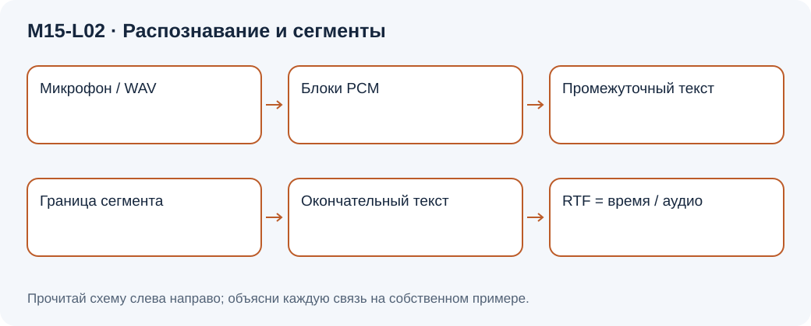

# M15-L02. Распознавание и сегменты

Версия материала: 1.1.0. Это самостоятельный урок: внешняя проверка наставником необязательна.

> **Версии и дата проверки:** Python 3.11.9, Vosk 0.3.45 и vosk-model-small-ru-0.22; синтез — Windows System.Speech с голосом Microsoft Irina Desktop · проверено 04.11.2026 · источник: [модели Vosk](https://alphacephei.com/vosk/models)

## Результат и входные знания

После урока ты сможешь: **Получить текст реального распознавателя и различить промежуточную и окончательную гипотезу.** Перед началом нужны M15-L01: предыдущий шаг модуля. Если термин из этого списка неясен, вернись к соответствующему уроку и воспроизведи его маленький пример. Продолжение по календарю не заменяет понимание зависимости.

## Объяснение

ASR преобразует звуковой сигнал в текстовую гипотезу. Это вероятностное распознавание, а не точная расшифровка по определению. Система использует акустические признаки и закономерности языка, поэтому может заменить редкое техническое слово более привычным, пропустить отрицание или добавить короткое слово. Ошибка затем влияет на оценку кандидата, если следующий компонент принимает гипотезу за безошибочный текст.

Распознавать можно законченный файл или поток небольших блоков. В потоковом режиме промежуточная гипотеза может меняться после поступления новых звуков. Пользовательский интерфейс должен отличать её от окончательного сегмента. Если отправлять каждую промежуточную версию в диалоговую модель как новую реплику, получится дублирование и противоречивая история.

Сегментация определяет, где начинается и заканчивается смысловая реплика. Детектор активности речи отличает вероятную речь от тишины, но не понимает завершённость мысли. Человек может делать паузу перед важным уточнением. Слишком короткий порог тишины обрывает ответ, слишком длинный добавляет задержку. Порог нужно проверять на реальных манерах речи, а не выбирать только по удобству демонстрации.

В обязательной лабораторной используется Vosk small Russian на CPU. Адаптер получает WAV16000 Гцмоно PCM16 и возвращает итоговый текст. Для первого воспроизводимого опыта звук генерирует установленный русский голос Windows. Это настоящий синтез и настоящее распознавание, но один искусственный голос не представляет микрофоны, акценты, шум и естественные паузы пользователей.

Время распознавания зависит от длительности записи, прогрева, модели и вычислительных ресурсов. Real-time factor, RTF, равен времени обработки, делённому на длительность аудио. Если десятисекундный файл обработан за пять секунд, RTF=0,5. Значение больше 1 означает, что данный проход занял больше времени, чем длилась запись. Однако для пакетного опыта с загрузкой модели это не равно устойчивой скорости уже прогретого потокового сервиса.

Сохраняй исходный текст, распознанную гипотезу и условия записи. При оценке ответа кандидата полезно позволить исправить ошибку расшифровки. Иначе продукт может наказать человека за дефект ASR. Само наличие низкого среднего WER не исключает критическую замену «не поддерживает» на «поддерживает», поэтому позже потребуется оценка смысловых ошибок.



Сопоставь подписи с примером: объясни величины и укажи, какие отношения показаны на рисунке.

## Разобранный пример

Python-блок выполняй из корня `C:\projects\ml-llm-course` в окружении курса (например, в ячейке Jupyter). Для примеров M15 сначала создай `question.wav` запуском лабораторной.

Контрольная запись длительностью 4,505 с распознавалась 6,021 с: RTF≈1,337. Время включало работу конкретного локального адаптера. Этот результат не подтверждает разговор без задержки; он задаёт исходную точку измерений.

```python
from pathlib import Path
from projects.interview_trainer.speech import transcribe_wav
text = transcribe_wav(Path('artifacts/M15/question.wav'))
print(text)
```

Выпиши различия с эталоном, не исправляя гипотезу вручную до подсчёта. Исправленный пользователем текст можно хранить отдельно как новый артефакт.

## Практика с поддержкой

Сначала выполни синтетический пример M15, чтобы проверить весь установленный путь. Затем переходи к микрофону. Если собственный файл не распознаётся, проверь формат до изменения модели. При сравнении двух записей держи неизменными модель и настройки, иначе причину разницы установить трудно.

Для технической практики используй [лабораторную M15](../../labs/M15/README.md). Полный код находится отдельно от твоего решения. Сначала предскажи результат одного контрольного случая, затем запусти пример и объясни расхождение, если оно появилось. Запиши команду, версию окружения и фактический вывод, чтобы позже повторить опыт.

## Самостоятельная задача A

Запиши три собственных коротких ответа: тихий, обычный и с паузой внутри предложения. Запусти реальный ASR через учебный проект, сохрани эталоны и гипотезы. Измерь длительность и время обработки, укажи режим прогрева. Объясни, почему три записи не дают надёжного общего рейтинга модели.

Сохрани первую попытку в `submissions/M15-L02.md`: исходные данные, результат и краткое обоснование.

## Подсказки по очереди

1. До распознавания проверь 16000 Гц, один канал и два байта на отсчёт.
2. RTF равен времени обработки/длительности аудио. Первый проход с загрузкой модели пометь отдельно.
3. Сохрани фактическую гипотезу до ручного исправления. Три записи одного автора проверяют путь, но не репрезентативное качество.

## Критерии и типичные ошибки

За объяснение механизма, корректность проверки, воспроизводимость и ограничения поставь по 0–2 балла: 0 — отсутствует или неверно, 1 — частично с помощью, 2 — самостоятельно и обоснованно. Для перехода каждый критерий должен быть выполнен самостоятельно (2); понимание механизма и новая задача обязательны и не компенсируются другими баллами. При помощи сначала отметь «с поддержкой», затем реши вариант B без подсказки. Критических ошибок быть не должно. Критические ошибки: подмена реального измерения выдуманным, использование ответа из решения как собственной первой попытки, вывод о качестве за пределами проверенных данных, нарушение явно заданного ограничения задачи. Исправление должно сопровождаться новым примером, а не только заменой текста отчёта.

Первая самостоятельная попытка выполняется без готового решения. После неё разрешены объяснения AI, подсказки и [полный разбор](../../solutions/modules/M15.md#m15-l02). Отметь полученную помощь. Если решение стало понятно только после разбора, состояние навыка — «с поддержкой»; для самостоятельности реши новый вариант.

## Новая и отложенная проверка

B: partial меняется «я внедрил» → «я не внедрил», затем final. Сколько ответов добавить в историю? C через неделю: повторная доставка final с segment_id=7 и revision=3; что сохранять?

Сохрани новую попытку до просмотра [ключа B/C](../../solutions/modules/M15.md).

## Источники и углубление

- [Официальная документация по теме](https://alphacephei.com/vosk/install) — сверяй контракт и определения, не копируй внешний пример вместо самостоятельной работы.
- [Исполняемый пример модуля](../../labs/M15/demo.py) — авторский код курса с явно указанными ограничениями.

[Оглавление модуля](../modules/M15.md)
