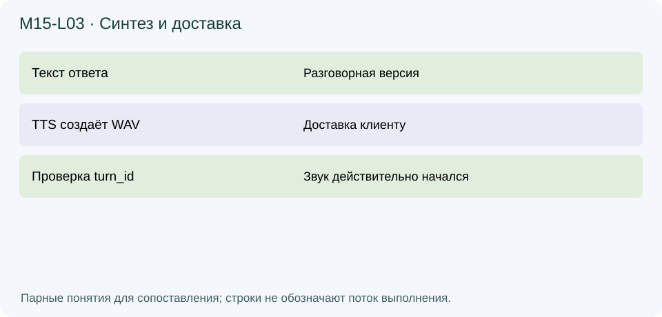

# M15-L03. Синтез и доставка

Версия материала: 1.1.0. Это самостоятельный урок: внешняя проверка наставником необязательна.

> **Версии и дата проверки:** Python 3.11.9, Vosk 0.3.45 и vosk-model-small-ru-0.22; синтез — Windows System.Speech с голосом Microsoft Irina Desktop · проверено 04.11.2026 · источник: [System.Speech.Synthesis](https://learn.microsoft.com/dotnet/api/system.speech.synthesis)

## Результат и входные знания

После урока ты сможешь: **Синтезировать реальный звук и отделить генерацию файла от слышимого ответа.** Перед началом нужны M15-L02: предыдущий шаг модуля. Если термин из этого списка неясен, вернись к соответствующему уроку и воспроизведи его маленький пример. Продолжение по календарю не заменяет понимание зависимости.

## Объяснение

TTS преобразует текст в аудио. Для пользователя важно не только качество произношения, но и момент, когда начинается воспроизведение. Полученный WAV ещё не означает, что человек его услышал: клиент может не загрузить файл, блокировать автоматическое воспроизведение или продолжать проигрывать прошлую реплику. Поэтому цепочка включает синтез, доставку, начало проигрывания и завершение.

В обязательном локальном варианте применяется Windows System.Speech с установленным русским голосом. Адаптер создаёт WAV16000 Гцмоно PCM16. Это системный синтез речи, работающий без платного API. Набор голосов зависит от установки Windows; фактически проверенный ноутбук содержит Microsoft Irina Desktop. На другой машине нужно перечислить доступные голоса и выбрать совместимый, а не обещать одинаковое звучание по одному имени.

Текст для озвучивания может отличаться от отображаемой технической записи. Формула, URL или фрагмент SQL редко звучат понятно при буквальном чтении. Полезно формировать краткую разговорную версию, сохраняя полный текст на экране. При этом нельзя менять смысл обратной связи: удаление отрицания или условия превращает технически верный ответ в ошибочный голосовой совет.

Разбиение длинного ответа на фразы может уменьшить время до первого звука, если система синтезирует и доставляет части постепенно. Но слишком мелкие куски ухудшают интонацию и увеличивают накладные расходы. Граница токена модели не является естественной границей речи. Для учебного проекта сначала достаточно законченной короткой реплики; затем можно измерить пользу синтеза по предложениям.

Клиент должен знать, какой реплике принадлежит файл. Перед воспроизведением сравнивается turn_id с актуальным состоянием и проверяется отмена. Иначе поздно завершившийся TTS может произнести устаревший вопрос после того, как пользователь уже ответил на новый. Ссылка на файл является данными доставки, а не доказательством актуальности.

При измерении качества проверь слышимость, разборчивость, правильность технических терминов и управление громкостью. Не выводи качество по размеру WAV или отсутствию исключения. Для самостоятельного обучения достаточно прослушать несколько фраз с SQL, API и отрицаниями и сохранить конкретные наблюдения. Человеческая оценка должна быть названа человеческой, а автоматические технические проверки — техническими.



Сопоставь подписи с примером: объясни величины и укажи, какие отношения показаны на рисунке.

## Аналогия: отправлено, доставлено, прочитано

Как похоже: у письма есть разные статусы — отправлено сервером, доставлено в ящик, открыто человеком. Только последний значит, что его действительно увидели. Вместо HTML-письма иногда шлют короткую SMS: форма проще, смысл тот же. А пуш «заказ в пути» не показывают, если заказ уже отменён.

| В уроке | В аналогии |
| --- | --- |
| WAV создан | Письмо отправлено сервером |
| Файл доставлен клиенту | Письмо доставлено в ящик |
| Звук начал играть | Письмо открыто: только это значит, что его увидели |
| Разговорная версия текста | SMS вместо HTML-письма: короче, но смысл тот же |
| Проверка turn_id перед воспроизведением | Пуш «заказ в пути» не показывают, если заказ уже отменён |
| Синтез по предложениям | Длинное письмо частями: первая часть быстрее, связность хуже |
| Набор голосов зависит от Windows | Шрифты на машине получателя: письмо выглядит по-разному |

**Где аналогия ломается:** письмо можно открыть позже, и оно ничего не потеряет. Голосовой ответ живёт внутри разговора: вопрос, прозвучавший с опозданием, мешает уже идущему ходу, поэтому устаревший звук не откладывают, а отбрасывают. И письмо читают глазами, а синтезированную речь могут не расслышать — разборчивость проверяют прослушиванием.

## Разобранный пример

Python-блок выполняй из корня `C:\projects\ml-llm-course` в окружении курса (например, в ячейке Jupyter). Для примеров M15 сначала создай `question.wav` запуском лабораторной.

Функция synthesize_wav возвращает путь к настоящему файлу. В контрольном запуске создание вопроса заняло 1,529 с, а длина звука составила 4,505 с. Эти величины описывают разные процессы.

```python
from pathlib import Path
from projects.interview_trainer.speech import synthesize_wav
path = synthesize_wav('Объясните, зачем нужна транзакция.',
                      Path('artifacts/M15/transaction.wav'))
```

После запуска открой файл обычным проигрывателем. Отметь, корректно ли слышно слово «транзакция», и сравни текст с услышанным. Наличие файла само по себе не завершает эту проверку.

## Практика с поддержкой

**Предскажи до запуска.** Прежде чем запускать код или пересчитывать пример, запиши ожидаемый вывод: числа, формы массивов, порядок или текст. После запуска сравни с фактическим и объясни каждое расхождение.

Начни с одной короткой русской фразы без кода. Подтверди, что выбран русский голос и файл воспроизводится. Затем добавь технический термин и сравни произношение. Меняй только текст, сохраняя голос, скорость и формат; так наблюдение будет связано с конкретным изменением.

Для технической практики используй [лабораторную M15](../../labs/M15/README.md). Полный код находится отдельно от твоего решения. Сначала предскажи результат одного контрольного случая, затем запусти пример и объясни расхождение, если оно появилось. Запиши команду, версию окружения и фактический вывод, чтобы позже повторить опыт.

## Самостоятельная задача A

Подготовь три пары текста: экранную и разговорную для SQL-запроса, формулы p95 и объяснения rollback. Синтезируй разговорные версии локально. Укажи, какие смысловые части нельзя потерять при сокращении. Измерь время синтеза и длительность каждой записи.

Сохрани первую попытку в `submissions/M15-L03.md`: исходные данные, результат и краткое обоснование.

## Подсказки по очереди

1. Разговорная версия SQL обязана сохранить фильтр paid, даже если не читает синтаксис буквально.
2. В объяснении p95 сохрани долю и выбранный способ вычисления; в rollback — условие незавершённой транзакции.
3. Время синтеза и длина WAV — разные величины. Прослушивание не заменяется наличием файла.

## Критерии и типичные ошибки

За объяснение механизма, корректность проверки, воспроизводимость и ограничения поставь по 0–2 балла: 0 — отсутствует или неверно, 1 — частично с помощью, 2 — самостоятельно и обоснованно. Для перехода каждый критерий должен быть выполнен самостоятельно (2); понимание механизма и новая задача обязательны и не компенсируются другими баллами. При помощи сначала отметь «с поддержкой», затем реши вариант B без подсказки. Критических ошибок быть не должно. Критические ошибки: подмена реального измерения выдуманным, использование ответа из решения как собственной первой попытки, вывод о качестве за пределами проверенных данных, нарушение явно заданного ограничения задачи. Исправление должно сопровождаться новым примером, а не только заменой текста отчёта.

Первая самостоятельная попытка выполняется без готового решения. После неё разрешены объяснения AI, подсказки и [полный разбор](../../solutions/modules/M15.md#m15-l03). Отметь полученную помощь. Если решение стало понятно только после разбора, состояние навыка — «с поддержкой»; для самостоятельности реши новый вариант.

## Новая и отложенная проверка

B: WAV готов на сервере в t=300 мс, загрузка окончена в 450, звук начал играть в 520. Что такое время до первого слышимого звука? C через неделю: пользователь отменил на 400, WAV пришёл на 450.

Сохрани новую попытку до просмотра [ключа B/C](../../solutions/modules/M15.md).

## Карточка урока

| Поле | Содержание |
| --- | --- |
| Правило | Цепочка ответа: текст → разговорная версия → синтез WAV → доставка → проверка turn_id и отмены → начало звука; наличие файла не значит, что человек услышал ответ; разговорная версия сокращает форму, но не смысл |
| Смысл величин | Время синтеза и длительность звука — разные величины; набор голосов зависит от установки Windows, имя голоса не гарантирует звучания; синтез по предложениям сокращает время до первого звука, но ухудшает интонацию; разборчивость терминов проверяют прослушиванием — это человеческая оценка |
| Когда применять | При озвучивании технического ответа. Пример: на экране «GET /users/{id} возвращает 404, если пользователя нет», в речи — «запрос пользователя по номеру вернёт ошибку четыреста четыре, если такого пользователя нет»: условие «если нет» сохранено |
| Главная ошибка | Выбросить отрицание или условие при сокращении или проиграть устаревший звук, не сверив turn_id |

## Источники и углубление

- [Microsoft Learn: класс SpeechSynthesizer (System.Speech.Synthesis)](https://learn.microsoft.com/en-us/dotnet/api/system.speech.synthesis.speechsynthesizer) — сверяй контракт и определения, не копируй внешний пример вместо самостоятельной работы.
- [MDN: Autoplay guide for media and Web Audio APIs](https://developer.mozilla.org/en-US/docs/Web/Media/Guides/Autoplay) — когда браузер блокирует автоматическое воспроизведение звука (на английском)
- [W3C: Speech Synthesis Markup Language 1.1](https://www.w3.org/TR/speech-synthesis11/) — разметка для синтеза: say-as для чисел и сокращений, паузы, ударение (на английском)
- [Исполняемый пример модуля](../../labs/M15/demo.py) — авторский код курса с явно указанными ограничениями.

[Оглавление модуля](../modules/M15.md)
