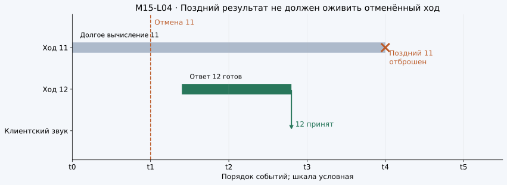

# M15-L04. Поток и перебивание

Версия материала: 1.1.0. Это самостоятельный урок: внешняя проверка наставником необязательна.

> **Версии и дата проверки:** Python 3.11.9, Vosk 0.3.45 и vosk-model-small-ru-0.22; синтез — Windows System.Speech с голосом Microsoft Irina Desktop; в браузере — fetch и AbortController · проверено 04.11.2026 · источник: [MDN: AbortController](https://developer.mozilla.org/docs/Web/API/AbortController)

## Результат и входные знания

После урока ты сможешь: **Спроектировать отмену так, чтобы старый ответ не воспроизвёлся после нового хода.** Перед началом нужны M15-L03: предыдущий шаг модуля. Если термин из этого списка неясен, вернись к соответствующему уроку и воспроизведи его маленький пример. Продолжение по календарю не заменяет понимание зависимости.

## Объяснение

Голосовой диалог состоит из параллельных во времени процессов: пользователь говорит, система распознаёт, модель готовит ответ, синтез создаёт аудио, клиент воспроизводит его. Даже если учебная реализация выполняет некоторые этапы последовательно, события сети и интерфейса могут приходить с задержкой. Поэтому управление только булевым флагом «говорим» быстро становится неоднозначным.

Удобна машина состояний: idle, listening, transcribing, thinking, speaking, cancelled. Переходы происходят по явным событиям: начало записи, конец записи, готовая расшифровка, готовый ответ, начало звука, остановка. Состояние описывает текущий пользовательский ход, а не все фоновые задачи сразу. Каждому ходу присваивается возрастающий turn_id или другой уникальный идентификатор.

Перебивание, barge-in, означает, что пользователь начинает говорить во время ответа системы. Продукт должен остановить текущий звук, отменить или пометить устаревшими связанные вычисления и перейти к новому вводу. На локальном CPU не всегда удаётся мгновенно прервать уже выполняющийся синтез или инференс. Но можно гарантировать, что его поздний результат не будет показан как актуальный.

Для этого каждый фрагмент несёт turn_id. Перед добавлением текста или звука клиент и сервер сравнивают его с активным ходом и списком отменённых. Если ход 7 отменён и активен ход 8, никакой поздний фрагмент 7 не принимается. Это правило действует независимо от порядка завершения вычислений. Оно защищает от гонки, когда старая тяжёлая задача завершилась после новой короткой.

Отмена должна охватывать очереди. Остановить проигрыватель недостаточно, если следующий кусок старого аудио уже лежит в очереди. Нужно очистить или пометить устаревшие элементы, остановить текущий источник и не разрешать новые фрагменты отменённого хода. Аналогично сервер не должен записывать поздний старый ответ как новый вопрос в историю.

Потоковая обработка полезна только при измеримой пользе. Ранний частичный ответ может оказаться неверным после получения всего контекста. Для первой версии тренажёра завершённая реплика с корректной отменой часто полезнее, чем сложный поток с гонками. Дополнительный поток внедряется после проверки порядка событий, границ сегментов и реальной задержки на устройстве.



Сопоставь подписи с примером: объясни величины и укажи, какие отношения показаны на рисунке.

## Разобранный пример

Python-блок выполняй из корня `C:\projects\ml-llm-course` в окружении курса (например, в ячейке Jupyter). Для примеров M15 сначала создай `question.wav` запуском лабораторной.

Последовательность: ход 7 начал TTS; пользователь нажал «прервать»; активным стал ход 8; через 200 мс пришёл аудиофрагмент 7. Он должен быть отброшен.

```python
def accept_chunk(active, chunk_turn, cancelled):
    return chunk_turn == active and chunk_turn not in cancelled

assert not accept_chunk(8, 7, {7})
assert accept_chunk(8, 8, {7})
```

Этот тест проверяет правило принятия. Реальная продуктовая проверка дополнительно должна подтвердить, что уже звучавший звук прекратился и очередь очищена.

## Практика с поддержкой

**Предскажи до запуска.** Прежде чем запускать код или пересчитывать пример, запиши ожидаемый вывод: числа, формы массивов, порядок или текст. После запуска сравни с фактическим и объясни каждое расхождение.

Проследи события на бумаге в двух порядках: старый результат приходит раньше нового и позже нового. Оба случая должны давать одинаковое актуальное состояние. Затем проверь учебный accept_chunk. Не считай этот модуль полным движком отмены: проверка браузерного воспроизведения выполняется в итоговом продукте.

Для технической практики используй [лабораторную M15](../../labs/M15/README.md). Полный код находится отдельно от твоего решения. Сначала предскажи результат одного контрольного случая, затем запусти пример и объясни расхождение, если оно появилось. Запиши команду, версию окружения и фактический вывод, чтобы позже повторить опыт.

## Самостоятельная задача A

Нарисуй временную диаграмму для ходов 11 и 12: LLM11 медленнее LLM12; ход 11 отменён; TTS12 готов; позже TTS11 готов. Опиши состояние истории и очередь аудио после каждого события. Добавь тест на поздний текст, а не только на поздний звук.

Сохрани первую попытку в `submissions/M15-L04.md`: исходные данные, результат и краткое обоснование.

## Подсказки по очереди

1. После отмены 11 активен 12: результат любого этапа 11 считается устаревшим.
2. Проверь два места: добавление текста в историю и добавление звука в очередь.
3. Остановка audioelement не очищает автоматически будущие queued chunks; все они должны пройти проверку turn_id.

## Критерии и типичные ошибки

За объяснение механизма, корректность проверки, воспроизводимость и ограничения поставь по 0–2 балла: 0 — отсутствует или неверно, 1 — частично с помощью, 2 — самостоятельно и обоснованно. Для перехода каждый критерий должен быть выполнен самостоятельно (2); понимание механизма и новая задача обязательны и не компенсируются другими баллами. При помощи сначала отметь «с поддержкой», затем реши вариант B без подсказки. Критических ошибок быть не должно. Критические ошибки: подмена реального измерения выдуманным, использование ответа из решения как собственной первой попытки, вывод о качестве за пределами проверенных данных, нарушение явно заданного ограничения задачи. Исправление должно сопровождаться новым примером, а не только заменой текста отчёта.

Первая самостоятельная попытка выполняется без готового решения. После неё разрешены объяснения AI, подсказки и [полный разбор](../../solutions/modules/M15.md#m15-l04). Отметь полученную помощь. Если решение стало понятно только после разбора, состояние навыка — «с поддержкой»; для самостоятельности реши новый вариант.

## Новая и отложенная проверка

B: очередь содержит audio11, active=11; cancel11; late text11; begin12; audio12; play. Что показать/проиграть? C через неделю: AbortController остановил ожидание, но сервер закончил вычисление позже.

Сохрани новую попытку до просмотра [ключа B/C](../../solutions/modules/M15.md).

## Источники и углубление

- [Официальная документация по теме](https://developer.mozilla.org/en-US/docs/Web/API/AbortController) — сверяй контракт и определения, не копируй внешний пример вместо самостоятельной работы.
- [Исполняемый пример модуля](../../labs/M15/demo.py) — авторский код курса с явно указанными ограничениями.

[Оглавление модуля](../modules/M15.md)
