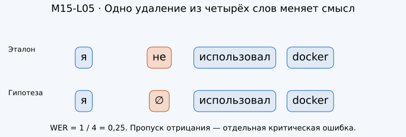

# M15-L05. Речевое оценивание

Версия материала: 1.1.0. Это самостоятельный урок: внешняя проверка наставником необязательна.

> **Версии и дата проверки:** Python 3.11.9, Vosk 0.3.45 и vosk-model-small-ru-0.22; синтез — Windows System.Speech с голосом Microsoft Irina Desktop · проверено 04.11.2026 · источник: [модели Vosk](https://alphacephei.com/vosk/models)

## Результат и входные знания

После урока ты сможешь: **Измерить ошибки распознавания и задержку полного диалога без смешения метрик.** Перед началом нужны M15-L04: предыдущий шаг модуля. Если термин из этого списка неясен, вернись к соответствующему уроку и воспроизведи его маленький пример. Продолжение по календарю не заменяет понимание зависимости.

## Объяснение

Речевой контур оценивается по нескольким независимым свойствам. ASR должен правильно передавать сказанное, TTS — разборчиво произносить ответ, диалог — реагировать на актуальную реплику, а интерфейс — поддерживать паузы и остановку. Одно среднее число не описывает весь продукт. Для каждого свойства заранее выбери наблюдение и способ подсчёта.

WER, word error rate, сравнивает последовательности слов эталона и гипотезы. Минимальное число замен S, удалений D и вставок I делится на число слов N в эталоне: WER=(S+D+I)/N. Это расстояние редактирования, поэтому выравнивание может быть неочевидным. WER бывает больше единицы, если вставок много. Для пустого эталона обычная формула не определена; лабораторная явно отклоняет такой случай.

Нормализация текста является частью метрики. В лабораторной нижний регистр и замена ё на е устраняют некоторые орфографические различия, пунктуация не считается словом. Числа и технические термины требуют отдельного решения: «SQL» и «эс кью эл» могут звучать одинаково, но токенизироваться по-разному. Не меняй нормализацию после просмотра результатов только ради улучшения оценки.

WER не измеряет смысловую опасность ошибки. Пропущенное «не» меняет утверждение, а лишнее «пожалуйста» может почти не влиять на задачу. Поэтому дополни метрику списком критических ошибок: отрицание, число, название технологии, действие или условие. Для интервьюера проверь, меняется ли оценка кандидата после исправления расшифровки.

Задержка диалога отсчитывается от осмысленного события. Например, от конца речи пользователя до начала ответного звука. В неё входят ожидание границы сегмента, ASR, поиск, LLM, TTS, доставка и очередь. Время полного синтеза файла не заменяет time-to-first-audio, а RTF распознавателя не заменяет полную задержку разговора.

Контрольный синтетический пример нужен для проверки установки и воспроизводимого пути, но качество продукта проверяется на живой речи. Сохрани разные уровни шума, пауз, длины и технического словаря. Для маленького набора показывай отдельные ошибки и число записей. Не обещай низкую задержку заранее: ноутбук с CPU и малой VRAM задаёт реальные ограничения, которые нужно измерять.

Для агрегирования WER различай среднее по записям и общее число ошибок, делённое на общее число слов. При втором способе длинные записи имеют больший вес. Если одна короткая запись дала один промах из двух слов, а длинная — один из двадцати, среднее по записям равно 0,275, а объединённая оценка — 2/22≈0,091. Обе величины допустимы, если выбранный смысл и знаменатель явно указаны.



Сопоставь подписи с примером: объясни величины и укажи, какие отношения показаны на рисунке.

## Разобранный пример

Python-блок выполняй из корня `C:\projects\ml-llm-course` в окружении курса (например, в ячейке Jupyter). Для примеров M15 сначала создай `question.wav` запуском лабораторной.

Эталон «я знаю sql», гипотеза «я знаю» дают одно удаление при N=3: WER=1/3. Для эталона «а» и гипотезы «а б в» две вставки дают WER=2. В проверенном TTS→ASR опыте M15 наблюдались две ошибки на семи эталонных словах: WER≈0,286.

```python
from labs.M15.demo import wer
print(wer('я знаю sql', 'я знаю'))
print(wer('а', 'а б в'))
assert wer('я знаю sql', 'я знаю') == 1 / 3
assert wer('а', 'а б в') == 2.0
```

Это результат одной синтетической записи. Он не является оценкой среднего WER для реальных собеседований или подтверждением пригодности ASR к техническим терминам.

## Практика с поддержкой

**Предскажи до запуска.** Прежде чем запускать код или пересчитывать пример, запиши ожидаемый вывод: числа, формы массивов, порядок или текст. После запуска сравни с фактическим и объясни каждое расхождение.

Возьми фактическую гипотезу из report.json и выполни выравнивание вручную. Проверь, какие слова удалены, заменены или добавлены. Затем прочитай исходный текст и гипотезу как ответы кандидата: изменился ли смысл? Это два разных вопроса, и отчёт должен содержать оба ответа.

Для технической практики используй [лабораторную M15](../../labs/M15/README.md). Полный код находится отдельно от твоего решения. Сначала предскажи результат одного контрольного случая, затем запусти пример и объясни расхождение, если оно появилось. Запиши команду, версию окружения и фактический вывод, чтобы позже повторить опыт.

## Самостоятельная задача A

Посчитай WER для «я не использовал docker» и «я использовал docker». Объясни, почему небольшой процент ошибок может исказить оценку кандидата. Затем составь таблицу из пяти этапов задержки с единицами и точками измерения; не подставляй неизмеренные числа.

Сохрани первую попытку в `submissions/M15-L05.md`: исходные данные, результат и краткое обоснование.

## Подсказки по очереди

1. В эталоне четыре слова; отсутствие «не» — одно удаление.
2. WER=1/4, но смысл меняется на противоположный: добавь отдельный признак критической ошибки.
3. Не вычитай несогласованные часы браузера и сервера. Для каждого интервала укажи место измерения и единицу.

## Критерии и типичные ошибки

За объяснение механизма, корректность проверки, воспроизводимость и ограничения поставь по 0–2 балла: 0 — отсутствует или неверно, 1 — частично с помощью, 2 — самостоятельно и обоснованно. Для перехода каждый критерий должен быть выполнен самостоятельно (2); понимание механизма и новая задача обязательны и не компенсируются другими баллами. При помощи сначала отметь «с поддержкой», затем реши вариант B без подсказки. Критических ошибок быть не должно. Критические ошибки: подмена реального измерения выдуманным, использование ответа из решения как собственной первой попытки, вывод о качестве за пределами проверенных данных, нарушение явно заданного ограничения задачи. Исправление должно сопровождаться новым примером, а не только заменой текста отчёта.

Первая самостоятельная попытка выполняется без готового решения. После неё разрешены объяснения AI, подсказки и [полный разбор](../../solutions/modules/M15.md#m15-l05). Отметь полученную помощь. Если решение стало понятно только после разбора, состояние навыка — «с поддержкой»; для самостоятельности реши новый вариант.

## Новая и отложенная проверка

B: эталон «я не использовал docker», гипотеза «я использовал docker». C через неделю: другой ответ потерял одно «ну» из четырёх слов. WER одинаков; равен ли риск?

Сохрани новую попытку до просмотра [ключа B/C](../../solutions/modules/M15.md).

## Источники и углубление

- [Официальная документация по теме](https://alphacephei.com/vosk/models) — сверяй контракт и определения, не копируй внешний пример вместо самостоятельной работы.
- [Исполняемый пример модуля](../../labs/M15/demo.py) — авторский код курса с явно указанными ограничениями.

[Оглавление модуля](../modules/M15.md)
