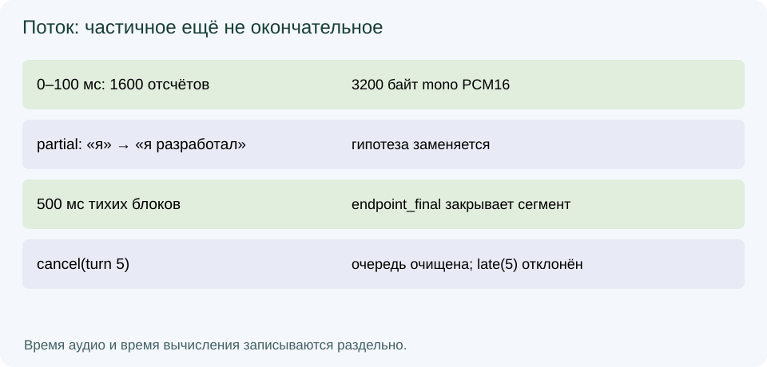

# M15-L06. От WAV к частичным гипотезам и отменяемым фрагментам

Версия 1.1.0. До урока: M15-L05. Начальный ориентир: 210 минут вместе с практикой; измеренное время записывай отдельно.


> **Версии и дата проверки:** Python 3.11.9, Vosk 0.3.45 и vosk-model-small-ru-0.22; синтез — Windows System.Speech с голосом Microsoft Irina Desktop · проверено 04.11.2026 · источник: [модели Vosk](https://alphacephei.com/vosk/models)

## Результат и входные знания

Ты проследишь одну реплику через последовательность аудиоблоков, увидишь меняющуюся гипотезу распознавания и проверишь, что отменённые фрагменты не попадают в воспроизведение. Это небольшой воспроизводимый потоковый опыт, независимый от качества микрофона. Позже тот же вход можно заменить реальной записью.

## Объяснение

### Блок, гипотеза и реплика — разные сущности

При 16 kHz в 100 мс содержатся 1600 отсчётов. Для mono PCM16 это 3200 байт. Этот блок — способ доставки, а не законченное слово или предложение. Граница блока может пересечь звук. Поэтому нельзя распознавать каждый блок как независимый файл: recognizer должен сохранять акустическое состояние между вызовами.

Vosk получает блок через AcceptWaveform. Когда законченного результата ещё нет, PartialResult даёт текущую гипотезу: сначала «я», потом «я разработал», затем более длинную фразу. Частичная гипотеза может переписаться; её не надо безвозвратно добавлять в историю как новый ответ. На endpoint или конце входа FinalResult закрывает распознавание сегмента. В отчёте всегда сохраняется kind события, иначе три partial выглядят как три повторения пользователя.

Завершение по паузе имеет компромисс. Короткий порог раньше начинает ответ, но способен разорвать мысль человека. Длинный порог добавляет ожидание после действительно законченного ответа. В учебной реализации RMS энергии блока сравнивается с порогом 300, а 500 мс тихих блоков после речи закрывают сегмент. Это прозрачный baseline, чувствительный к шуму и громкости, а не готовая промышленная VAD. Дополнительная секунда нулевых отсчётов между фразами делает демонстрацию воспроизводимой.

### Почему одной отмены fetch недостаточно

После отмены часть результата уже могла оказаться в очереди или прийти позже. Поэтому событие имеет идентификатор хода. receive проверяет его при доставке, pop — перед использованием; cancel очищает уже накопленное и меняет активную эпоху. Иначе запрос TTS был отменён, но ранее принятый кусок всё равно звучит.



## Аналогия: TCP-поток и потоковый парсер

Как похоже: границы TCP-пакетов не совпадают с границами сообщений, поэтому потоковый парсер помнит недочитанный хвост прошлого куска. Парсить каждый пакет как отдельный JSON бессмысленно. Пока сообщение не закрыто, индикатор прогресса показывает предварительное значение. А после сброса кэша записи старого поколения отбрасывают по номеру поколения.

| В уроке | В аналогии |
| --- | --- |
| Блок 100 мс = 3200 байт | Пакет TCP: его граница не совпадает с границей сообщения |
| AcceptWaveform с состоянием между вызовами | Потоковый парсер, который помнит хвост прошлого куска |
| Распознавать каждый блок отдельно | Парсить каждый пакет как отдельный JSON |
| PartialResult | Предварительное значение прогресса: ещё изменится |
| FinalResult на endpoint | Сообщение закрыто разделителем |
| 500 мс тишины после речи | Таймаут простоя: данных нет — сообщение считается законченным |
| Эпоха хода в очереди звука | Номер поколения кэша: после сброса старые записи отбрасывают |
| at_ms — время в аудио | Позиция в файле, а не время обработки |

**Где аналогия ломается:** разделитель сообщений в протоколе однозначен, а конец реплики угадывают по паузе: человек может задуматься посреди фразы, и сегмент оборвётся. И предварительное значение протокола только растёт, а гипотеза ASR может переписать уже показанные слова.

## Разобранный пример

### Числа и запуск

```python
rate, milliseconds, bytes_per_sample = 16000, 100, 2
frames = rate * milliseconds // 1000
assert frames == 1600 and frames * bytes_per_sample == 3200
```

```powershell
.\.venv\Scripts\python.exe labs\M15\streaming_lab.py
```

Два фрагмента синтезируются Windows SAPI в настоящие WAV. Затем создаётся единый файл с паузами и передаётся Vosk блоками 100 мс. Отчёт artifacts/M15-stream/report.json содержит временную метку в аудио, kind и текст. Это аудиовремя: обработка файла может идти быстрее или медленнее реальной речи. Поля at_ms нельзя выдавать за задержку вычисления.

AudioQueue далее получает настоящие WAV-байты как фрагменты, но не воспроизводит звук: проверяется допускающий протокол. После cancel старый уже принятый фрагмент удаляется, поздний отклоняется, новый ход принимается. Проверка слышимого воспроизведения выполняется отдельно кнопкой остановки эталонного интерфейса. Не смешивай эти два свидетельства.

[Интерактивный опыт этого урока](../visuals/M15-L06.html): сначала предскажи результат, затем измени условие.

## Практика с поддержкой

**Предскажи до запуска.** Прежде чем запускать код или пересчитывать пример, запиши ожидаемый вывод: числа, формы массивов, порядок или текст. После запуска сравни с фактическим и объясни каждое расхождение.

Найди в отчёте одну цепочку partial и соответствующий endpoint_final. Прослушай локальный WAV и вручную сверяй финальный текст. Сократи pause_ms до 200, затем увеличь до 800; сравни число сегментов, особенно внутри фразы. Сохрани оба отчёта. Если границы не изменились, выбери запись с короткой внутренней паузой — не придумывай эффект ради красивого вывода.

## Самостоятельная задача A — M15-L06-A

В новом WAV есть речь 400 мс, пауза 350 мс, речь 600 мс и тишина 1000 мс. Предскажи сегментацию для порогов 300 и 500 мс. Проверь на собственном составленном WAV и сохрани события. Для очереди дай последовательность begin(5), receive(5,A), cancel(), receive(5,B), begin(7), receive(7,C), pop(). Укажи, какие байты имеют право попасть в воспроизведение.

## Критерии и типичные ошибки

Критерии: partial не записан как несколько окончательных ответов; времени аудио не приписана скорость модели; отмена удаляет и накопленный, и поздний старый результат. Не требуется заранее заданный WER, требуется корректно его измерить.

## Подсказки по очереди

1. Пауза 350 меньше 500, но больше 300.
2. Новый сегмент создаётся после завершения предыдущего recognizer.
3. receive и pop защищают разные моменты жизненного цикла.

## Новая и отложенная проверка

Повтор B: поздний фрагмент нового хода приходит после второй отмены. Через неделю C: источник подаёт stereo PCM16 48 kHz; вычисли размер 100 мс и объясни, почему текущий recognizer должен отклонить формат до запуска. [Ключи](../../solutions/modules/M15.md).

## Источники и углубление

[Официальный пример Vosk](https://github.com/alphacep/vosk-api/blob/master/python/example/test_simple.py), [wave Python 3.11](https://docs.python.org/3.11/library/wave.html). Тестовые фразы синтезированы для курса; это не оценка реальных голосов и шумов.
