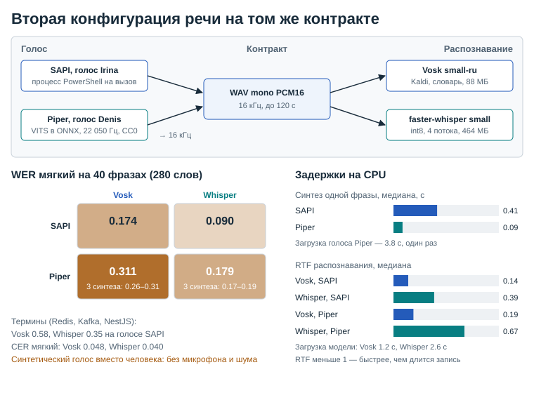
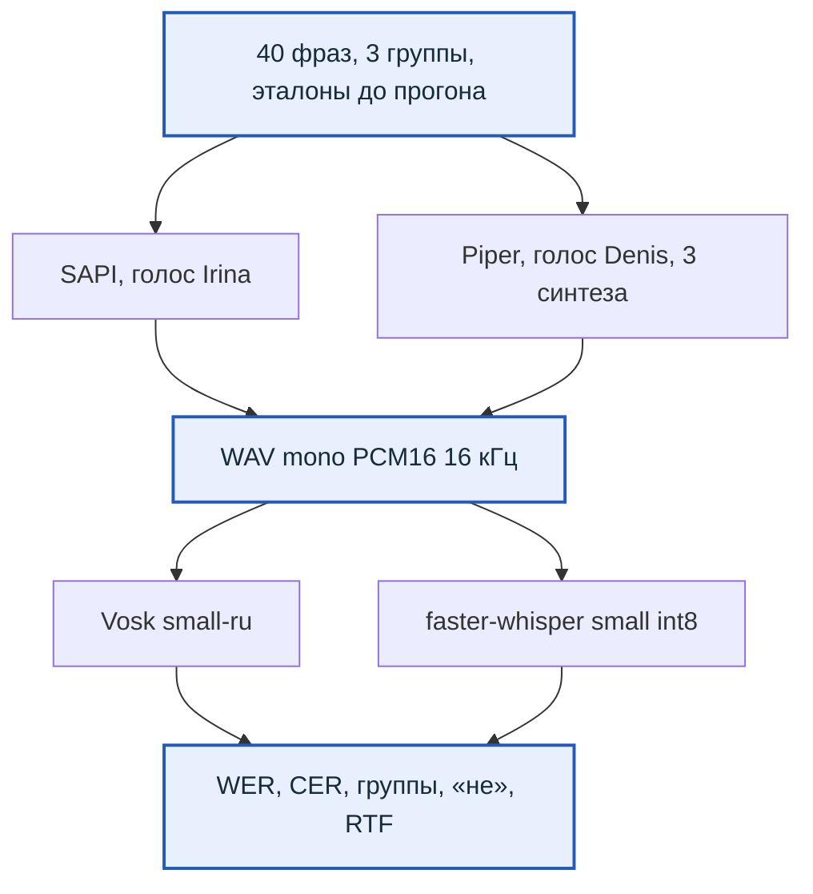

# M15-L07X. Вторая конфигурация речи: faster-whisper и Piper

**Расширение 1.2.0.** Урок дополняет модуль, не входит в обязательный минимум 1.1.0.

**Результат:** собрать вторую конфигурацию речи на том же WAV-контракте, что базовая: Piper для синтеза и faster-whisper для распознавания. Затем сравнить её с Vosk и Windows SAPI на 40 фразах собеседования по WER, CER и задержке и решить, какая часть конвейера где лучше. Нужно понимать, почему прогон на синтетическом голосе ещё не говорит о качестве на живых кандидатах.

**До урока:** M15-L02, M15-L03, M15-L05. Тесты и отчёт работают без моделей. Прогон требует пакеты `faster-whisper` и `piper-tts` (`requirements-optional.in`) и модели из `tools\download_models.py --speech-extra`, около 0.55 ГБ. На CPU прогон занимает около восьми минут. Ориентир — 150 минут чтения, прогона и задачи; это плановая гипотеза, а не измеренное время.

> **Версии и дата проверки:** Python 3.11.9; Vosk 0.3.45 и vosk-model-small-ru-0.22; faster-whisper 1.2.1 (CTranslate2 4.8.5), модель faster-whisper-small (ревизия 536b066) в int8; piper-tts 1.8.0 (onnxruntime 1.31.1), голос ru_RU-denis-medium; Windows System.Speech, голос Microsoft Irina Desktop · проверено 09.11.2026 · источник: [faster-whisper](https://github.com/SYSTRAN/faster-whisper)

## Объяснение

### Две конфигурации на одном контракте

Базовая конфигурация M15: Windows SAPI с голосом Irina синтезирует речь, Vosk small-ru её распознаёт. Между ними контракт из `projects/interview_trainer/speech.py`: WAV mono, PCM16, 16 кГц, не длиннее 120 секунд, текст от 1 до 4000 символов. Вторая конфигурация соблюдает тот же контракт, поэтому подключается без переделки приложения:
- **Piper** синтезирует речь моделью VITS в формате ONNX. Текст сначала переводится в фонемы через espeak-ng. Голос ru_RU-denis-medium говорит с частотой 22 050 Гц, и модуль `speech_alt.py` пересчитывает звук в 16 кГц.
- **faster-whisper** — это Whisper, переписанный на CTranslate2. Модель small весит 464 МБ и загружается в int8: веса хранятся 8-битными целыми, и считает она быстрее. Используются 4 потока CPU.

В приложении конфигурация выбирается флагами `--asr whisper` и `--tts piper`. По умолчанию остаются Vosk и SAPI, и их тесты проходят без изменений.

### Чем движки отличаются по устройству

- **Vosk** — модель Kaldi с фиксированным словарём и языковой моделью, 88 МБ. Она выдаёт только слова из своего словаря, кириллицей и без цифр. Зато распознаёт поток кусками и отдаёт частичные гипотезы, как в M15-L06.
- **Whisper** — Transformer «кодировщик — декодировщик», он генерирует текст токен за токеном. Пишет пунктуацию, цифры и латиницу, но обрабатывает окно до 30 секунд целиком и потоковых частичных гипотез сам не даёт. Как любой генератор, он может написать то, чего в записи не было.
- **SAPI** — системный голос Windows. В проекте каждый вызов запускает отдельный процесс PowerShell, и это время входит в задержку.
- **Piper** работает в процессе Python, голос загружается один раз. Модель подмешивает случайный шум, поэтому один и тот же текст каждый раз звучит немного по-разному. Две подряд синтезированные фразы «Повторный запрос не должен создавать второй заказ.» получились разной длины.

### Как сравнивать

Набор — 40 фраз собеседования, 280 слов, `data/speech/phrases-ru.json`. Фразы разбиты на три группы: 24 общих, 8 с числами и 8 с техническими терминами. Каждая фраза проходит через оба голоса и оба распознавателя, это 4 пары.

**WER** = (S + D + I) / N, где S — замены, D — пропуски, I — вставки слов, N — слов в эталоне. Он считается по всему набору сразу, а не как среднее по фразам. Численный пример: Whisper на голосе SAPI сделал 27 замен, 3 пропуска и 3 вставки, WER = 33 / 280 ≈ 0.118.

Эталонов два вида, и оба записаны до прогона:
- **строгий** — первый эталон, числа словами и термины латиницей;
- **мягкий** — лучший из альтернатив: «200» вместо «двухсот», «редис» вместо «Redis».

**CER** считается так же, но по символам. Для русского языка он мягче: «изменения применятся» и «изменение применится» по WER дают две ошибки, по CER — две буквы.

**Задержка** — это RTF (время обработки, делённое на длительность аудио, как в M15-L02) и медиана секунд на фразу. Загрузка модели — холодный старт — измеряется отдельно.

### Почему синтетика — не бенчмарк

Авторский прогон заменяет человека синтетическим голосом. Аудио чистое: нет микрофона, шума, акцента и запинок. Кроме того, голос сам влияет на результат: если Piper произносит слово неразборчиво, ошибётся любой распознаватель. Поэтому распознаватели честно сравниваются только внутри одного голоса, а строка Piper измеряет вместе и синтез, и распознавание. Качество на живых кандидатах проверяет задача A на собственных записях.

**Лицензии.** Модель Vosk — Apache-2.0, faster-whisper и веса Whisper — MIT, движок piper-tts — GPL-3.0 (он ставится необязательно, только для локального использования). У голоса Denis данные под CC0. Голос Irina в Piper не выбран: в его описании лицензия данных указана как Unknown.



Сопоставь рисунок с таблицей авторского прогона: какой распознаватель точнее на каждом голосе и чем за это платит.

## Аналогия: второй адаптер за тем же портом

Backend-разработчик знает архитектуру портов и адаптеров. Один интерфейс репозитория, за ним два адаптера: к PostgreSQL и к MongoDB. Перед переключением их сравнивают на записанном трафике.

| В уроке | В аналогии |
| --- | --- |
| Контракт WAV mono PCM16 16 кГц | Интерфейс репозитория |
| `speech_alt.py` рядом с `speech.py` | Второй адаптер того же порта |
| Флаги `--asr` и `--tts` | Конфигурация выбора драйвера |
| 40 фраз и WER | Регрессионный прогон на записанных запросах |
| RTF и холодный старт | Задержка запроса и прогрев пула соединений |
| Синтетический голос вместо человека | Нагрузочный тест на синтетическом трафике |

**Где аналогия ломается:** записанный трафик одинаков для обоих адаптеров. Здесь вход зависит от синтеза: у Piper он меняется от запуска к запуску. И ошибки не равноценны: одна вставленная частица «не» стоит одно слово WER, но переворачивает смысл ответа кандидата.

## Разобранный пример

Python-блок выполняй из корня `C:\projects\ml-llm-course` в окружении курса. Модели для него не нужны. Пример пересчитывает WER из замен, пропусков и вставок, сравнивает строгий и мягкий эталон на числах и проверяет ошибку, меняющую смысл.

```python
import importlib.util
import json
from pathlib import Path

spec = importlib.util.spec_from_file_location("speech_compare", "labs/M15/speech_compare.py")
lab = importlib.util.module_from_spec(spec)
spec.loader.exec_module(lab)
report = json.loads(Path("quality/speech/report.json").read_text(encoding="utf-8"))

cell = report["cells"]["sapi->whisper"]
s, d, i, n = (cell["strict"][k] for k in ("s", "d", "i", "words"))
assert round((s + d + i) / n, 4) == cell["strict"]["wer"]  # WER = (S + D + I) / N over the whole set

row = next(r for r in cell["rows"] if r["id"] == "n01")
print(row["hyp"], lab.score(next(p for p in lab.phrases() if p["id"] == "n01"), row["hyp"]))

t04 = {key: next(r["hyp"] for r in c["rows"] if r["id"] == "t04") for key, c in report["cells"].items()}
for key, hyp in t04.items():
    print(f"{key:15} {lab.negation_mismatch('Я писал бэкенд на NestJS и TypeScript.', hyp)!s:5} {hyp}")
assert lab.negation_mismatch("Я писал бэкенд на NestJS и TypeScript.", t04["sapi->vosk"])  # «не» was inserted
```

Whisper записал «Время ответа упала с 200 до 90 мс.». По строгому эталону это четыре замены: две цифры вместо слов, «мс» вместо «миллисекунд» и «упала» вместо «упало». По мягкому эталону остаются две. Правило нормализации меняет WER сильнее, чем иная смена модели, поэтому его записывают до прогона. «NestJS» на голосе SAPI оба распознавателя услышали с частицей «не», которой в эталоне не было.

### Авторский прогон 09.11.2026

```powershell
.\.venv\Scripts\python.exe -m pip install -r requirements-optional.in
.\.venv\Scripts\python.exe tools\download_models.py --speech-extra
.\.venv\Scripts\python.exe labs\M15\speech_compare.py run
.\.venv\Scripts\python.exe labs\M15\speech_compare.py report
```

Голос → распознавание, мягкий эталон, 40 фраз:

| Пара | WER | CER | Общие | Числа | Термины | RTF |
| --- | --- | --- | --- | --- | --- | --- |
| SAPI → Vosk | 0.174 | 0.048 | 0.099 | 0.091 | 0.578 | 0.14 |
| SAPI → Whisper | 0.090 | 0.040 | 0.038 | 0.057 | 0.349 | 0.39 |
| Piper → Vosk | 0.311 | 0.125 | 0.275 | 0.164 | 0.651 | 0.19 |
| Piper → Whisper | 0.179 | 0.067 | 0.093 | 0.170 | 0.533 | 0.67 |

Синтез одной фразы, медиана: SAPI — 0.41 с, Piper — 0.09 с. Голос Piper загружается один раз, первый вызов занимает 3.8 с. Первый вызов распознавания вместе с загрузкой модели — 1.2 с у Vosk и 2.6 с у Whisper.

Что показал прогон:
- **Whisper точнее Vosk на обоих голосах.** На голосе SAPI WER вдвое ниже: 0.090 против 0.174, на общих фразах — 0.038 против 0.099. Цена — скорость: RTF 0.39 против 0.14 при четырёх потоках против одного. Обе модели успевают быстрее, чем длится запись.
- **Речь Piper распознаётся хуже, чем речь SAPI, любым распознавателем.** Синтез Piper случаен, поэтому все 40 фраз синтезированы трижды. WER Vosk на трёх синтезах — от 0.257 до 0.311, Whisper — от 0.173 до 0.193. Каждое значение выше, чем у того же распознавателя на голосе SAPI. Первый прогон, ещё без повторных синтезов, дал 0.264 и 0.169. Вывод от случайности не зависит, а вот одно число для Piper без разброса ничего не значит.
- **Piper синтезирует почти в пять раз быстрее SAPI.** После загрузки голоса медиана 0.09 с на фразу против 0.41 с. Около 0.27 с из времени SAPI занимает запуск процесса PowerShell с загрузкой System.Speech: автор замерил его отдельно. 95-й процентиль у SAPI доходит до 2.4 с. Piper к тому же работает не только в Windows, а SAPI — только в ней.
- **Термины — слабое место обоих.** Vosk не умеет писать латиницу: «PostgreSQL» он записал как «пост в г и рыл». Whisper пишет латиницу («TypeScript», «React»), но на группе терминов его WER всё равно 0.35. Для собеседования по backend это главный риск: ошибаются как раз в словах, которые оценивает интервьюер.
- **Нормализация решает не меньше модели.** На числах строгий WER Whisper — 0.200, мягкий — 0.057: он пишет цифры. У Vosk строгий и мягкий совпадают, он пишет числа словами. Даже в общей фразе Whisper записал «за 2 спринта», и строгий эталон счёл это ошибкой.
- **CER мягче WER в 2–4 раза.** Whisper на голосе Piper записал «изменение применится» вместо «изменения применятся»: по смыслу верно, но WER насчитал ошибки в формах слов. Для русского языка CER честнее показывает разборчивость, а WER — готовность текста к поиску по словам.
- **Вставленное «не».** «NestJS» на голосе SAPI превратилось у Vosk в «не та», у Whisper — в «не здеший». В этой фразе смысл не перевернулся, но в ответе кандидата такая вставка перевернёт его. Отчёт отдельно считает фразы, где число «не», «нет» и «ни» не совпало с эталоном.

У автора весь прогон занял около восьми минут, из них больше половины — Whisper на четырёх наборах аудио.

## Схема



Сравнение двух конфигураций на одном контракте. Фразы и правила эталонов записаны до прогона. Каждый голос синтезирует все фразы в WAV одного формата, и каждый распознаватель получает оба набора аудио. Синтез Piper повторяется трижды, потому что он случаен. Измеряются WER и CER по всему набору и по группам, расхождения в отрицаниях и задержка с отдельным холодным стартом. Выделены набор, контракт и метрики: без них сравнение движков превращается в сравнение условий.

## Практика с поддержкой

**Предскажи до запуска.** Запиши ожидаемый вывод до запуска кода. Какой распознаватель точнее и насколько? Какая группа фраз самая трудная? Чей синтез быстрее и почему? Совпадут ли числа для Piper при повторном запуске? После запуска сравни с фактическим и объясни каждое расхождение.

1. Выполни `.\.venv\Scripts\python.exe labs\M15\speech_compare.py report` и сверь таблицу с авторским прогоном.
2. В `quality/speech/report.json` найди фразы группы `terms` для пары `sapi->vosk` и `sapi->whisper`. Какие термины распознал хотя бы один движок?
3. Найди `piper_samples` и объясни, почему для SAPI таких выборок нет.
4. Если модели скачаны, запусти тренажёр со второй конфигурацией: `.\.venv\Scripts\python.exe -m projects.interview_trainer.app --asr whisper --tts piper`. Сравни время ответа `/asr` в интерфейсе с базовой конфигурацией.

## Самостоятельная задача A — M15-L07X-A

Проверь конфигурации на своём голосе. Запиши не меньше 30 фраз из `data/speech/phrases-ru.json`, по возможности из всех трёх групп. Подойдёт любой записывающий инструмент, который сохраняет WAV PCM16, частота и число каналов любые. Положи файлы в папку вместе с `manifest.csv` с колонками `file,id`. Запусти `.\.venv\Scripts\python.exe labs\M15\speech_compare.py own <папка>`. Сравни Vosk и Whisper на своём голосе по WER, CER и группам, найди фразы с расхождением в «не» и сопоставь всё это с синтетическим прогоном. Реши, какую конфигурацию распознавания взять в тренажёр и почему.

## Подсказки по очереди

1. Строка манифеста выглядит так: `g01.wav,g01`. Id берутся из файла фраз, а текст эталона лабораторная подставит сама.
2. Запиши хотя бы одну фразу в тихой комнате и одну — с бытовым шумом, и пометь их для себя.
3. Сводку отчёта даёт `lab.summary(report)`, где `report` — прочитанный `artifacts/M15/speech-own/report.json`.
4. Сравнивай распознаватели только на одних и тех же записях, а синтетику и свой голос — как разные условия, а не как разные модели.

## Критерии и типичные ошибки

**Критерии до попытки:** обе конфигурации соблюдают один контракт WAV. Эталоны и правила нормализации записаны до прогона. WER посчитан по всему набору с разбивкой на замены, пропуски и вставки, рядом стоит CER. Холодный старт отделён от рабочей задержки. Случайный синтез повторён несколько раз. Синтетический прогон назван синтетическим. Для самостоятельного зачёта объясни без открытого кода, чем строгий эталон отличается от мягкого, и посчитай WER по числу замен, пропусков и вставок.

**Типичные ошибки:** сравнивать распознаватели на разных голосах и приписывать разницу модели; придумывать правило нормализации после того, как увидел результат; считать WER как среднее по фразам; включать загрузку модели в задержку каждой фразы; объявлять Piper лучше или хуже по одному синтезу; выдавать синтетический прогон за качество на кандидатах; не смотреть на отрицания.

## Новая и отложенная проверка

**Повтор B:** у пары Piper → Whisper по строгому эталону 44 замены, 7 пропусков и 6 вставок на 280 словах. Посчитай WER. Фраза длится 3 секунды. Сколько ждать распознавания при RTF 0.67 у Whisper и при RTF 0.19 у Vosk? Сколько добавит холодный старт, если модель загружается на первом запросе? **Отложенная C:** спроектируй речевую часть тренажёра для работы. Кто распознаёт частичные гипотезы для перебивания из M15-L06, кто пишет итоговую расшифровку ответа, кто озвучивает вопросы. Как ты защитишься от вставленного или потерянного «не» и как проверишь синтез на людях, а не на распознавателе. [Ключи](../../solutions/modules/M15.md) открывай после сохранения попытки.

## Карточка урока

| Поле | Содержание |
| --- | --- |
| Правило | Вторая конфигурация подключается за тем же контрактом и сравнивается на одном наборе с эталонами, записанными до прогона. WER считается по всему набору, рядом CER и группы. Холодный старт отдельно. Случайный синтез повторяется. Синтетика — не бенчмарк на людях |
| Смысл величин | WER = (S + D + I) / N по словам, CER — то же по символам. RTF — время обработки на секунду аудио. Холодный старт — загрузка модели на первом вызове |
| Когда применять | Перед сменой движка речи. Пример: на голосе SAPI Whisper дал WER 0.090 против 0.174 у Vosk при RTF 0.39 против 0.14. Piper синтезирует фразу за 0.09 с против 0.41 у SAPI, но его речь распознаётся хуже на всех трёх синтезах |
| Главная ошибка | Сравнивать движки в разных условиях и подбирать нормализацию после результата |

## Источники и углубление

Статья [Robust Speech Recognition via Large-Scale Weak Supervision](https://arxiv.org/abs/2212.04356) (Radford и др., 2022) — модель Whisper. Реализация [faster-whisper](https://github.com/SYSTRAN/faster-whisper) на CTranslate2. Движок синтеза [Piper](https://github.com/OHF-Voice/piper1-gpl) и [голоса Piper](https://huggingface.co/rhasspy/piper-voices). [Модели Vosk](https://alphacephei.com/vosk/models). В курсе: WER и RTF — M15-L02, синтез и доставка — M15-L03, речевое оценивание — M15-L05, частичные гипотезы и перебивание — M15-L06.
