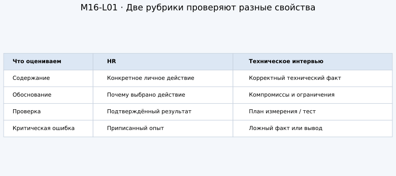

# M16-L01. Требования и две рубрики

Версия материала: 1.1.0. Это самостоятельный урок: внешняя проверка наставником необязательна.

> **Версии и дата проверки:** Python 3.11.9, стандартная библиотека; продукт курса — Qwen2.5-0.5B-Instruct (ревизия 7ae5576) через transformers 4.57.6 и PyTorch 2.15.0+cpu, поиск TF-IDF из scikit-learn 1.9.1, Vosk 0.3.45 и vosk-model-small-ru-0.22, Windows System.Speech с голосом Microsoft Irina Desktop · проверено 04.11.2026 · источник: [карточка Qwen2.5-0.5B-Instruct](https://huggingface.co/Qwen/Qwen2.5-0.5B-Instruct)

## Результат и входные знания

После урока ты сможешь: **Зафиксировать границы продукта и отдельные критерии HR и технического интервью.** Перед началом нужны Все предыдущие модули; есть рабочие артефакты и самостоятельные попытки. Если термин из этого списка неясен, вернись к соответствующему уроку и воспроизведи его маленький пример. Продолжение по календарю не заменяет понимание зависимости.

## Объяснение

Итоговый тренажёр предназначен для практики, а не для автоматического решения о найме. Пользователь выбирает тип интервью, отвечает голосом или текстом и получает объяснимую обратную связь. Ценность продукта состоит в возможности безопасно повторять попытки, замечать пробелы и улучшать ответы. Поэтому требования должны описывать учебный результат, а не обещать точное предсказание будущего трудоустройства.

HR и техническое интервью проверяют разные свойства. В HR-ответе полезны ясность, конкретность личного действия и аргументация. Технический ответ требует корректности, понимания компромиссов и способа проверить решение. Хорошая структура рассказа не компенсирует неверное объяснение транзакции. И наоборот, технически верная формулировка не делает рассказ о собственном опыте конкретным.

Рубрика задаёт наблюдаемые признаки каждого уровня. Например, конкретность 0 означает отсутствие примера,1 — пример без ясного личного действия,2 — определённое действие и результат с указанными ограничениями. Числа нужны для сравнения попыток, но не являются объективной мерой ценности человека. Каждый балл сопровождается фрагментом ответа и следующим упражнением.

Критические ошибки указываются отдельно. Если обратная связь приписывает кандидату опыт, которого он не называл, красивое оформление не делает её приемлемой. Если техническое объяснение содержит ложный факт, высокая оценка ясности не компенсирует его. Поэтому не своди все измерения в одну сумму без правил блокировки. Для самостоятельного проекта достаточно нескольких ясных критериев и примеров уровней.

Требования включают и взаимодействие: начало сессии, выбор направления, ограничение числа вопросов, возможность завершить, исправить расшифровку и повторить попытку. Для голоса необходимы понятное состояние записи, воспроизведение актуальной реплики и остановка. Ограничения оборудования входят в документ: локальные модели имеют измеренные задержки, а текстовый режим помогает продолжить при проблеме звука.

Перед разработкой приёмочных тестов перечисли то, что продукт действительно обещает. Не включай без доказательств распознавание эмоций, личности или профессионального уровня по голосу. Система оценивает содержимое ответа по явной рубрике. Это делает обратную связь проверяемой и соответствует учебной задаче. Изменение обещаний продукта должно менять и набор проверок.



Сопоставь подписи с примером: объясни величины и укажи, какие отношения показаны на рисунке.

## Аналогия: техзадание с двумя независимыми ревью

Как похоже: перед выпуском сервиса проходят дизайн-ревью и ревью безопасности, и отличный интерфейс не компенсирует уязвимость. Критерии приёмки пишут как «дано — когда — тогда», а не «сделать хорошо». В SLA не вписывают то, что мониторинг не измеряет. А при отказе зависимости сервис переходит в упрощённый режим, а не падает.

| В уроке | В аналогии |
| --- | --- |
| Требования продукта | Техзадание с критериями приёмки |
| HR-рубрика и техническая рубрика | Два независимых ревью: дизайн и безопасность |
| Уровни 0, 1, 2 с признаками | Критерии «дано — когда — тогда» вместо «сделать хорошо» |
| Критическая ошибка блокирует | Уязвимость блокирует релиз при любом качестве интерфейса |
| Не обещать распознавание эмоций | Не вписывать в SLA то, что мониторинг не измеряет |
| Текстовый режим при проблеме звука | Деградация функциональности: при отказе работает упрощённый режим |
| Изменение обещаний меняет проверки | Новое требование в ТЗ — новый приёмочный тест |

**Где аналогия ломается:** критерии приёмки сервиса проверяет автоматический тест. Балл по рубрике ставит человек или модель, и это суждение со своей ошибкой, поэтому каждый балл сопровождается цитатой из ответа. И ТЗ описывает поведение программы, а рубрика — ответ живого человека, которого нельзя оценивать как личность.

## Разобранный пример

Python-блок выполняй из корня `C:\projects\ml-llm-course` в окружении курса (например, в ячейке Jupyter).

HR-ответ:«Мы ускорили сервис». По критерию конкретности это недостаточно: неясны действие автора, измерение и условия. Уточнение:«Какую часть изменения сделали лично вы и как измерили результат?» Технический ответ:«Добавлю индекс». Здесь уточняются фильтр запроса, план выполнения и стоимость записи.

```python
rubrics = {
    'hr': ['clarity', 'specificity', 'reasoning'],
    'technical': ['correctness', 'tradeoffs', 'verification'],
}
```

Одинаковое число критериев не означает одинаковый смысл. Лабораторная M16 отклоняет HR-набор полей, ошибочно помеченный как technical.

## Практика с поддержкой

**Предскажи до запуска.** Прежде чем запускать код или пересчитывать пример, запиши ожидаемый вывод: числа, формы массивов, порядок или текст. После запуска сравни с фактическим и объясни каждое расхождение.

Возьми один собственный ответ и оцени его дважды: по HR и по технической рубрике. Объясни, почему часть критериев неприменима без контекста вопроса. Затем выбери правильный тип сессии и оставь только соответствующую рубрику. Балл должен опираться на наблюдаемое содержание.

Для технической практики используй [лабораторную M16](../../labs/M16/README.md). Полный код находится отдельно от твоего решения. Сначала предскажи результат одного контрольного случая, затем запусти пример и объясни расхождение, если оно появилось. Запиши команду, версию окружения и фактический вывод, чтобы позже повторить опыт.

## Самостоятельная задача A

Напиши по одному ответу уровней 0,1,2 для HR-конкретности и технической проверки решения. Для каждого приведи доказательство из текста и одно следующее действие. Затем сформулируй три обязательных требования к голосовому интерфейсу и критерий их приёмки.

Сохрани первую попытку в `submissions/M16-L01.md`: исходные данные, результат и краткое обоснование.

## Подсказки по очереди

1. Для конкретности ищи пример и личное действие; для технической проверки — метод измерения результата.
2. Не оценивай уверенность голоса или личность: критерии относятся к содержанию ответа.
3. Приёмочный тест интерфейса должен наблюдать запись, исправление текста и реальную остановку звука.

## Критерии и типичные ошибки

За объяснение механизма, корректность проверки, воспроизводимость и ограничения поставь по 0–2 балла: 0 — отсутствует или неверно, 1 — частично с помощью, 2 — самостоятельно и обоснованно. Для перехода каждый критерий должен быть выполнен самостоятельно (2); понимание механизма и новая задача обязательны и не компенсируются другими баллами. При помощи сначала отметь «с поддержкой», затем реши вариант B без подсказки. Критических ошибок быть не должно. Критические ошибки: подмена реального измерения выдуманным, использование ответа из решения как собственной первой попытки, вывод о качестве за пределами проверенных данных, нарушение явно заданного ограничения задачи. Исправление должно сопровождаться новым примером, а не только заменой текста отчёта.

Первая самостоятельная попытка выполняется без готового решения. После неё разрешены объяснения AI, подсказки и [полный разбор](../../solutions/modules/M16.md#m16-l01). Отметь полученную помощь. Если решение стало понятно только после разбора, состояние навыка — «с поддержкой»; для самостоятельности реши новый вариант.

## Новая и отложенная проверка

B: ответ «индекс всегда ускоряет все запросы» уверенно и подробно оформлен. Можно ли компенсировать ошибку ясностью? C через неделю: HR-ответ краткий, но содержит конкретное личное действие; следует ли автоматически снизить конкретность за длину?

Сохрани новую попытку до просмотра [ключа B/C](../../solutions/modules/M16.md).

## Карточка урока

| Поле | Содержание |
| --- | --- |
| Правило | Требования описывают учебный результат и взаимодействие; HR оценивают по ясности, конкретности и аргументации, технику — по корректности, компромиссам и проверке; каждый балл 0–2 сопровождается фрагментом ответа и следующим упражнением; критическая ошибка блокирует при любой сумме |
| Смысл величин | Уровни рубрики — наблюдаемые признаки, а не мера ценности человека; продукт не обещает распознавать эмоции, личность или уровень по голосу; ограничения оборудования и текстовый режим — часть требований; изменение обещаний меняет набор приёмочных проверок |
| Когда применять | При фиксации границ продукта. Пример: HR-ответ «Я перевёл выгрузку отчётов на пакетную обработку и сравнил время до и после на копии базы» — конкретность 2: личное действие и способ проверки; технический ответ «Кэш снимает нагрузку» без условий инвалидации — корректность 1, проверка 0 |
| Главная ошибка | Свести все измерения в одну сумму без правил блокировки или оценивать человека вместо содержания ответа |

## Источники и углубление

- [Официальная документация по теме](https://www.nist.gov/itl/ai-risk-management-framework) — сверяй контракт и определения, не копируй внешний пример вместо самостоятельной работы.
- [Исполняемый пример модуля](../../labs/M16/demo.py) — авторский код курса с явно указанными ограничениями.

[Оглавление модуля](../modules/M16.md)
