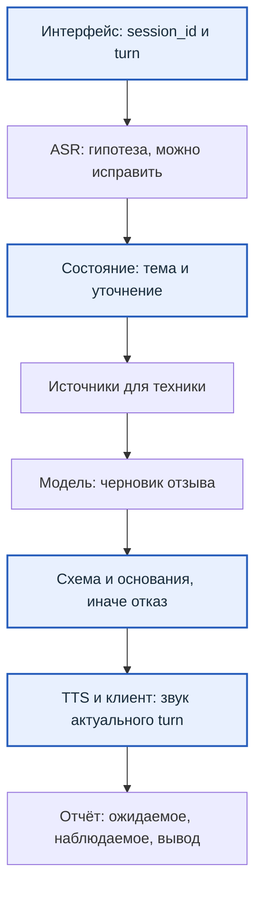

# M16-L02. Интеграция и независимая проверка

Версия материала: 1.1.0. Это самостоятельный урок: внешняя проверка наставником необязательна.

> **Версии и дата проверки:** Python 3.11.9, стандартная библиотека; продукт курса — Qwen2.5-0.5B-Instruct (ревизия 7ae5576) через transformers 4.57.6 и PyTorch 2.15.0+cpu, поиск TF-IDF из scikit-learn 1.9.1, Vosk 0.3.45 и vosk-model-small-ru-0.22, Windows System.Speech с голосом Microsoft Irina Desktop · проверено 04.11.2026 · источник: [карточка Qwen2.5-0.5B-Instruct](https://huggingface.co/Qwen/Qwen2.5-0.5B-Instruct)

## Результат и входные знания

После урока ты сможешь: **Проверить полный пользовательский путь и отделить интеграционные факты от оценок качества.** Перед началом нужны M16-L07: состояние и ограниченные уточнения. Если термин из этого списка неясен, вернись к соответствующему уроку и воспроизведи его маленький пример. Продолжение по календарю не заменяет понимание зависимости.

## Объяснение

Интеграция соединяет компоненты в работающий путь: интерфейс получает запись, сервер распознаёт речь, сценарий обновляет состояние, поиск подбирает источник, модель формирует ответ, синтез создаёт звук, клиент воспроизводит его. Успешные отдельные лабораторные не гарантируют, что эти соединения правильны. Ошибки часто находятся на границе форматов, идентификаторов и ожиданий.

Начни с минимального сквозного сценария. Создай сессию, выбери направление, получи вопрос, отправь короткий ответ, прочитай обратную связь и заверши интервью. Затем повтори с голосом. Сохраняй входы, release_id и наблюдаемые результаты, чтобы при дефекте воспроизвести его. Не меняй сразу несколько компонентов после первой ошибки: это затрудняет поиск причины.

Независимая проверка означает, что итоговые случаи не использовались для настройки формулировок и параметров. Для HR и технического режима подготовь разные наборы с понятными ожидаемыми свойствами. Включи сильный ответ, частичный ответ, уверенную ошибку, отсутствие информации и просьбу завершить. Для технических объяснений добавь проверяемый источник. Не делай тестом точное совпадение единственной красивой фразы.

Проверяй позитивные и негативные пути. Невалидный JSON, неизвестная сессия, пустой ответ, отсутствующая модель и ошибка ASR должны приводить к понятному состоянию, а не к зависшему экрану. Если локальная модель не загружена, продукт должен честно сообщить о невозможности соответствующего действия. Сценарная заглушка не считается доказательством работы реальной LLM, даже когда она помогает отладить интерфейс.

Учебный эталон находится в projects/interview_trainer. Его README содержит актуальную команду запуска и ограничения. Запуск эталона подтверждает возможность пройти путь на данном окружении, но не заменяет самостоятельную разработку и защиту решений. Для портфолио важно объяснить, какие части написаны учеником, что использовано готовым и какие изменения проверены независимо.

Отчёт об интеграции разделяет три колонки: ожидаемое, наблюдаемое, вывод. Если не было реального микрофонного ввода, нельзя отмечать его как пройденный по синтетическому WAV. Если проверено только отклонение неправильной рубрики, нельзя объявлять справедливой всю обратнуюсвязь. Такое разделение помогает завершать оставшиеся проверки без ложного ощущения готовности.


Сопоставь подписи с примером: объясни величины и укажи, какие отношения показаны на рисунке.

## Аналогия: e2e-тесты микросервисов и mock платёжного шлюза

Как похоже: юнит-тесты каждого микросервиса зелёные, а пользовательский путь ломается на границе — консьюмер ждёт userId, провайдер шлёт user_id. Поэтому есть e2e-тест всего пути. Mock платёжного шлюза помогает отладить интерфейс, но реальную оплату не проверяет. А в отчёте о тестировании «не запускали» никогда не превращается в «прошло».

| В уроке | В аналогии |
| --- | --- |
| Отдельные лабораторные | Юнит-тесты каждого микросервиса |
| Сквозной сценарий | E2E-тест пользовательского пути через все сервисы |
| Ошибки на границе форматов и ID | Консьюмер ждёт userId, провайдер шлёт user_id |
| Независимые итоговые случаи | Приёмочный набор, который не подгоняли под реализацию |
| Сценарная заглушка вместо LLM | Mock платёжного шлюза: интерфейс отлажен, оплата не проверена |
| Понятное состояние при отказе модели | «Сервис временно недоступен» вместо вечного спиннера |
| Колонки ожидаемое, наблюдаемое, вывод | Отчёт о тестировании, где «не запускали» не равно «прошло» |

**Где аналогия ломается:** e2e-тест микросервисов проверяет детерминированные ответы, и зелёный прогон — точный факт. В тренажёре HTTP 200 и точный ASR — только интеграционные факты: модель может уверенно сказать неверное, и полезность совета оценивают отдельно, вручную.

## Разобранный пример

M16demo валидирует два явно синтетических примера и отвергает смешение рубрик. Он также показывает наличие отчётов M12–M15. Это проверка структуры свидетельств; отсутствующий отчёт означает «не найден», а существующий файл ещё нужно прочитать.

```powershell
.\.venv\Scripts\python.exe labs\M16\demo.py
```

Следующий обязательный шаг — запуск реального приложения по инструкции в projects/interview_trainer/README.md и прохождение обоих направлений в браузере. Не засчитывай этот шаг только по лабораторному JSON.

## Схема



Сквозной путь одного хода в продукте. На каждой границе передаются идентификаторы и формат: session_id и turn идут от интерфейса до звука, состояние интервью решает, какая тема и нужно ли уточнение, технический режим добавляет источники. Ответ модели проходит проверку схемы и оснований; при провале показывается явный отказ, а не убедительный текст. Звук принимается только для актуального turn. Отчёт об интеграции разделяет ожидаемое, наблюдаемое и вывод: HTTP 200 и точный ASR — интеграционные факты, а полезность и правильность совета оценивают отдельно, вручную. Выделены границы, где проверяются идентификаторы и контракты.

## Практика с поддержкой

**Предскажи до запуска.** Прежде чем запускать код или пересчитывать пример, запиши ожидаемый вывод: числа, формы массивов, порядок или текст. После запуска сравни с фактическим и объясни каждое расхождение.

Сначала пройди только текстовый сценарий и зафиксируй сессию. Затем включи голос с тем же смысловым ответом. Если результат отличается, отдельно проверь расшифровку и параметры запроса. Это позволяет локализовать ошибку до смены модели или переписывания сценария.

Для технической практики используй [лабораторную M16](../../labs/M16/README.md). Полный код находится отдельно от твоего решения. Сначала предскажи результат одного контрольного случая, затем запусти пример и объясни расхождение, если оно появилось. Запиши команду, версию окружения и фактический вывод, чтобы позже повторить опыт.

## Самостоятельная задача A

Составь матрицу из десяти интеграционных случаев, включая оба типа интервью, голос, текст, отмену, пустой ввод и ошибку модели. Выполни их на эталонном проекте и сохрани реальные результаты. Для одного дефекта подготовь минимальную последовательность воспроизведения.

Сохрани первую попытку в `submissions/M16-L02.md`: исходные данные, результат и краткое обоснование.

## Подсказки по очереди

1. Покрой обе ветки и оба типа ввода до негативных случаев: HR/technical×text/voice.
2. Добавь пустой ввод, неизвестную сессию, отмену, поздний звук, недоступную модель и повтор запроса.
3. Запиши ожидаемое до выполнения; наличие файла отчёта не означает успешный пользовательский сценарий.

## Критерии и типичные ошибки

За объяснение механизма, корректность проверки, воспроизводимость и ограничения поставь по 0–2 балла: 0 — отсутствует или неверно, 1 — частично с помощью, 2 — самостоятельно и обоснованно. Для перехода каждый критерий должен быть выполнен самостоятельно (2); понимание механизма и новая задача обязательны и не компенсируются другими баллами. При помощи сначала отметь «с поддержкой», затем реши вариант B без подсказки. Критических ошибок быть не должно. Критические ошибки: подмена реального измерения выдуманным, использование ответа из решения как собственной первой попытки, вывод о качестве за пределами проверенных данных, нарушение явно заданного ограничения задачи. Исправление должно сопровождаться новым примером, а не только заменой текста отчёта.

Первая самостоятельная попытка выполняется без готового решения. После неё разрешены объяснения AI, подсказки и [полный разбор](../../solutions/modules/M16.md#m16-l02). Отметь полученную помощь. Если решение стало понятно только после разбора, состояние навыка — «с поддержкой»; для самостоятельности реши новый вариант.

## Новая и отложенная проверка

B: новый вопрос «Почему кэш может отдавать устаревшие данные?». HTTP 200, ASR точен, модель утверждает «кэш всегда актуален». Какие проверки прошли? C через неделю: ответ верен, но TTS проиграл предыдущий ход.

Сохрани новую попытку до просмотра [ключа B/C](../../solutions/modules/M16.md).

## Карточка урока

| Поле | Содержание |
| --- | --- |
| Правило | Сначала минимальный сквозной путь (сессия, вопрос, ответ, обратная связь, завершение), затем голос; после первой ошибки меняют один компонент; итоговые случаи независимы от настройки; отчёт разделяет ожидаемое, наблюдаемое и вывод |
| Смысл величин | Интеграционные факты — путь пройден, форматы и ID согласованы, отказ даёт понятное состояние; оценка качества — полезность и правильность совета, отдельно и вручную; заглушка вместо модели не доказывает работу реальной LLM; синтетический WAV не заменяет проверку микрофона |
| Когда применять | При сборке продукта. Пример: случай «пустой ответ в текстовом режиме» — ожидаемое: понятное сообщение и тот же вопрос; наблюдаемое: сообщение показано, turn не изменился; вывод: интеграция пройдена, а полезность совета этим случаем не проверена |
| Главная ошибка | Засчитать HTTP 200 или лабораторный JSON как проверку качества или отметить пройденным то, что не запускали |

## Источники и углубление

- [Python: unittest — фреймворк модульных тестов](https://docs.python.org/3/library/unittest.html) — сверяй контракт и определения, не копируй внешний пример вместо самостоятельной работы.
- [Martin Fowler: Contract Test](https://martinfowler.com/bliki/ContractTest.html) — проверка границы между сервисами: совпадает ли ожидание потребителя с ответом поставщика (на английском)
- [Ham Vocke: The Practical Test Pyramid](https://martinfowler.com/articles/practical-test-pyramid.html) — юнит-, интеграционные, контрактные и сквозные тесты и баланс между ними (на английском)
- [Исполняемый пример модуля](../../labs/M16/demo.py) — авторский код курса с явно указанными ограничениями.

[Оглавление модуля](../modules/M16.md)
