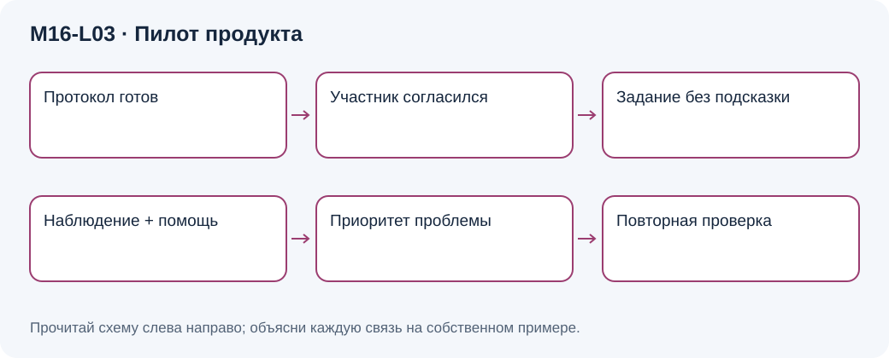

# M16-L03. Пилот продукта

Версия материала: 1.1.0. Это самостоятельный урок: внешняя проверка наставником необязательна.

> **Версии и дата проверки:** Python 3.11.9, стандартная библиотека; продукт курса — Qwen2.5-0.5B-Instruct (ревизия 7ae5576) через transformers 4.57.6 и PyTorch 2.15.0+cpu, поиск TF-IDF из scikit-learn 1.9.1, Vosk 0.3.45 и vosk-model-small-ru-0.22, Windows System.Speech с голосом Microsoft Irina Desktop · проверено 04.11.2026 · источник: [карточка Qwen2.5-0.5B-Instruct](https://huggingface.co/Qwen/Qwen2.5-0.5B-Instruct)

## Результат и входные знания

После урока ты сможешь: **Спланировать реальное исследование удобства и честно отделить его от авторского запуска.** Перед началом нужны M16-L02: предыдущий шаг модуля. Если термин из этого списка неясен, вернись к соответствующему уроку и воспроизведи его маленький пример. Продолжение по календарю не заменяет понимание зависимости.

## Объяснение

Пилот продукта проверяет, как реальные люди используют тренажёр и понимают его обратную связь. Авторский запуск полезен для поиска очевидных ошибок, но автор знает ожидаемые действия и часто обходит неудобные места. Поэтому успешный self-test не заменяет пилот с участниками. В курсе можно подготовить весь протокол заранее, но результаты появятся только после реального участия людей.

Начни с конкретных вопросов исследования. Например: видно ли, когда микрофон записывает; понимает ли участник, как исправить расшифровку; считает ли следующую рекомендацию выполнимой; успевает ли прервать длинный ответ. Вопрос «нравится ли вам ИИ» слишком общий и плохо связан с изменениями продукта. Наблюдение должно помогать принять инженерное решение.

Участники должны понимать, что это учебный тренажёр, какие данные сохраняются и как завершить участие. Для небольшого локального пилота можно не сохранять сырой голос, если достаточно заметок и согласованных обезличенных примеров. Согласие на участие не означает согласие на публикацию записи в портфолио. Эти действия обсуждаются отдельно и описываются простыми словами.

Протокол задаёт одинаковые задания, но не диктует человеку каждый клик. Попроси пройти короткое HR-интервью, затем технический вопрос, исправить ошибку расшифровки и прервать ответ. Наблюдай, где возникает заминка. Если подсказка необходима, отметь её: успешное завершение после помощи отличается от самостоятельного. Это правило похоже на оценивание ученика в самом курсе.

Малый пилот помогает обнаружить проблемы, но не даёт точной статистической оценки всей аудитории. Три участника могут найти серьёзный дефект, однако их средняя оценка не обосновывает рыночные обещания. Показывай число участников, условия, способ набора и ограничения. Отдельно сохраняй реальные измерения времени и субъективные отзывы.

После пилота сгруппируй проблемы по наблюдаемому ущербу и воспроизводимости. Потеря ответа кандидата требует исправления раньше косметической неточности. Для каждого изменения укажи проверку: например, после добавления индикатора записи новый участник должен понять состояние без подсказки. Не объявляй улучшение только потому, что интерфейс изменился; нужна повторная проверка.



Сопоставь подписи с примером: объясни величины и укажи, какие отношения показаны на рисунке.

## Аналогия: dogfooding против юзабилити-теста

Как похоже: команда пользуется своим продуктом каждый день и по привычке обходит неудобные места, поэтому для проверки зовут людей, которые видят продукт впервые. Модератор не подсказывает клики, а если подсказал — задача не считается выполненной самостоятельно. Согласие на запись сессии отдельно от согласия на её публикацию. Пять участников находят серьёзные проблемы, но статистики по аудитории не дают.

| В уроке | В аналогии |
| --- | --- |
| Авторский запуск | Dogfooding: команда обходит неудобные места по привычке |
| Пилот с участниками | Юзабилити-тест с людьми, видящими продукт впервые |
| Конкретный вопрос исследования | Гипотеза: найдёт ли пользователь кнопку остановки без подсказки |
| Помощь отмечается | Модератор подсказал — задача не самостоятельная |
| Согласие и хранение данных | Согласие на запись отдельно от согласия на публикацию |
| 3–5 участников | Малый тест находит серьёзные проблемы, но не даёт статистики |
| null вместо 0 | Пустая ячейка «не измеряли», а не ноль секунд |

**Где аналогия ломается:** юзабилити-тест интерфейса проверяет, понятен ли путь. Здесь ещё оценивают, помогает ли обратная связь, а это зависит от ответа участника и от модели, поэтому одно задание может дать разным людям разный опыт. И в учебном пилоте участников может пока не быть — тогда протокол готов, а результатов нет.

## Разобранный пример

Пример строки протокола:«Задание—прервать ответ; наблюдение—участник нажал «Стоп», звук продолжался ещё 1,8 с; помощь—не требовалась; версия—v1; вывод—проверить очистку очереди». Это образец формы, а не факт проведённого пилота.

```json
{"participant":"P01","task":"interrupt","status":"not_run",
 "observed_seconds":null,"help":null,"release":null}
```

Поля null сохраняют честное отсутствие измерения. Ноль секунд означал бы измеренный мгновенный результат и потому здесь был бы неверным.

## Практика с поддержкой

**Предскажи до запуска.** Прежде чем запускать код или пересчитывать пример, запиши ожидаемый вывод: числа, формы массивов, порядок или текст. После запуска сравни с фактическим и объясни каждое расхождение.

Проведи репетицию протокола сам и найди вопросы, на которые невозможно ответить наблюдением. Переформулируй «удобно ли» в конкретный сценарий. Затем подготовь пустую таблицу для реальных участников и не заполняй её предполагаемыми результатами.

Для технической практики используй [лабораторную M16](../../labs/M16/README.md). Полный код находится отдельно от твоего решения. Сначала предскажи результат одного контрольного случая, затем запусти пример и объясни расхождение, если оно появилось. Запиши команду, версию окружения и фактический вывод, чтобы позже повторить опыт.

## Самостоятельная задача A

Подготовь протокол пилота на 3–5 согласившихся участников: объяснение цели, четыре задания, поля наблюдений, правила хранения и критерии приоритета ошибок. Если участников пока нет, оставь статус not_run и проведи отдельно авторскую репетицию, явно пометив её.

Сохрани первую попытку в `submissions/M16-L03.md`: исходные данные, результат и краткое обоснование.

## Подсказки по очереди

1. Согласие на участие и согласие на публикацию голоса — разные действия.
2. Попроси выполнить четыре конкретных задания и отмечай помощь вместо подсказки каждого клика.
3. Если участников нет, observed_seconds остаётся null, а статус not_run. Авторская репетиция хранится отдельно.

## Критерии и типичные ошибки

За объяснение механизма, корректность проверки, воспроизводимость и ограничения поставь по 0–2 балла: 0 — отсутствует или неверно, 1 — частично с помощью, 2 — самостоятельно и обоснованно. Для перехода каждый критерий должен быть выполнен самостоятельно (2); понимание механизма и новая задача обязательны и не компенсируются другими баллами. При помощи сначала отметь «с поддержкой», затем реши вариант B без подсказки. Критических ошибок быть не должно. Критические ошибки: подмена реального измерения выдуманным, использование ответа из решения как собственной первой попытки, вывод о качестве за пределами проверенных данных, нарушение явно заданного ограничения задачи. Исправление должно сопровождаться новым примером, а не только заменой текста отчёта.

Первая самостоятельная попытка выполняется без готового решения. После неё разрешены объяснения AI, подсказки и [полный разбор](../../solutions/modules/M16.md#m16-l03). Отметь полученную помощь. Если решение стало понятно только после разбора, состояние навыка — «с поддержкой»; для самостоятельности реши новый вариант.

## Новая и отложенная проверка

B: автор запустил все тесты, участников ещё нет. Какие из утверждений «запускается», «понятен интерфейс», «помогает улучшить ответ» доказаны? C через неделю: один знакомый прошёл с постоянными подсказками автора.

Сохрани новую попытку до просмотра [ключа B/C](../../solutions/modules/M16.md).

## Карточка урока

| Поле | Содержание |
| --- | --- |
| Правило | Пилот проверяет конкретные вопросы на реальных участниках: одинаковые задания, наблюдение без диктовки кликов, отметка любой помощи; согласие на участие отдельно от согласия на публикацию; неизмеренное поле — null, а не 0 |
| Смысл величин | Авторский запуск находит очевидные ошибки, но автор знает путь и обходит неудобства; малый пилот находит серьёзные проблемы, но не даёт статистики по аудитории; проблемы ранжируют по ущербу и воспроизводимости; после исправления нужна повторная проверка |
| Когда применять | При планировании пилота. Пример: из 4 участников 3 нашли кнопку остановки без подсказки, 1 — после подсказки модератора; в отчёте «самостоятельно 3/4, с помощью 1/4» и вывод: проблема видимости есть, но о доле всей аудитории четыре человека не говорят |
| Главная ошибка | Выдать авторскую репетицию за пилот или придумать ответы участников, которых не было |

## Источники и углубление

- [Официальная документация по теме](https://www.nist.gov/itl/ai-risk-management-framework) — сверяй контракт и определения, не копируй внешний пример вместо самостоятельной работы.
- [Исполняемый пример модуля](../../labs/M16/demo.py) — авторский код курса с явно указанными ограничениями.

[Оглавление модуля](../modules/M16.md)
