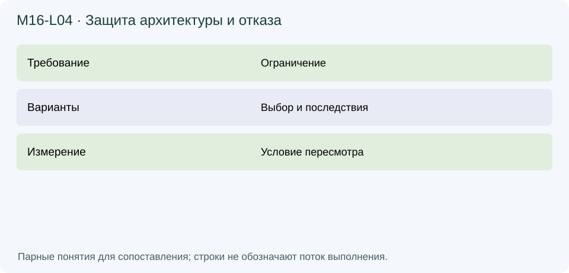

# M16-L04. Защита архитектуры и отказа

Версия материала: 1.0.0. Это самостоятельный урок: внешняя проверка наставником необязательна.

## Результат и входные знания

После урока ты сможешь: **Объяснить выбранные компромиссы и воспроизвести управляемый отказ.** Перед началом нужны M16-L03: предыдущий шаг модуля. Если термин из этого списка неясен, вернись к соответствующему уроку и воспроизведи его маленький пример. Продолжение по календарю не заменяет понимание зависимости.

## Объяснение

Архитектурная защита проверяет способность связать требования, ограничения и решения. Перечень модных библиотек не является объяснением. Для каждого важного компонента нужно показать, какую задачу он решает, какие данные получает, какой контракт возвращает и почему выбран именно такой уровень сложности. Хорошая защита допускает альтернативы и объясняет условия, при которых выбор изменится.

Для локального голосового интервьюера ограничения очевидны:32 ГБ RAM, небольшая VRAM, бесплатное обязательное выполнение и Windows. Поэтому маленькая модель, CPU-распознавание, короткий контекст и ограниченная конкурентность могут быть рациональными. Они не гарантируют высокую разговорную скорость. Защита должна опираться на фактические измерения, а не на рекламные значения другого сервера.

Нарисуй поток данных и границы состояния. Покажи, где находится ответ кандидата, какой текст уходит в модель, как выбирается рубрика, откуда берутся технические источники и кто решает завершить интервью. Добавь версии и идентификаторы. Затем проследи один запрос от микрофона до звука, отмечая очереди, возможные ошибки и контрольные точки.

Отказ демонстрируется на безопасной копии или управляемой конфигурации. Можно отключить доступ к модели, передать невалидный формат аудио или активировать неверный релиз в лабораторной. Цель — показать обнаружение, понятное состояние пользователя и восстановление. Не нужно повреждать единственную копию данных или создавать непредсказуемую нагрузку. Восстановление подтверждается повторным запросом с ожидаемым поведением.

Компромиссы записываются как архитектурные решения: контекст, варианты, выбор, последствия, условия пересмотра. Например, сценарный диалог выбран для предсказуемого завершения; агентный поиск рассматривается после измеренного недостатка фиксированных маршрутов. Такая запись показывает инженерное мышление лучше, чем утверждение «агенты современнее».

На защите ожидаются вопросы о данных и оценивании. Почему тест независим?Как обнаружить утечку?Почему одна метрика не скрывает регрессию?Что происходит при ошибке ASR?Как откатить версию индекса?Ответы должны опираться на реальные артефакты проекта. Если компонент пока не измерен, назови это ограничением и предложи конкретный опыт, который закроет неопределённость.

Схема показывает отношения между понятиями этого урока, а не измеренную производительность. Найди в объяснении смысл каждого блока. Затем закрой подписи и воспроизведи связи своими словами: что поступает на вход, что изменяется и по какому наблюдению можно проверить результат.

## Разобранный пример

Пример решения:«Используем один активный тяжёлый запрос на локальном CPU. Причина—при конкурентности 2 измеренная очередь и общая задержка выросли. Последствие—второй пользователь видит занятость. Пересмотр—после отдельного нагрузочного опыта с другой моделью». Числа следует подставить только после собственного измерения.

Для демонстрации отката сначала запусти M13 и покажи canary. Затем в продукте проверь понятный отказ при недоступной модели и восстановление после возвращения корректной конфигурации. Лабораторный rollback и реальный продуктовый отказ отмечаются как разные сценарии.

## Практика с поддержкой

Выбери одно решение, например Vosk на CPU. Объясни его через пять вопросов: зачем; что получает; что возвращает; что проверено; когда менять. Затем покажи фактический отчёт M15. Если ответ невозможно связать с наблюдением, пометь его как гипотезу.

Для технической практики используй [лабораторную M16](../../labs/M16/README.md). Полный код находится отдельно от твоего решения. Сначала предскажи результат одного контрольного случая, затем запусти пример и объясни расхождение, если оно появилось. Запиши команду, версию окружения и фактический вывод, чтобы позже повторить опыт.

## Самостоятельная задача

Подготовь семиминутную защиту: схема, три решения с альтернативами, три измерения, одна регрессия и один отказ с восстановлением. Для каждого утверждения укажи файл или наблюдение. После защиты измени требование: два одновременных пользователя вместо одного. Назови затронутые части.

Сохрани собственную попытку в `submissions/M16-L04.md` и приложи код или данные, если они нужны. В отчёте должны быть исходное условие, ход проверки, результат и границы вывода. Не заменяй объяснение скриншотом успешного запуска: другой человек должен понять, почему результат отвечает на поставленный вопрос.

## Подсказки по порядку

1. Начни с требования и ограничения, затем объясни выбор и альтернативу, а не перечисляй библиотеки.
2. Каждое число на защите должно ссылаться на отчёт с условиями измерения.
3. Для двух пользователей проверь изоляцию сессий, очередь, память и отмену; рост числа потоков сам по себе проблему не решает.

## Самопроверка и типичные ошибки

За объяснение механизма, корректность проверки, воспроизводимость и ограничения поставь по 0–2 балла: 0 — отсутствует или неверно, 1 — частично с помощью, 2 — самостоятельно и обоснованно. Для перехода нужны минимум 6 из 8 и отсутствие критических ошибок. Критические ошибки: подмена реального измерения выдуманным, использование ответа из решения как собственной первой попытки, вывод о качестве за пределами проверенных данных, нарушение явно заданного ограничения задачи. Исправление должно сопровождаться новым примером, а не только заменой текста отчёта.

Первая самостоятельная попытка выполняется без готового решения. После неё разрешены объяснения AI, подсказки и [полный разбор](../../solutions/modules/M16.md#m16-l04). Отметь полученную помощь. Если решение стало понятно только после разбора, состояние навыка — «с поддержкой»; для самостоятельности реши новый вариант.

## Новая и отложенная проверка

Через неделю защити новое требование без подготовленного текста: объясни, какие компоненты меняются, а какие остаются совместимыми.

Запиши дату следующей проверки и конкретное условие. Состояние «подтверждено позже» появляется после её фактического выполнения, а не автоматически после чтения.

## Источники и углубление

- [Официальная документация по теме](https://docs.docker.com/build/building/best-practices/) — сверяй контракт и определения, не копируй внешний пример вместо самостоятельной работы.
- [Исполняемый пример модуля](../../labs/M16/demo.py) — авторский код курса с явно указанными ограничениями.

[Оглавление модуля](../modules/M16.md)
