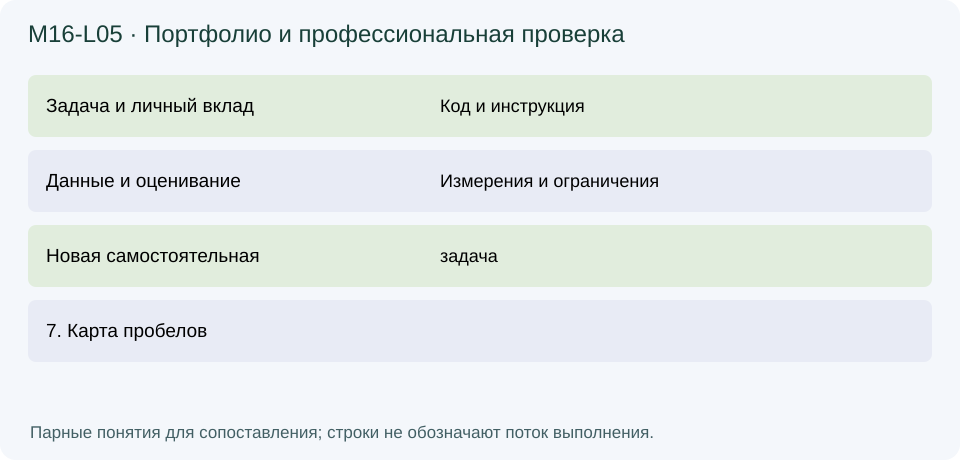

# M16-L05. Портфолио и профессиональная проверка

Версия материала: 1.1.0. Это самостоятельный урок: внешняя проверка наставником необязательна.

## Результат и входные знания

После урока ты сможешь: **Представить проверяемый инженерный результат и определить следующие пробелы.** Перед началом нужны M16-L04: предыдущий шаг модуля. Если термин из этого списка неясен, вернись к соответствующему уроку и воспроизведи его маленький пример. Продолжение по календарю не заменяет понимание зависимости.

## Объяснение

Портфолио должно позволять другому разработчику понять задачу, запустить ограниченный пример и проверить основные утверждения. Красивое описание без данных не показывает инженерную готовность. Для этого проекта важны код, архитектура, условия запуска, независимые оценки, известные ограничения и примеры исправленных ошибок. Отдельно укажи свою работу и использованные готовые компоненты.

Завершение учебного маршрута не присваивает грейд middle. Работодатель оценивает самостоятельность, релевантный опыт, способность поддерживать систему и проходить технические собеседования. Проект может дать сильные свидетельства части этих навыков, но не заменяет опыт ответственности за реальных пользователей. Поэтому карьерную готовность нужно оценивать отдельно от наличия материалов курса.

Сформулируй результат конкретно: «Собрал локальный тренажёр с двумя рубриками, проверил N независимых случаев, измерил задержки в условиях X, обнаружил регрессию Y и исправил Z». Подставляй только фактически полученные значения. Не используй «качество 95%» без описания задачи, знаменателя и способа разметки. Ограничение, подкреплённое измерением, повышает понятность проекта.

Самостоятельная профессиональная проверка включает новую задачу. Например, добавь тип вопроса, обнови индекс с несовместимой метаданной, найди утечку тестовых данных или объясни резкое возрастание p95. Готовый эталон можно посмотреть после первой попытки, но тогда подтверждение самостоятельности переносится на новый вариант. Умение понять чужое решение и умение создать своё — разные свидетельства.

При подготовке к вакансиям собери актуальные требования выбранного рынка и сопоставь их с артефактами. Python, SQL, ML-валидация, PyTorch, LLM-инференс, RAG, оценивание, эксплуатация и системный дизайн встречаются в разных комбинациях; конкретный список зависит от позиции. Этот урок не выдаёт непроверенный список текущих вакансий за исследование рынка. Сохраняй дату и ссылку каждой реальной вакансии при обновлении карьерной карты.

План после курса строится по ошибкам проверки. Если сложно пояснить градиент, вернись к M03 и M07. Если неясно, почему RAG ошибается, раздели поиск и генерацию по M10 и M11. Если продукт нестабилен, повтори M13 и M15. Продвинутая ветка распределённого обучения и GPU-ядер полезна после освоения основ, но не должна скрывать пробел в честной валидации.

Внутри портфолио нужны воспроизводимые ограничения: что требует скачанной модели, что работает без сети, какое оборудование проверено, где режим только демонстрационный. В эталонном проекте малая локальная Qwen показала неподтверждённые сведения от первого лица и обрезание ответа при лимите 128 токенов; интерфейс сообщает об обрезании. Это реальные причины продолжить оценивание, а не заявлять высокое качество интервьюера. Собственная версия должна показать, какие из этих проблем воспроизводятся и что удалось исправить.



Сопоставь подписи с примером: объясни величины и укажи, какие отношения показаны на рисунке.

## Разобранный пример

Слабая строка README: «Сделал умного HR с высокой точностью». Проверяемая форма: «Есть HR и backend-сценарии; обратная связь проверяется двумя рубриками; сохранены набор случаев, условия измерений и ограничения локальных моделей». Конкретные числа вносятся из отчётов.

```text
Требование вакансии → мой артефакт → независимая проверка → пробел
RAG evaluation → набор retrieval cases → новые вопросы → reranking
```

Такое сопоставление помогает выбирать следующую практику, а не просто увеличивать список технологий в резюме.

## Практика с поддержкой

Прочитай проект глазами человека, который не видел переписку. Найди каждое утверждение о качестве и рядом поставь проверяемый источник. Если источник отсутствует, переформулируй утверждение как гипотезу или добавь эксперимент. Затем проверь один новый случай без заранее подготовленного ответа.

Для технической практики используй [лабораторную M16](../../labs/M16/README.md). Полный код находится отдельно от твоего решения. Сначала предскажи результат одного контрольного случая, затем запусти пример и объясни расхождение, если оно появилось. Запиши команду, версию окружения и фактический вывод, чтобы позже повторить опыт.

## Самостоятельная задача

Подготовь README портфолио, короткую демонстрацию и таблицу из восьми компетенций с доказательствами. Выполни новую задачу: добавь тему очередей сообщений в техническое интервью, сохранив старые оценочные случаи. Покажи новые проверки и отсутствие известных регрессий.

Сохрани первую попытку в `submissions/M16-L05.md`: исходные данные, результат и краткое обоснование.

## Подсказки по порядку

1. Свяжи каждое заявление о качестве с входами, знаменателем и процедурой проверки.
2. Новая тема требует источников, новых оценочных случаев и прогона старого набора без подгонки.
3. Раздели подготовленный курс, самостоятельно показанный навык и карьерную готовность. Публиковать репозиторий для локальной самопроверки не требуется.

## Самопроверка и типичные ошибки

За объяснение механизма, корректность проверки, воспроизводимость и ограничения поставь по 0–2 балла: 0 — отсутствует или неверно, 1 — частично с помощью, 2 — самостоятельно и обоснованно. Для перехода каждый критерий должен быть выполнен самостоятельно (2); понимание механизма и новая задача обязательны и не компенсируются другими баллами. При помощи сначала отметь «с поддержкой», затем реши вариант B без подсказки. Критических ошибок быть не должно. Критические ошибки: подмена реального измерения выдуманным, использование ответа из решения как собственной первой попытки, вывод о качестве за пределами проверенных данных, нарушение явно заданного ограничения задачи. Исправление должно сопровождаться новым примером, а не только заменой текста отчёта.

Первая самостоятельная попытка выполняется без готового решения. После неё разрешены объяснения AI, подсказки и [полный разбор](../../solutions/modules/M16.md#m16-l05). Отметь полученную помощь. Если решение стало понятно только после разбора, состояние навыка — «с поддержкой»; для самостоятельности реши новый вариант.

## Новая и отложенная проверка

B: новая тема — транзакции, и один старый SQL-case стал ошибочным. Можно ли публиковать по выросшему общему среднему? C через две недели: импорт сессии schema2 в программу, читающую schema1.

Сохрани новую попытку до просмотра [ключа B/C](../../solutions/modules/M16.md).

## Источники и углубление

- [Официальная документация по теме](https://docs.github.com/en/repositories/managing-your-repositorys-settings-and-features/customizing-your-repository/about-readmes) — сверяй контракт и определения, не копируй внешний пример вместо самостоятельной работы.
- [Исполняемый пример модуля](../../labs/M16/demo.py) — авторский код курса с явно указанными ограничениями.

[Оглавление модуля](../modules/M16.md)
