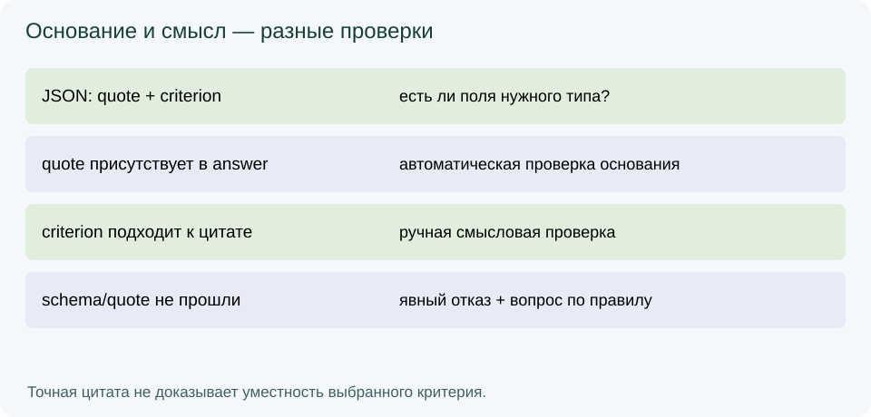
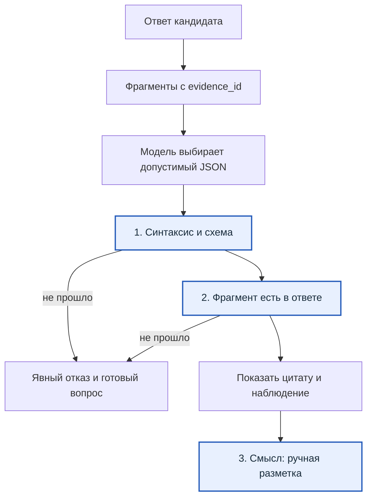

# M16-L06. Обратная связь с проверяемыми основаниями

Версия 1.1.0. До урока: M16-L01. Начальный ориентир: 180 минут вместе с практикой; измеренное время записывай отдельно.


> **Версии и дата проверки:** Python 3.11.9, transformers 4.57.6, PyTorch 2.15.0+cpu; модель Qwen2.5-0.5B-Instruct (ревизия 7ae5576) · проверено 04.11.2026 · источник: [карточка Qwen2.5-0.5B-Instruct](https://huggingface.co/Qwen/Qwen2.5-0.5B-Instruct)

## Результат и входные знания

Ты отделишь сырой вывод модели от разрешённого пользователю сообщения, сохранишь отказ и сравнишь две политики на одинаковых ответах. Для учебного интервьюера особенно вредно приписать человеку опыт, которого он не описывал. Гладкий текст сам по себе не выполняет продуктовую задачу.

## Объяснение

### Три уровня проверки

Первый уровень — синтаксис: можно ли разобрать JSON и совпадают ли поля с договором. Второй — основание: действительно ли предложенная цитата присутствует в текущем ответе кандидата. Третий — смысл: подходит ли цитата выбранному критерию и помогает ли следующий шаг. Автоматическая проверка substring решает только второй уровень, причём в узком смысле наличия. Цитата «я не внедрял кеш» не подтверждает достижение «внедрил кеш».

Первая исправленная политика candidate_json просила JSON с quote/criterion и проверяла наличие цитаты. На реальных коротких ответах маленькая модель часто нарушала даже эту схему. Такой результат сохраняется как неудачный эксперимент, а не заменяется ожидаемым JSON. Следующий вариант candidate ограничивает сам выбор модели: приложение делит ответ на точные фрагменты, присваивает им evidence_id и заранее формирует допустимые JSON-комбинации evidence_id/criterion/next_step.

При генерации prefix_allowed_tokens_fn разрешает только следующий токен одной из этих комбинаций. Если допустимы варианты {id:0} и {id:1}, общие токены обязательны, а в точке различия модель выбирает по своим вероятностям. После полного объекта разрешён EOS. Это настоящая модельная генерация с ограниченным пространством ответа; формат обеспечивается программой. Она не доказывает, что модель умеет свободно писать JSON или что выбранный критерий правильный.

Приложение берёт цитату из исходного фрагмента по выбранному ID и строит нейтральное наблюдение. Оно не публикует свободный вывод модели о достижении. Фраза «В твоём ответе есть ...; проверь по критерию ...» не объявляет человека хорошим специалистом и не выдумывает результат. Выбор критерия и полезность следующего вопроса всё равно проверяются человеком по рубрике M11. Первые четыре фрагмента ограничены 200 символами каждый: длинный ответ может потерять важную деталь, и это отдельный случай для оценки покрытия.

Старый baseline сохранён: модель свободно пишет отзыв. candidate_json сохраняет неудачный промежуточный вариант; в интерфейсе используется bounded candidate. Если вход пуст или полученный выбор не прошёл дополнительную проверку ID/схемы, отображается явное «модель не дала проверяемое наблюдение», а затем заранее заданный уточняющий вопрос. Это правило приложения, не успешный ответ LLM. В отчёте отдельно raw_output, display_text, fallback_used, display_policy и selection_policy. Raw содержит именно сгенерированный JSON выбора, а не восстановленную цитату.



## Аналогия: выпадающий список вместо свободного ввода

Как похоже: если поле свободного ввода позволяет написать что угодно, выпадающий список даёт выбрать только разрешённый вариант. Значение пункта — ID, а текст по этому ID подставляет сервер. Редактор новостей проверяет, что цитата действительно есть в стенограмме, и отдельно — уместна ли она в контексте. Когда автоответ поддержки не находит основания, клиент получает шаблонное «уточните, пожалуйста», а не выдумку.

| В уроке | В аналогии |
| --- | --- |
| Свободный отзыв модели | Поле свободного ввода: можно написать что угодно |
| Bounded candidate | Выпадающий список: только разрешённые варианты |
| evidence_id | Значение пункта списка: текст по нему подставляет сервер |
| prefix_allowed_tokens_fn | Маска ввода: недопустимый символ не печатается |
| Проверка существования цитаты | Цитата действительно есть в стенограмме |
| Явный отказ и заранее заданный вопрос | Шаблонный ответ поддержки, когда основания не нашлось |
| Смысл проверяет человек | Редактор решает, уместна ли верная цитата в контексте |

**Где аналогия ломается:** вариант в списке выбирает человек, понимая его смысл. Здесь выбирает модель по вероятностям: формат гарантирует программа, но выбранный критерий может быть нелепым, и это ловит только ручная разметка. И точная цитата «я не внедрял кеш» существует в ответе, но достижения не подтверждает.

## Разобранный пример

Кандидат: «Я добавил уникальный ключ и проверил повторный запрос». Модель предлагает quote=«API оплаты успешно запущен». Строка не найдена в ответе — публикация запрещена. Если цитата «Я добавил уникальный ключ» и criterion=action, проверка основания проходит. Но это ещё не доказывает, что вся платёжная архитектура корректна или что изменение улучшило бизнес-метрику.

```python
from projects.interview_trainer.feedback import validate_observations
import json
answer = 'Я добавил уникальный ключ и проверил повторный запрос.'
raw = json.dumps({'observations':[{'quote':'API оплаты успешно запущен','criterion':'result'}], 'next_step':'action'})
assert not validate_observations(raw, 'hr', answer)['valid']
```

Функция evaluate_answer принимает один объект модели от вызывающего кода. В baseline она сохраняет исходный отзыв без автоматического объявления правильности; в candidate возвращает проверку и публикационную политику. Загрузку весов не нужно повторять на каждом случае. История включает только предыдущие вопросы и ответы, а не прежние непроверенные оценки модели.

[Интерактивный опыт этого урока](../visuals/M16-L06.html): сначала предскажи результат, затем измени условие.

## Схема



Три уровня проверки обратной связи в bounded candidate. Приложение делит ответ кандидата на точные фрагменты с evidence_id и заранее строит допустимые JSON-комбинации; при генерации prefix_allowed_tokens_fn разрешает только их, поэтому формат обеспечивает программа, а не умение модели писать JSON. Синтаксис и существование выбранного фрагмента проверяются автоматически; при провале показывается явный отказ и заранее заданный вопрос — это правило приложения, а не ответ LLM. Пользователь видит цитату из исходного фрагмента, а не свободный вывод модели о достижениях. Подходит ли критерий и полезен ли следующий шаг, решает только ручная разметка. Выделены три уровня проверки.

## Практика с поддержкой

**Предскажи до запуска.** Прежде чем запускать код или пересчитывать пример, запиши ожидаемый вывод: числа, формы массивов, порядок или текст. После запуска сравни с фактическим и объясни каждое расхождение.

Пройди фиксированные случаи tests/test_product_v2.py: неверная цитата, лишнее поле, неизвестный тип критерия, не-JSON и правильная цитата. Затем запусти сравнение версий в M11. Сначала прочитай raw_output, потом display_text: улучшение защиты нельзя выдавать за улучшение самой модели. Отказ предотвращает ложное сообщение, но уменьшает покрытие полезной обратной связи.

## Самостоятельная задача A — M16-L06-A

Создай шесть новых ответов: два с конкретным действием, два с отрицанием («не делал»), один без измеримого результата, один с инструкцией внутри цитируемого ответа. До запуска запиши недопустимые выводы. Сравни обе реальные конфигурации, разметь существование цитат и уместность next_step отдельно. Сохрани исходные outputs. Любая выдуманная биографическая деталь в display_text блокирует выпуск на этом наборе. Нельзя компенсировать её средним баллом остальных случаев.

## Подсказки по очереди; новая и отложенная проверка

Сначала проверь контракт, затем происхождение цитаты, затем смысл. Совпадение точной цитаты не заменяет третий шаг. Повтор B: цитата настоящая, но относится к чужому действию («коллега внедрил...»); объясни, почему нельзя считать это личным вкладом. Через неделю C: модель возвращает верную цитату и нелепый criterion — техническая проверка проходит, ручная должна обнаружить дефект. [Разбор](../../solutions/modules/M16.md).

## Критерии и типичные ошибки

Работа завершена, когда сохранены обе версии вывода, отказ правильно назван правилом, нет известных критических регрессий на подготовленных проверочных случаях, а ограничения ручной разметки описаны. Это не гарантия отсутствия любой будущей ошибки.

## Карточка урока

| Поле | Содержание |
| --- | --- |
| Правило | Три уровня проверки: синтаксис и схема → существование выбранного фрагмента в текущем ответе → смысл (критерий и следующий шаг); пользователю показывают цитату из исходного фрагмента, а не свободный вывод модели; при провале — явный отказ и заранее заданный вопрос как правило приложения |
| Смысл величин | Bounded candidate: приложение строит допустимые JSON-комбинации, prefix_allowed_tokens_fn разрешает только их — формат обеспечивает программа; raw_output, display_text и fallback_used хранят раздельно; отказ предотвращает ложное сообщение, но уменьшает покрытие полезной обратной связью |
| Когда применять | При публикации обратной связи. Пример: ответ «Я не настраивал репликацию, но читал документацию» разбит на два фрагмента; модель выбрала первый и criterion = action — цитата существует, уровень 2 пройден, но «не настраивал» не подтверждает действия: уровень 3 провален при ручной разметке |
| Главная ошибка | Считать существование цитаты подтверждением смысла или выдавать защиту приложения за улучшение модели |

## Источники и углубление

[JSON Python 3.11](https://docs.python.org/3.11/library/json.html), [карточка модели](https://huggingface.co/Qwen/Qwen2.5-0.5B-Instruct), [Transformers: управление генерацией](https://huggingface.co/docs/transformers/v4.57.1/en/main_classes/text_generation). Политика публикации и примеры — собственный материал курса.

Для углубления: [Min et al.: FActScore](https://arxiv.org/abs/2305.14251) — длинный ответ разбивают на атомарные факты и считают долю фактов, подтверждённых надёжным источником (на английском).
