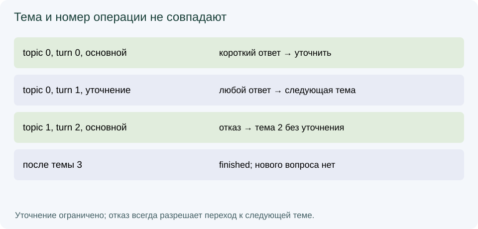

# M16-L07. Состояние интервью и ограниченные уточнения

Версия 1.1.0. До урока: M16-L06. Начальный ориентир: 180 минут вместе с практикой; измеренное время записывай отдельно.


> **Версии и дата проверки:** Python 3.11.9, стандартная библиотека (http.server) · проверено 04.11.2026 · источник: [Python 3.11: http.server](https://docs.python.org/3.11/library/http.server.html)

## Результат и входные знания

Ты построишь интервью, которое умеет задать уточнение и завершиться, а затем проверишь все переходы без дорогостоящих генераций. Модель может помогать сформулировать содержание; право перейти к следующей теме остаётся у явного состояния приложения. Такой разделённый дизайн проще отлаживать и защищать.

## Объяснение

### Почему одного счётчика недостаточно

В старом сценарии turn был одновременно номером HTTP-операции и номером темы. Уточнение нарушает это равенство: после ответа на первую тему уже два логических хода, но тема всё ещё первая. Поэтому нужны topic_index, turn и clarification. topic_index выбирает одну из четырёх тем, turn защищает от повторной отправки, clarification показывает, что разрешённое уточнение уже началось.

Простой контракт: на каждую тему не больше одного уточнения. Короткий ответ либо «не знаю» вызывает уточнение, явный отказ обсуждать тему переводит к следующей. После ответа на уточнение тема завершается независимо от длины. Это эвристика полноты, не оценка компетентности. Длинный бессодержательный ответ может пройти её, короткий точный — вызвать лишний вопрос. Ограничение следует проверить отдельно и при необходимости заменить классификатором на размеченных примерах, сохранив конечность автомата.

Для четырёх тем получается от четырёх до восьми ответов. Если все ответы короткие: тема 0 основной вопрос → уточнение → тема 1 и так далее. Отказ не должен запускать бесконечное «пожалуйста, уточните». Завершённое состояние не имеет следующего вопроса и отклоняет новый ответ.

История нужна в двух местах. Во-первых, хранилище объясняет, какой вопрос и ответ привели к переходу. Во-вторых, следующий вызов модели получает контекст предыдущих реплик, чтобы не оценивать уточнение как совершенно новую тему. Сохранённая история сама по себе не влияет на модель: её нужно явно включить в messages. Размер истории ограничивается; ранее выданный непроверенный отзыв не надо превращать в новый факт о кандидате.



## Разобранный пример — переход

Начало: topic=0, turn=0, clarification=false. Ответ «Работал над сервисом» короткий. После сохранения: topic=0, turn=1, clarification=true. Повторный HTTP с turn=0 отклоняется без второй генерации. На уточнение приходит ответ; теперь topic=1, turn=2, clarification=false. Если вместо первого ответа был отказ, следующий topic=1 уже при turn=1.

```python
from projects.interview_trainer.core import Interview
s = Interview('hr')
question, sources = s.prepare('Работал над сервисом.', 0)
s.commit('Работал над сервисом.', 'Учебная фикстура', sources, 0)
assert (s.topic_index,s.turn,s.clarification) == (0,1,True)
s.commit('Не хочу обсуждать детали.', 'Без оценки', [], 0)
assert (s.topic_index,s.turn,s.clarification) == (1,2,False)
```

В приложении prepare выполняется до генерации, commit — после успешного получения результата. Это не даёт ошибке модели случайно продвинуть интервью. Блокировка сервера и проверка turn защищают единственное принятое изменение. GET состояния восстанавливает клиента после потери HTTP-ответа, но память процесса не является долговременным хранилищем.

[Интерактивный опыт этого урока](../visuals/M16-L07.html): сначала предскажи результат, затем измени условие.

## Практика с поддержкой

**Предскажи до запуска.** Прежде чем запускать код или пересчитывать пример, запиши ожидаемый вывод: числа, формы массивов, порядок или текст. После запуска сравни с фактическим и объясни каждое расхождение.

Выполни десять готовых траекторий из tests/test_product_v2.py: два режима × короткие/длинные/отказ/не знаю/смешанные ответы. Выпиши последовательность topic, turn, clarification для одного случая. Потом пройди его через интерфейс и проверь, что номер темы не выдаётся за номер реплики.

## Самостоятельная задача A — M16-L07-A

Измени требование: разрешены две попытки уточнения, но при явном отказе немедленный переход. Реализуй независимую функцию перехода в стартовом файле exercises/M16. Рассчитай максимум ответов для пяти тем и проверь завершение на длинной последовательности «не знаю». Сохрани один контрпример к правилу «короткий = неполный»: он объясняет границу эвристики, а не требует подменять результат.

## Критерии и типичные ошибки

Критерии: номер операции монотонно растёт; тема не меняется при разрешённом уточнении; повтор не создаёт историю; предел конечен; отказ уважается. Для зачёта нужен новый случай без подсказки, а не совпадение структуры классов с эталоном.

## Подсказки по очереди; новая и отложенная проверка

Вместо bool потребуется счётчик уточнений. Максимум ответов на тему равен 1+limit. Повтор B: две темы, limit=0. Через неделю C: пользователь возвращается после перезапуска; предложи сериализацию и две проверки совместимости версии состояния. Не называй восстановление sessionStorage восстановлением серверной памяти. [Ключи](../../solutions/modules/M16.md).

## Источники и углубление

[Python dataclasses](https://docs.python.org/3.11/library/dataclasses.html), собственная спецификация конечного интервью в projects/interview_trainer/core.py.
