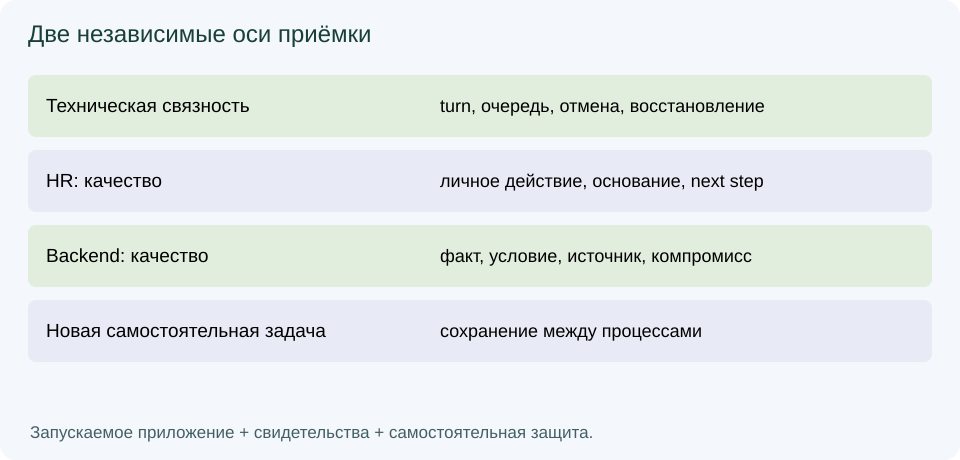
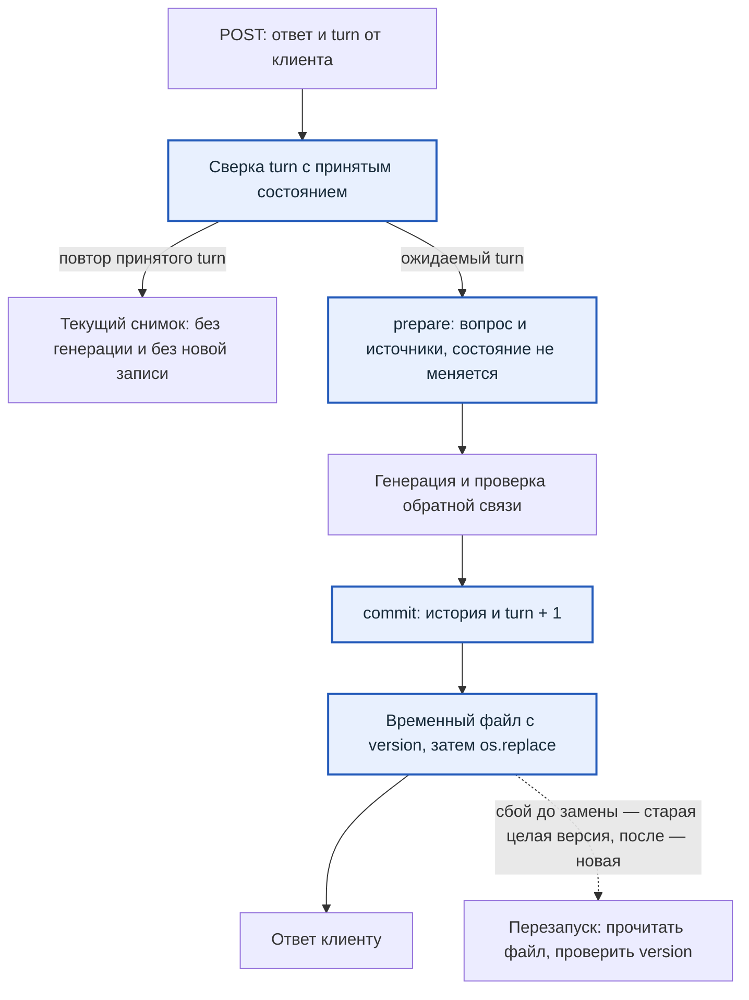

# M16-L08. Самостоятельная сборка и защита нового требования

Версия 1.1.0. До урока: M16-L05 и M16-L07. Начальный ориентир: 300 минут вместе с практикой; измеренное время записывай отдельно.

> **Версии и дата проверки:** Python 3.11.9, стандартная библиотека; продукт курса — Qwen2.5-0.5B-Instruct (ревизия 7ae5576) через transformers 4.57.6 и PyTorch 2.15.0+cpu, поиск TF-IDF из scikit-learn 1.9.1, Vosk 0.3.45 и vosk-model-small-ru-0.22, Windows System.Speech с голосом Microsoft Irina Desktop · проверено 04.11.2026 · источник: [Python 3.11: http.server](https://docs.python.org/3.11/library/http.server.html)

## Результат и входные знания

Ты представишь запускаемый собственный вариант тренажёра, проверишь полный путь и защитишь изменение, которого не было в готовом примере. Схема описывает решение, но не заменяет работающее приложение. Пользоваться библиотеками, подсказками и кодом курса разрешено; авторство конкретных решений и полученную помощь нужно указать.

## Объяснение

### От компонентов к продукту

Работа делится на маленькие приёмки. Сначала текстовый путь с состояниями; затем поиск технических источников; затем проверяемая обратная связь; затем запись, ASR и TTS; затем отмена и восстановление. После каждой ступени сохраняется воспроизводимый сценарий. Если прикрутить всё сразу, одинаковое «не ответил» может означать ошибку микрофона, распознавания, поиска, генерации, схемы или доставки, и ты не узнаешь, где исправлять.

Для каждой сессии нужны mode, session_id, turn, topic, version и outputs этапов. Аудио и ответы не надо печатать в общий лог без необходимости. Учебный продукт хранит сессию в памяти и позволяет явный экспорт: это ограничение. Самостоятельное требование ниже добавляет устойчивое сохранение, поэтому понадобится различать запись на диск, подтверждение клиенту и повтор после сбоя.

Оценивание имеет две отдельные оси. Техническая приёмка проверяет, что состояние не дублируется, формат соблюдён и отменённое аудио не принято. Качество проверяет полезность HR-совета и правильность технического объяснения. Даже 100% HTTP 200 не означает полезных советов. Сравнение версий проводится на одинаковых case_id; просмотревший ключ check-набора должен подготовить новые случаи для финальной независимой проверки.

## Аналогия: сохранение документа в редакторе

Как похоже: редактор сохраняет документ во временный файл и подменяет им старый — если программа упадёт посреди записи, на диске останется прежняя целая версия, а не половина. Повторное нажатие «Сохранить» не создаёт вторую копию. Старая версия программы честно отказывается открыть файл нового формата. А то, что файл открылся без ошибок, ещё не значит, что текст в нём вычитан.

| В уроке | В аналогии |
| --- | --- |
| Приёмка по ступеням | Сборка по этапам: фундамент принимают до стен |
| Временный файл и os.replace | Сохранение через временный файл и подмену старого |
| version состояния | Версия формата файла: старая программа отказывается открыть новый |
| Повтор принятого turn | Повторное «Сохранить» не создаёт вторую копию |
| Восстановление после перезапуска | Восстановление документа после сбоя редактора |
| Две оси: техника и качество | Файл открылся без ошибок, но текст ещё надо вычитать |
| Один процесс и один пользователь | Документ открыт в одном окне: совместное редактирование не решено |

**Где аналогия ломается:** редактор сохраняет то, что напечатал человек, и это можно набрать снова. Ответ модели при повторной генерации будет другим, поэтому принятый ход не перегенерируют, а возвращают сохранённый снимок. И надёжное восстановление сессии не делает советы полезнее — качество проверяют отдельно.

## Самостоятельная задача A — основная работа M16-HW01

Создай запускаемый продукт в submissions/M16-HW01. Можно взять отдельные компоненты эталона, но представь их соединение и собственные решения. Обязательны HR и backend режимы, ограниченные уточнения, источники технической части, цитируемые основания обратной связи, явный отказ при недостаточности, запись/распознавание/озвучивание, остановка аудио и восстановление клиента после потери ответа.

**Новое требование:** после перезапуска сервера незавершённая сессия восстанавливается из локального файла; повторная отправка уже принятого turn не добавляет запись. Файл сохраняется атомарной заменой временного файла. Учебная область — один процесс и один пользователь; одновременная запись нескольких процессов не считается решённой. Добавь version состояния и понятный отказ при неизвестной версии. Не используй реальное резюме для примеров — придуманных ответов достаточно.

Сдаваемые артефакты: команда запуска; код; README с границами; две отдельные группы оценочных случаев; неизменённые raw outputs; ручная разметка; сравнение baseline/candidate; логи технических сценариев; схема; перечень использованного готового кода и своей работы. Собственную демонстрацию нельзя заменить только схемой или запуском чужого demo.

## Критерии и типичные ошибки — порядок проверки

1. Из чистого процесса начать HR, дать неполный ответ, получить одно уточнение, продолжить и завершить.
2. В backend найти источники, дать ответ с технической ошибкой и вручную оценить разбор; не считать ссылку доказательством любого вывода.
3. Передать неверный turn и повторить принятый запрос — ни история, ни генерация не дублируются.
4. Отменить озвучивание при накопленном и позднем результате, затем начать новую реплику.
5. Сохранить сессию, остановить сервер, восстановить в новом процессе и проверить номер темы/операции.
6. Подать несовместимую version файла и незавершённый временный файл: ни один не должен тихо обнулить или исказить принятую историю.
7. Проверить качество отдельно на новых HR и backend случаях. Критический дефект не компенсируется другими баллами.

## Разобранный пример — технический

Если сохранён accepted_turn=3 и браузер повторил turn=2, сервер возвращает текущий снимок либо конфликт с возможностью получить снимок. Он не вызывает LLM повторно. Если сбой произошёл до атомарной замены файла, остаётся старая целая версия; после замены — новая целая версия. Это свойство локального протокола, а не обещание exactly-once для любых внешних эффектов.

В solutions/exercises/M16 приведён небольшой эталон переходов, а в projects/interview_trainer — рабочая исходная интеграция. В ключе M16 ниже есть отдельный законченный [веб-адаптер с файловым сохранением](../../solutions/exercises/M16/durable_app.py). Эти части нужны для проверки механизмов, но новую реализацию и защиту ты делаешь самостоятельно.

## Схема

Путь одного запроса и одного сбоя в самостоятельном требовании. Сервер сверяет turn: повтор уже принятого запроса получает текущий снимок, без повторной генерации и без новой записи в историю. Для ожидаемого turn prepare готовит вопрос и источники, не меняя состояние; commit выполняется только после успешной генерации и проверки. Состояние с version пишется во временный файл и подменяет старый атомарной заменой os.replace: сбой до замены оставляет прежнюю целую версию, после — новую целую. При перезапуске файл читается с проверкой version, неизвестная версия даёт понятный отказ, а не тихое обнуление. Это свойство локального протокола для одного процесса, а не exactly-once для любых внешних эффектов. Выделен протокол принятия хода.

## Подсказки по очереди; новая и отложенная проверка

Сначала воспроизведи отказ на двух строках истории, затем добавь файловый протокол, затем подключи UI. Вариант B: пользователь экспортировал файл и пытается импортировать чужой mode; явно проверь совместимость. Отложенная задача C: изменился порядок тем новой версии программы. Объясни, почему одного числового topic_index мало, и предложи стабильные topic_id с миграцией либо явным отказом.

Защита — пять минут объяснения пути одного запроса и одного сбоя, затем небольшое изменение без открытого эталона. Проходные условия: продукт запускается; обязательные сценарии выполнены; критических ошибок в проверочном наборе нет; механизм объяснён; новый случай решён самостоятельно. Реальный пилот с участниками помечается отдельно: если участников пока нет, подготовь протокол и не выдумывай их ответы.

## Карточка урока

| Поле | Содержание |
| --- | --- |
| Правило | Собирать по ступеням с приёмкой каждой: текстовый путь → источники → проверяемая обратная связь → голос → отмена и восстановление; состояние с version пишут во временный файл и подменяют атомарно через os.replace; повтор принятого turn возвращает снимок без генерации |
| Смысл величин | Техническая приёмка (нет дублей, формат, отмена, восстановление) и качество (полезность HR-совета, правильность техники) — две оси; сбой до замены оставляет старую целую версию, после — новую; протокол рассчитан на один процесс и не обещает exactly-once для внешних эффектов |
| Когда применять | При защите нового требования. Пример: сессия сохранена после turn = 4, и сервер упал во время записи временного файла — после перезапуска читается прежний целый файл с turn = 4; файл с version = 3 при поддержке только версии 2 даёт понятный отказ, а не пустую историю |
| Главная ошибка | Подключить всё сразу без ступенчатой приёмки или тихо обнулить историю при неизвестной version файла |

## Источники и углубление

[Python pathlib](https://docs.python.org/3.11/library/pathlib.html), [os.replace](https://docs.python.org/3.11/library/os.html#os.replace). Проверка портфолио не присваивает автоматически профессиональный грейд.

[Интерактивная проверка условий](../visuals/M16-L08.html).
