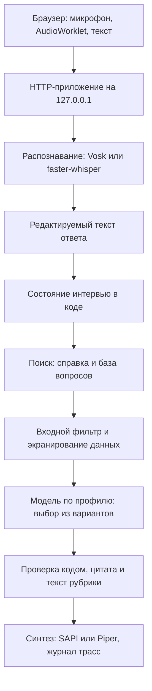

# Голосовой тренажёр собеседований на CPU: что смогли маленькие локальные модели и где они сломались

> **Черновик, не опубликован.** Перед публикацией проверь формулировки, укажи авторство и роль ИИ-ассистента в разработке. Числа взяты из файлов репозитория по ссылкам в тексте. Все наборы данных маленькие и авторские, поэтому числа — наблюдения, а не бенчмарк.

## Задача

Тренажёр помогает готовиться к собеседованию на русском языке. В нём два сценария, HR и backend, по четыре темы, и в каждой теме можно одно уточнение: всего от 4 до 8 ответов. Кандидат отвечает голосом или текстом и получает учебную обратную связь: что в ответе есть и какой следующий шаг поможет его улучшить. Тренажёр ничего не решает о найме и не ставит общий балл.

Ограничения выбраны сразу:
- всё работает локально на CPU ноутбука под Windows;
- никаких платных API, ответы кандидата не покидают машину;
- сервер слушает только `127.0.0.1`;
- модели и версии закреплены, после установки сеть не нужна.

Эти ограничения определили почти все решения ниже. Модели берутся маленькие, а надёжность приходится добывать устройством системы, а не размером модели.

## Архитектура



Ключевые решения:
- **Состояние интервью держит код, а не модель.** Номер хода, тема и уточнение — явное состояние Python. Устаревший или повторный ход отклоняется до обращения к модели. Тяжёлая операция выполняется одна, второй запрос получает 409.
- **Модель выбирает, а не пишет.** Вместо свободного отзыва модель возвращает выбор из списка, который построил код: номер фрагмента ответа, критерий и следующий шаг. На страницу попадают только точная цитата кандидата и постоянный текст рубрики. Код ограничивает генерацию допустимыми вариантами: в transformers через префиксное дерево токенов, в llama.cpp через GBNF-грамматику.
- **Один контракт для всех моделей.** Профили в `profiles.yaml`:
  - `tiny` — Qwen2.5-0.5B через transformers;
  - `strong` — Qwen3.5-4B Q4_K_M через llama-server;
  - `ru-8b` и `api` объявлены, но выключены.

  У всех одни методы, один лимит контекста 1800 токенов и одна рубрика. Недоступный профиль не подменяется другим.
- **Речь за WAV-контрактом.** Распознавание и синтез обмениваются WAV mono PCM16 16 кГц. Поэтому Vosk и Windows SAPI по умолчанию меняются на faster-whisper и Piper флагами, без переделки приложения.
- **Данные — это данные.** Вопрос, источники, ответ и история проходят входной фильтр и экранирование, прежде чем попасть в промпт. Журнал трасс хранит ответ кандидата только как хеш и длину.

## Как оценивали

**Свободная генерация против выбора из вариантов.** Это парная оценка курса M11 на 8 авторских случаях и модели 0.5B ([quality/evaluation/v3](../quality/evaluation/v3/comparison.json)).
- **Свободный отзыв:** критические ошибки в 4 ответах из 8 — выдуманные данные, технически неверный совет, ответ от первого лица вместо обратной связи. Медиана ответа — 10.7–15.5 секунды в разных частях набора.
- **Выбор из вариантов:** 0 критических ошибок, 2.9–4.0 секунды.
- **Порог полезности не пройден:** его прошла только одна часть набора из четырёх.

**0.5B против 4B** на 16 случаях M11 ([quality/model-comparison/report.md](../quality/model-comparison/report.md)):

| Показатель | 0.5B | 4B |
| --- | --- | --- |
| Прошли рубрику | 8 из 16 | 10 из 16 |
| JSON по схеме без ограничения вывода | 0 из 16 | 16 из 16 |
| Речь → первый звук, p50 / p95 | 4.9 / 6.2 с | 7.8 / 9.2 с |
| Токенов/с: заполнение / декодирование | 329 / 10.6 | 53 / 8.4 |
| Пик памяти | 3.3 ГБ | 4.4 ГБ |

**Поиск по базе вопросов** на 40 запросах, написанных до первого прогона ([quality/question-search](../quality/question-search/report.json)). Recall@1 вырос с 0.65 до 0.90:
- было: пересечение основ слов из шести букв или символьный TF-IDF;
- стало: USER-bge-m3 в sqlite-vec, слияние RRF с BM25 и кросс-энкодер bge-reranker-v2-m3.

**Речь** на 40 фразах, озвученных синтезом. На голосе SAPI мягкий WER Vosk — 0.174, faster-whisper — 0.090 ([quality/speech](../quality/speech/report.json)). Технические термины вроде Redis или NestJS у обоих дают WER от 0.35 до 0.65.

**Безопасность.** Отравленный вопрос или источник с текстом `<|im_start|>` раньше превращался в настоящий ролевой токен. В промпте получалось 9 ролевых токенов вместо 5 — поддельный системный ход. Экранирование это закрыло ([quality/trainer-security](../quality/trainer-security/probe-strong.json)).

## Компромиссы

- **Выбор из вариантов: надёжность ценой выразительности.** Критических ошибок нет, ответ быстрее в 3–5 раз. Но модель не может сказать ничего, чего нет в списке. В четырёх из шести провалов 4B выбранный шаг спрашивал то, что кандидат уже сказал: на трек в списке всего три постоянных шага, и подходящего среди них часто нет.
- **0.5B или 4B.** 4B лучше выбирает фрагмент (0.5B все 16 раз взяла первый) и держит JSON без грамматики. Но голосовой ход у неё медленнее почти на 3 секунды. Декодирование у 4B в Q4 почти такое же, как у 0.5B в float32. Медленнее заполнение длинного промпта: 53 токена в секунду против 329.
- **Vosk или Whisper.** Whisper вдвое точнее на синтезированной речи, но не отдаёт частичных гипотез, а без них нет перебивания. Vosk быстрее (RTF 0.14–0.19 против 0.39–0.67) и потоковый.
- **SAPI или Piper.** Piper даёт первый звук за 0.2 секунды против 0.5 у SAPI и работает не только в Windows. Но его голос распознаётся хуже, синтез случаен от запуска к запуску, а движок распространяется под GPL-3.0.
- **Гибридный поиск — не бесплатное улучшение.** Слияние плотного поиска со слабым BM25 без морфологии ухудшило Recall@1 с 0.825 до 0.600. Спас только кросс-энкодер, и он стоит около 0.84 секунды на запрос.

## Отрицательные результаты

Их больше, чем хотелось бы, и они важнее таблиц выше:
- **Свободная генерация в версии 1.0.** В первых двух прогонах маленькая модель один раз приписала кандидату результат «API оплаты успешно запущен», которого не было, а другой раз оборвалась на лимите токенов. Отсюда переход к выбору из вариантов.
- **Ни один профиль не проходит порог курса M11.** Нужно, чтобы хотя бы частично полезной была обратная связь в 75% ответов. У 0.5B — 50%, у 4B — 62.5%.
- **LLM-судья не заменяет разметку.** На 32 ранее размеченных ответах каппа Коэна у 0.5B −0.20, хуже случайного угадывания, у 4B — 0.18. Судья 4B не нашёл ни одной из шести критических ошибок.
- **Порог уверенности рерэнкера не отделяет тему вне базы от пересказа.** Заранее выбранный порог отклонил все 8 тем, которых нет в базе, но вместе с ними 18 из 40 верных запросов. Поиск теперь всегда показывает ближайшие вопросы с пометкой уверенности.
- **Экранирование останавливает подделку ролей, но не убеждение.** Без входного фильтра 4B выполнила приказ из отравленных данных в 8 ходах из 8, в пределах разрешённых вариантов. С фильтром — ни разу. Но фильтр работает по шаблонам и пропускает пересказанный приказ без маркеров.
- **Память.** llama-server по умолчанию держит кэш промптов до 8 ГиБ. Пик памяти 4B дошёл до 9 ГБ, хотя тренажёр этот кэш не использует. С `--cache-ram 0` пик — 4.4 ГБ, а ответы те же.

## Что дальше

- **Варианты следующих шагов из данных:** строить их из ожидаемых свойств ответа и критериев базы вопросов и добавить вариант «ответ полон, переходим дальше». Это главное узкое место по разбору ошибок 4B.
- **Корпус шире пяти документов** и поиск T52 для справки к backend-ответам.
- **Независимая человеческая разметка** рубрики и судьи вместо авторской с помощью ИИ.
- **Записи живых голосов с микрофона и шумом** вместо синтеза.
- **Русская модель на 8 млрд параметров** в профиле `ru-8b`, если её загрузка оправдана.
- **Перебивание голосом в основном интерфейсе** и перенос пайплайна на TypeScript (NestJS, pgvector).

## Как воспроизвести

```powershell
.\.venv\Scripts\python.exe tools\download_models.py --speech --llm
.\.venv\Scripts\python.exe -m projects.interview_trainer.app
.\.venv\Scripts\python.exe -m projects.interview_trainer.compare_profiles report
.\.venv\Scripts\python.exe -m pytest -q tests
```

Подробности запуска, профилей, второй конфигурации речи, поиска и безопасности — в [README тренажёра](../projects/interview_trainer/README.md).

## Границы этого текста

Наборы — от 16 до 40 авторских синтетических примеров. Разметка рубрики сделана автором с помощью ИИ, это не независимая человеческая разметка. Голос кандидата в замерах заменён синтезом. Все замеры сделаны на одной машине. Тренажёр — учебный проект: в нём нет многопользовательского режима, долговременного хранилища и аутентификации, и публиковать его как сервис без переработки нельзя.
