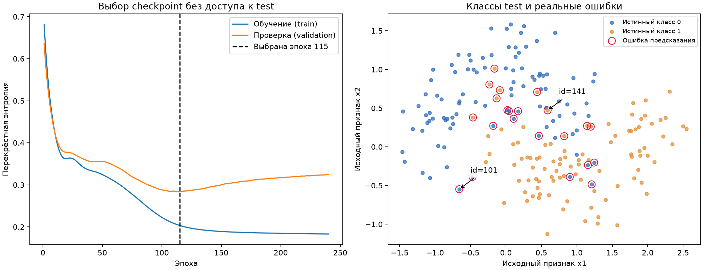

# M07-HW01 — исполненный эталон

Данные: seed=23, noise=0,30; split 600/200/200. StandardScaler обучен только на train.

| Метод | Test accuracy |
|---|---:|
| MLP | 0.890000 |
| LogisticRegression | 0.875000 |

Checkpoint выбран по минимуму validation: эпоха 115. Test не использовался для выбора.

## Две ошибки

### Объект 101

Координаты [-0.6589975139915212, -0.5478325048667737]; истинный класс 0, предсказан 1.
Logits [-0.6290320158004761, 0.7127536535263062]; вероятности классов 0/1: 0.207217/0.792783.
Среди 15 ближайших train-объектов в стандартизованном пространстве: [7, 8] объектов классов 0/1.
Это конкретное несогласие модели с размеченной целью. Окружение точки и вероятность помогают описать ошибку, но не доказывают её причину. Нельзя по координатам установить, вызван ли промах шумом, ограниченной моделью или выборкой. Для различения гипотез нужны отдельные эксперименты на validation; этот test не превращаем в подбор параметров.

### Объект 141

Координаты [0.5877886073616619, 0.4714829127316928]; истинный класс 1, предсказан 0.
Logits [0.8431380987167358, -0.6523386240005493]; вероятности классов 0/1: 0.816899/0.183101.
Среди 15 ближайших train-объектов в стандартизованном пространстве: [13, 2] объектов классов 0/1.
Это конкретное несогласие модели с размеченной целью. Окружение точки и вероятность помогают описать ошибку, но не доказывают её причину. Нельзя по координатам установить, вызван ли промах шумом, ограниченной моделью или выборкой. Для различения гипотез нужны отдельные эксперименты на validation; этот test не превращаем в подбор параметров.

## Проверки

Производная по w аналитически −8; центральная разность с ε=1e-05: -8.0000000001.
Максимальная разница logits при восстановлении в новом процессе: 0.0.
Артефакты model.pt, release.json, split.json, history.json и report.json находятся рядом с этим отчётом. Вероятности показывают уверенность выбранной модели, а не вероятность истинной причины ошибки.
