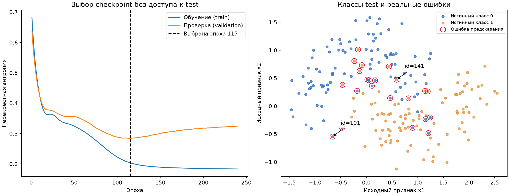

# M07: решения для самопроверки

Открывай после собственной попытки. Если ты изучил ключ до решения, новая задача из раздела повторения обязательна для проверки самостоятельности. Числа в учебных примерах не являются оценкой реальных кандидатов.

## M07-L01-A

z₁=2·(−1)+3+1=2, z₂=−(−1)+2·3−2=5, ReLU оставляет [2,5]. Первый слой 3→4:12+4=16 параметров. Второй 4→2:8+2=10. Всего 26. Без активации эффективные параметры W=W₂W₁ и b=W₂b₁+b₂. В соглашении PyTorch для батча это XWᵀ+b. Если добавить третий линейный слой без активаций, класс функций по-прежнему останется линейным со смещением.

## M07-L02-A

Предсказание 3, e=−2, L=4. ∂L/∂w=2·(−2)·2=−8; ∂L/∂b=−4. w_new=1−0,05·(−8)=1,4; b_new=1,2. Новое предсказание 4, новый loss1. Два независимых прямых прохода на исходных неизменных параметрах дадут накопленные градиенты −16 и −8. После optimizer.zero_grad(set_to_none=True) .grad будет None до следующего backward; это не ошибка, а отсутствие накопленного значения.

## M07-L03-A

Loss=(4·0,2+4·0,4+2·1,0)/10=4,4/10=0,44. Простое среднее 0,5333 неверно: маленький последний батч получил слишком большой вес. Исправление: model.train(); optimizer.zero_grad(); logits=model(x_train); loss=criterion(logits,y_train); loss.backward(); optimizer.step(). Затем model.eval() и with torch.inference_mode(): criterion(model(x_val),y_val). Никакого backward на validation. Если test используется для выбора эпохи, знание его результата влияет на решение, поэтому независимой финальной проверки больше нет.

## M07-L04-A

Выбрать вторую эпоху с val0,4. Наблюдение совместимо с переобучением на третьей, но не исключает шум validation, сдвиг данных или ошибки режима. Проверки NaN: (1) torch.isfinite на x и допустимые target; (2) конечность logits до loss; (3) конечность loss и затем каждого градиента после backward. Для всегда 0 accuracy95/100=0,95, recall класса 1=0/5=0. Если цель — находить редкий класс 1, baseline бесполезен несмотря на 95%.

## M07-L05-A

Классы обеих моделей [1,1], но разности logits велики:9,18,−9,0. Для первой строки softmax([1,2])≈[0,269;0,731], softmax([10,20])≈[0,000045;0,999955]; уверенность изменилась. Минимальный инференс: state_dict, архитектура, preprocessing, порядок признаков/схема, версии кода и контрольные входы. Для продолжения Adam: optimizer_state, номер эпохи/шага, scheduler_state при наличии, RNG состояния и порядок/состояние sampler. Сохранение этих компонентов позволяет более точно продолжить эксперимент, но межплатформенная побитовая идентичность отдельно не обещается.

## M07-HW01

Полный исполняемый эталон изменённого задания находится в [hw_reference.py](../exercises/M07/hw_reference.py). Запуск из корня: `.\.venv\Scripts\python.exe solutions/exercises/M07/hw_reference.py`. Он обучает seed=23/noise=0,30 и сохраняет отдельный комплект в `artifacts/M07/hw-reference/`, включая split, scaler, веса, историю, график, две ошибки и восстановление в новом процессе. Основной комплект M07 не заменяется.

Алгоритм: сначала split 600/200/200, затем StandardScaler только на train; MLP 2→16→2, CrossEntropyLoss на logits, Adam; минимум validation выбирает checkpoint, test используется после выбора. LogisticRegression получает те же признаки и split. Две ошибки выбираются по первым исходным ID среди промахов уже замороженной модели, а не используются для подбора её параметров.

| Наблюдение авторского запуска | Значение |
|---|---:|
| Выбранная эпоха | 115 |
| MLP test accuracy | 0,890 |
| LogisticRegression test accuracy | 0,875 |
| Ошибок MLP на 200 test-объектах | 22 |
| Градиент w: аналитический / центральная разность | −8 / −8,00000000005241 |
| Максимальное отличие logits в новом процессе | 0,0 |

Первая ошибка: исходный ID 101 (позиция 104 в test), x≈[−0,658998;−0,547833], истинный класс 0, предсказан 1. Logits≈[−0,629032;0,712754], вероятности [0,207217;0,792783]. Среди 15 ближайших train-точек в стандартизованном пространстве 7 относятся к классу 0 и 8 к классу 1. Это локально смешанное окружение; модель ошиблась с вероятностью выбранного класса около 0,79. Значение вероятности не доказывает её калибровку.

Вторая ошибка: ID 141 (позиция 11 в test), x≈[0,587789;0,471483], истинный класс 1, предсказан 0. Logits≈[0,843138;−0,652339], вероятности [0,816899;0,183101]. Среди 15 ближайших train-точек 13 имеют класс 0 и 2 — класс 1. Предсказание согласуется с локальным большинством, но не с истинной меткой этого объекта. Это описание наблюдения, а не доказательство причины ошибки: координаты и соседи не устанавливают, виноват ли шум, ограниченная ёмкость сети или состав выборки.

График показывает снижение train loss и рост validation после выбранного минимума. Конкретное преимущество MLP на этом split небольшое; по одному seed нельзя объявлять общее превосходство. Следующий эксперимент с гипотезой о причине ошибки должен использовать validation/новые данные и заранее определённый протокол, сохраняя назначение test.

Численная проверка использует L(w)=(2w+1−5)² при w=1 и центральную разность с ε=1e−5; аналитически dL/dw=−8. Полные неокруглённые значения, индексы соседей и условия запуска лежат в [hw-report.json](../../quality/reference-runs/M07-hw/hw-report.json), связный разбор — в [hw-report.md](../../quality/reference-runs/M07-hw/hw-report.md). Это сохранённая в репозитории копия эталонного прогона ([описание](../../quality/reference-runs/M07-hw/README.md)); твой собственный запуск записывает тот же комплект в `artifacts/M07/hw-reference/`. Изменения версий библиотек могут немного изменить результаты; проверяй протокол, допустимую численную погрешность и реальные ошибки своего запуска.

## Дополнение версии 1.1.0

### Самостоятельный validation-pass и повторные варианты

Полный код находится в [solutions/exercises/M07/solution.py](../exercises/M07/solution.py). Он запоминает model.training, включает eval, выполняет вычисление в inference_mode и возвращает режим в finally. Поэтому исключение не оставляет модель в неожиданном режиме. Dropout выключен, параметры/градиенты не изменяются.

Проверка: `.\.venv\Scripts\python.exe exercises\M07\check.py solutions\exercises\M07\solution.py`.

B: если исходно eval, после вызова тоже eval. C: передай неверные labels, поймай исключение снаружи и проверь model.training. finally должен сработать. Ошибочная реализация без eval меняет численное качество из-за dropout; без inference_mode строится ненужный граф. Ни один из этих фактов не означает обновление весов сам по себе: обновление требует отдельного действия optimizer.

## M07-L01: B и C

**B.** Первый слой: 4·5+5=25 параметров; второй: 5·3+3=18; всего 43. Формы: X[2,4] → h[2,5] → ReLU(h)[2,5] → y[2,3]. В каждой скрытой ячейке 4, после ReLU тоже 4; каждая выходная ячейка 5·4=20. Итог [[20,20,20],[20,20,20]]. Batch=8 меняет только первую ось тензоров, параметры остаются 43.

**C.** y=3(2x+1)−4=6x−1; выход [−7,−1,5]. Композиция аффинных слоёв остаётся аффинной. Для XOR положительны (0,1),(1,0), отрицательны (0,0),(1,1). При границе ax₁+bx₂+c>0 сумма двух положительных выражений должна быть >0, а сумма двух отрицательных ≤0; обе суммы равны a+b+2c. Это противоречие, поэтому глубина без нелинейности не помогает.

## M07-L02: B и C

**B.** Предсказания [1,3], ошибки [−1,1], MSE=(1+1)/2=1. dL/dw=(2/2)·(−1·1+1·3)=2, dL/db=(2/2)·(−1+1)=0. Для sum loss=2, градиенты (4,0). При SGD w меняется на −lr·gradient, поэтому замена mean на sum удваивает шаг по w; размер батча влияет на масштаб суммарной ошибки.

**C.** z=6, loss=25, z.grad=2·(6−1)=10, w.grad=None: detach создал независимый от w тензор. Исправление — z=3*w, без detach и без повторного requires_grad_. Тогда w.grad=10·3=30. Градиент по промежуточной независимой переменной не восстанавливает потерянную связь с исходными параметрами.

## M07-L03: B и C

**B.** Взвешенная сумма loss=3·1+3·1+3·1+1·4=13 на 10 объектов: 1,3. Среднее средних равно (1+1+1+4)/4=1,75 и ошибочно приписывает последнему объекту вес 1/4 вместо 1/10. Корректный аккумулятор прибавляет batch_mean·batch_size и делит на общее число объектов.

**C.** Первый градиент 2·1·1²=2, w₁=1−0,1·2=0,8. Второй градиент при новом w: 2·0,8·2²=6,4, поэтому корректный w₂=0,8−0,64=0,16. Без очистки накопится 2+6,4=8,4 и w₂=−0,04. Значение −0,04 не является результатом двух корректных SGD-шагов: второй шаг использовал устаревший первый градиент.

## M07-L04: B и C

**B.** Минимум validation 0,55 на эпохе 3, значит сохраняем её веса. После неё train улучшается, а validation ухудшается — наблюдаем паттерн переобучения, хотя один журнал не доказывает единственную причину. Test не участвует в выборе эпохи: иначе он перестанет быть независимой итоговой проверкой. Сравнивать раннюю остановку следует по заранее выбранной validation-метрике.

**C.** Подтверждён неконечный признак validation-объекта 17; проблему режима как единственную причину данные не поддерживают. Нужно найти источник пропуска и применить заранее определённую обработку (например, train-fitted imputer), затем проверить конечность всех преобразованных входов и повторить validation с проверкой конечности logits/loss. NaN на входе — установленный дефект, но без повторного прогона нельзя утверждать, что иных дефектов нет. Удаление объекта без отчёта меняет состав проверки.

## M07-L05: B и C

**B.** Преобразованный вход [(14−10)/2,(10−20)/5]=[2,−2]. Правильные logits [−1,5;−4,5]. Возвращённые [34,5;−4,5] совпадают с применением W непосредственно к raw без scaler. max_abs_error=max(36,0)=36, проверка провалена. Совпадение одного из двух logits не оправдывает выпуск; для диагноза нужно проверить реальный путь preprocessing.

**C.** A достаточен для согласованного инференса, но не сохраняет накопленные моменты Adam; новый optimizer стартует с другой историей. B содержит необходимое дополнительное состояние для данного контура, однако нужно также восстановить режим train, следующий батч, scheduler/шаг, RNG и проверить детерминизм операций. Сравнивают один следующий update и состояние optimizer с непрерывным запуском. Перечень файлов сам по себе не доказывает точное возобновление на другой версии библиотек или устройстве.

## M07-HW01: B и C

**B.** Первый градиент 2·(0·2−1)·2=−4, w₁=0,4. Второй новый градиент 2·(0,4−1)·1=−1,2. С очисткой w₂=0,4+0,12=0,52. Наблюдаемое 0,92 получается из накопленного −4−1,2=−5,2: второй zero_grad пропущен. Нужно очищать перед каждым update, если накопление специально не предусмотрено. Разброс validation вызван активным Dropout в данном наблюдении; eval отключает его, inference_mode/no_grad отключает построение графа. Неизменные веса подтверждают отсутствие update, но не правильность режима.

**C.** Выбирается эпоха 2 по минимуму validation=0,48, независимо от лучшего последнего train loss. Восстановление отклоняется: max_abs_error=3, что больше 1e−6. Argmax в обеих строках совпадает, однако logits и вероятности изменились. Сравнить следует сами веса/архитектуру и preprocessing (порядок признаков, mean/scale); также проверить eval и тип данных. По одному масштабу различия нельзя однозначно назвать причину, но нарушение контракта уже доказано.
